# Sơ đồ kiến trúc hệ thống luận giải và gieo số

Sơ đồ dưới đây chuyển đổi luồng xử lý sang cú pháp Mermaid `flowchart TD`. Năm payload (Bát Tự, Lịch Thiên Mệnh, Số Học, Thiên Thời và Kinh Dịch/RAG) được hợp nhất trước khi Engine Trung Tâm thực hiện tính trọng số và gieo số.

```mermaid
flowchart TD
    CLIENT["INPUT ĐẦU VÀO TỪ CLIENT<br/>{year, month, day, hour}"]

    BAZI["👤 MODULE BÁT TỰ<br/>input_user_bazi.py<br/>Giải mã năng lượng Tiên Thiên gốc"]
    CAL["📅 MODULE LỊCH THIÊN MỆNH<br/>birth_destiny_calendar.py<br/>Đối chiếu Thần Sát: Quý Nhân, Lộc<br/>Loại trừ ngày Tứ Hành Xung"]
    NUM["📦 MODULE SỐ HỌC CỐ ĐỊNH<br/>input_numerology.py<br/>Ma trận Hà Đồ - Lạc Thư<br/>Ánh xạ Ngũ Hành và số Đại Cát dân gian"]
    TIME["⏱️ MODULE BIẾN THIÊN THỜI GIAN<br/>input_time_factor.py<br/>Trích xuất Can Chi tại thời điểm kích hoạt<br/>datetime.now()"]

    subgraph ICHING_BLOCK["🔮 MODULE KINH DỊCH ĐỘC LẬP — iching_pipeline.py"]
        direction TB
        MAIHOA["Engine Mai Hoa<br/>Toán học cổ: (Y + M + D) % 8<br/>Hào động: (Y + M + D + H) % 6<br/>Ví dụ: Quẻ ID 26, Hào 2"]
        RAG["RAG Ground Truth<br/>Tra cứu văn bản cổ theo ID quẻ<br/>Ví dụ: db.get(where={id: 26})"]
        MAIHOA -->|"ID quẻ và Hào động"| RAG
    end

    MERGE{{"HỢP NHẤT 5 LUỒNG<br/>PAYLOAD JSON"}}

    subgraph CORE["⚙️ ENGINE TRUNG TÂM — engine_core.py"]
        direction TB
        POOL["Khởi tạo bể số tĩnh<br/>Pool 00–45"]

        subgraph WEIGHTS["Ma trận trọng số động — Multi-layer Weight Matrix"]
            direction TB
            W1["Lớp 1 — Bát Tự<br/>Trùng hành Dụng Thần: +60 điểm"]
            W2["Lớp 2 — Kinh Dịch<br/>Trùng hành Quẻ từ RAG: +40 điểm"]
            W3["Lớp 3 — Thiên Thời<br/>Thuận hành thời gian thực: +25 điểm"]
            W4["Lớp 4 — Hào Động<br/>Trùng số đuôi với vị trí Hào động: +25 điểm"]
            W5["Lớp 5 — Thần Sát Lịch<br/>Ngày/giờ đại cát cá nhân: +20 điểm"]
            W6["Lớp 6 — Dân Gian<br/>Bộ số đại cát dân gian: +15 điểm"]
            W7["Lớp 7 — Bù Trừ Biến Thiên<br/>Đảo chiều sinh số giải sát nếu giờ cực xấu"]

            W1 --> W2 --> W3 --> W4 --> W5 --> W6 --> W7
        end

        DRAW["Gieo số<br/>Bốc ngẫu nhiên có trọng số<br/>random.choices()"]
        FILTER["Hậu bộ lọc Âm Dương<br/>Giảm 80% điểm nếu số lượng chẵn/lẻ vượt mốc 3"]

        POOL --> W1
        W7 --> DRAW --> FILTER
    end

    OUT["📥 PAYLOAD ĐẦU RA DUY NHẤT<br/>Giao diện: 6 số phong thủy tối ưu<br/>Ví dụ: 03, 08, 12, 23, 26, 38<br/>Tri thức RAG: Quẻ Sơn Thiên Đại Súc, Hào 2<br/>LLM Prompt: System Prompt có ngữ cảnh cố định"]
    LLM["🤖 MÔ HÌNH NGÔN NGỮ ĐIỀU PHỐI<br/>LLM Interpretation Layer<br/>Đọc ngữ cảnh RAG, dịch nghĩa và cá nhân hóa lời phán<br/>Bộ lọc cứng ID Mai Hoa giúp hạn chế hallucination"]

    CLIENT --> BAZI
    BAZI -->|"Can / Chi năm sinh"| CAL
    BAZI -->|"Dụng Thần: Mộc (ví dụ)"| NUM
    CAL -->|"JSON Thần Sát ngày/giờ"| TIME
    NUM -->|"JSON thuộc tính số"| TIME
    TIME --> MAIHOA

    BAZI -.->|"Payload Bát Tự"| MERGE
    CAL -.->|"Payload Lịch"| MERGE
    NUM -.->|"Payload Số Học"| MERGE
    TIME -.->|"Payload Thiên Thời"| MERGE
    RAG -->|"Payload Kinh Dịch / RAG"| MERGE

    MERGE --> POOL
    FILTER --> OUT --> LLM

    classDef source fill:#eaf4ff,stroke:#3976ad,color:#153958
    classDef module fill:#f3f5ff,stroke:#6b75ba,color:#282f62
    classDef processing fill:#fff8e8,stroke:#c49a39,color:#564018
    classDef output fill:#eaf9ee,stroke:#4b9460,color:#21552d

    class CLIENT source
    class BAZI,CAL,NUM,TIME,MAIHOA,RAG module
    class MERGE,POOL,W1,W2,W3,W4,W5,W6,W7,DRAW,FILTER processing
    class OUT,LLM output
```

**Quy ước:** Mũi tên liền biểu thị luồng xử lý chính; mũi tên nét đứt biểu thị các payload được đưa vào bước hợp nhất. Những giá trị như Dụng Thần Mộc, ID quẻ 26, Hào 2 và dãy 6 số được giữ dưới dạng ví dụ theo sơ đồ gốc.
