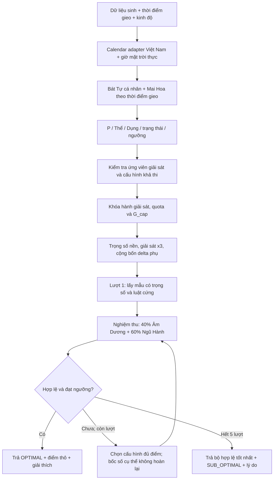

# Lưu trữ v3 — đã được thay thế bởi lịch Trung Quốc UTC+8 ở v4

Tài liệu bên dưới giữ lại các quyết định trước thay đổi lịch. Không dùng làm cấu hình cho runtime hiện tại.

# Plan logic MVP 1 — Randomyst Numbers

Cập nhật: 11/10/2026, theo trao đổi với người dùng.

Trạng thái: MVP local Python/FastAPI đã chạy, có giao diện, bộ sinh β = 2, lịch Việt Nam, Bát Tự chuyển mã, tra cứu Kinh Dịch và SQLite. Người dùng đã đồng ý ba đề xuất triển khai ngày 11/10/2026. Nghiệm thu độ chính xác toàn dải vẫn đang hoàn thiện; các phần thiên văn mang EXPERIMENTAL. Những mục đề xuất còn lại không tự trở thành quyết định đã chốt; xem mục 14 cho trạng thái runtime mới nhất.

## 1. Phạm vi đã chốt

- Một người dùng duy nhất.
- Người dùng đã cho phép triển khai bản chạy theo đề xuất; phạm vi MVP 1 vẫn là một bộ sáu số 00–45. Adapter/nghiên cứu trước đó được nối thành ứng dụng local; LLM không chặn đầu ra bộ số.
- Nền tảng đã triển khai: Python/FastAPI, giao diện HTML/JS local, dữ liệu nguồn JSON và lịch sử SQLite.
- Adapter lịch đã chọn: `calendar_adapter/vietnamese.py`, thuật toán `hnd-simplified-vn-utc7-v0.1`, UTC+7 cố định. Lựa chọn triển khai đã chốt; trạng thái kiểm chứng vẫn `EXPERIMENTAL`. EoT và tiết khí Bát Tự dùng thành phần riêng.
- MVP 1: bể số nguyên **0–45**, hiển thị hai chữ số **00–45**.
- Phạm vi năm đầu vào: **ngày sinh 1950–2026**, **thời điểm gieo 2024–2030**, tính cả hai năm biên; kiểm tra giờ đồng hồ UTC+7 trước hiệu chỉnh. Vùng tra cứu nội bộ **01/12/1949–31/01/2031** không mở rộng dải được phép nhập. Kết quả lịch phải có bộ đối chiếu, chưa coi là đã kiểm chứng 100% từ repo nguồn.
- Mở rộng sau: **0–55**, **0–99**; quy tắc số phải nhận cấu hình bể số.
- Một kết quả gồm **6 số khác nhau đôi một**, lấy mẫu không hoàn lại.
- **Cấm bộ có cả 6 số thuộc cùng một hành trong mọi trạng thái của toàn engine**, kể cả hành Dụng Thần hoặc hành Thông Quan. Điều này độc lập với quy tắc cấm thuần chẵn/lẻ.
- Hỗ trợ thời điểm hiện tại lúc bấm gieo và thời điểm người dùng nhập. Nguồn timestamp client/server và cách đối chiếu sẽ chốt khi thiết kế API.
- Trong một yêu cầu, giữ nguyên quẻ Mai Hoa và Dụng Thần qua các lượt gieo lại.
- Tối đa **5 lượt tổng cộng**, gồm lượt đầu và 4 lượt gieo lại.
- Hết lượt chưa đạt ngưỡng: trả bộ tốt nhất hợp lệ đã tạo, kèm `SUB_OPTIMAL`; việc không đạt điểm không được biến thành lỗi xử lý yêu cầu hợp lệ.
- Dùng **Dụng Thần chính đầu tiên** do `tinix-bazi` trả về để chấm điểm ở MVP 1; vẫn lưu danh sách và lý do đầy đủ để truy vết.
- Khi giải quẻ xung đột với Dụng Thần: **ưu tiên tuyệt đối bảo vệ Dụng Thần**. Giữ nhánh Thực Thần Chế Sát; ở nhánh chọn hành an toàn, so tất cả ứng viên bằng **điểm thô cao nhất của bộ khả thi** rồi mới chọn.
- Điểm ngũ hành **tương đối theo ngữ cảnh cố định**; 100 nghĩa là tốt nhất trong ngữ cảnh ấy. Đã chốt `G = 100 × clip(G_raw / G_cap, 0, 1)` với G_cap dương, khóa trước lượt 1, không thay qua các lượt; giữ điểm thô để kiểm tra.
- Ngưỡng theo trạng thái: **70 Đại Cát / 75 các trạng thái còn lại / 85 Đại Hung**.
- Giải sát: trọng số hành được chọn **nhân 3**, quota **tối thiểu 3 số**.
- Giải sát cường độ cao chỉ bật khi **Đại Hung**. Xung đột ở các trạng thái khác dùng **Soft Filter**, không tự bật ×3/quota giải sát.
- Trong Đại Hung, cấm số có hành khắc Dụng Thần **ngay từ lượt 1**; không dùng điểm cao ở thành phần khác để vượt qua luật này.
- Thực Thần Chế Sát áp dụng cùng luật ×3/quota **3–4** như các mode giải sát khác; không hiểu “bơm 100%” là dồn toàn bộ xác suất vào một hành.
- Đầu vào giờ đồng hồ UTC+7; **lịch âm Việt Nam**; hiệu chỉnh **giờ mặt trời thực**. Mốc đổi ngày 23h được xét **sau hiệu chỉnh**, áp dụng cho ngày/giờ Mai Hoa và Bát Tự theo lựa chọn của người dùng.
- Tại mốc đổi ngày, chuyển đồng bộ **năm/tháng/ngày âm lịch hiệu lực** cho Y/M/D. Do đó Y Mai Hoa đổi từ 23h giờ mặt trời thực đêm trước mùng 1 Tết; năm Bát Tự vẫn đổi ở thời điểm Lập Xuân thật.
- Kinh độ nơi gieo được **lấy tự động theo thứ tự thiết bị → IP → mặc định 105.0°E tại lúc bấm gieo**, tách riêng với kinh độ sinh. Mỗi phiên lấy vị trí lại; dữ liệu không cũ quá 15 phút; kinh độ dùng tính làm tròn hai số thập phân. Địa điểm thủ công được ưu tiên cho phiên đó; giữ nguyên thời điểm và cảnh báo giáp ranh bằng sai số tổng hợp, không lùi 4 phút.
- Tách **Generation Weight** khỏi **Evaluation Score**. Thiên Thời/Hào Động/Thần Sát/Dân Gian chỉ điều hướng trọng số sinh số, bắt đầu ở lượt 1; không cộng vào điểm nghiệm thu 40% Âm Dương + 60% Ngũ Hành và không đổi G_cap.
- Trọng số cuối dùng **cộng các delta trong một hệ số**, không nhân nối tiếp bốn hệ số thưởng: `Weight(n) = Base_Weight(n) × (1 + Δ_thien_thoi + Δ_hao_dong + Δ_than_sat + Δ_dan_gian)`.
- Thiên Thời lấy **Nguyệt Lệnh tại thời điểm gieo**, không lấy tháng sinh. **Mọi trạng thái ngoài Đại Hung**, gồm Đại Cát/Thứ Cát/Bình hòa/Tiêu hao: mọi số hợp lệ thuộc hành Vượng/Tướng nhận +15%. **Đại Hung:** chỉ hành giải sát đã chọn đang Vượng/Tướng được thưởng +15%.
- Hành chủ thời vận MVP 1 lấy theo **hành địa chi tháng tiết khí**, giữ suốt tháng: Dần/Mão = Mộc; Tỵ/Ngọ = Hỏa; Thìn/Tuất/Sửu/Mùi = Thổ; Thân/Dậu = Kim; Hợi/Tý = Thủy.
- Thần Sát thưởng theo mục tiêu Can/Chi **thực tế khớp sao trong bốn trụ gốc**, rồi ánh xạ về hành và bảng đuôi của engine. Người dùng đã xác nhận tên **Thiên Ất**.
- Nhiều sao cùng trợ hành: sao đầu +20%, sao thứ hai +10%, **mỗi sao từ thứ ba trở đi +5%**. Không hiểu thành chuỗi giảm một nửa vô hạn hoặc cộng đều +20%.
- Tập sao MVP 1 chỉ gồm **Thiên Ất Quý Nhân, Thiên Đức Quý Nhân, Văn Xương Quý Nhân**; không dùng toàn bộ CAT_36.
- Thiên Đức tra mục tiêu theo **tháng tiết khí lúc gieo**, rồi đối chiếu đúng loại Can/Chi trong **bốn trụ sinh gốc**. Thiên Ất/Văn Xương vẫn tra bằng can ngày sinh.
- Cùng tên sao xuất hiện nhiều trụ chỉ là **một lần kích hoạt**; các tên sao khác nhau cùng trợ một hành được cộng theo luật giảm biên. Một sao khớp nhiều hành đóng góp mức nền **+20% cho từng hành đã khớp**, sau đó tổng hợp tên sao riêng cho từng hành.
- Dân Gian thưởng **từng số đơn lẻ +5% cố định**, không đòi đủ cặp. Danh sách MVP 1 đóng gồm **09, 11, 18, 22, 28, 33, 38, 39, 44**, lưu tại `dan_gian_config.json`.
- Cả bốn delta được **tính và khóa trước lượt 1**, giữ nguyên giá trị qua **lượt 1–5**. Bộ lọc retry quyết định số còn được chọn; không tính lại delta theo thời gian chạy hoặc các số vừa bốc.

**Đã chốt cập nhật 11/10/2026:** quota giải sát là **3–4**. Báo cáo v3 giữ cấu hình lịch sử 3–5; báo cáo v4 đã chạy lại với trần 4. Core Mai Hoa chỉ dùng Y/M/D/H; Quẻ Hổ/Quẻ Biến là dữ liệu hiển thị, không ảnh hưởng logic sinh/chấm số.

Nguồn yêu cầu: `docs/architect_idea.md`, tài liệu `/Users/tranduyhung/Downloads/System Diagram Details.md`, đặc tả Mai Hoa đính kèm tại `/Users/tranduyhung/.codex/attachments/16426fad-ef22-4891-95d5-6114fabe9c13/Pasted text.txt` và các câu trả lời trực tiếp trong chat. Đặc tả đính kèm được người dùng gọi là `dac_ta_mai_hoa_engine.md`. Nội dung các tài liệu là dữ liệu thiết kế để đối chiếu; quyết định trực tiếp trong chat có ưu tiên khi có khác biệt. Vì vậy giữ 00–45 và ngưỡng 70/75/85 dù tài liệu từng ghi 01–99 hoặc ngưỡng cố định 75.

## 2. Các quy tắc Mai Hoa đã chốt

- Y: thứ tự địa chi năm **âm lịch đổi ở Tết**, Tý = 1 đến Hợi = 12. Không lấy năm Bát Tự đổi tại Lập Xuân để làm Y.
- M: số tháng âm lịch; tháng nhuận giữ nguyên số tháng.
- D: ngày âm lịch, 1–30.
- H: thứ tự địa chi giờ, Tý = 1 đến Hợi = 12.
- Thượng quái: `(Y + M + D) % 8`; dư 0 lấy 8.
- Hạ quái: `(Y + M + D + H) % 8`; dư 0 lấy 8.
- Hào động: `(Y + M + D + H) % 6`; dư 0 lấy 6.
- Thứ tự Tiên Thiên: Càn, Đoài, Ly, Chấn, Tốn, Khảm, Cấn, Khôn tương ứng 1–8.
- Quái chứa hào động là Dụng; quái còn lại là Thể.
- Hành quái: Càn/Đoài = Kim; Ly = Hỏa; Chấn/Tốn = Mộc; Khảm = Thủy; Cấn/Khôn = Thổ.
- **Core đã khóa:** `maihoa-ymdh-v1`, chỉ bốn biến trên. Phút/giây dùng để xử lý thời gian/TST, không thêm vào tổng quẻ/hào; seed hoặc số lượt không đổi core.
- Quẻ Hổ/Quẻ Biến nằm trong `display_hexagrams`, sẵn schema để bơm dữ liệu, hiển thị khi cần; không tham gia logic chọn/chấm số.

| Quan hệ Dụng–Thể | Trạng thái theo đặc tả |
|---|---|
| Dụng sinh Thể | Đại Cát |
| Thể khắc Dụng | Thứ Cát (Khắc xuất) |
| Tỷ hòa | Bình hòa |
| Thể sinh Dụng | Tiêu hao |
| Dụng khắc Thể | Đại Hung |

**Phân tách logic theo các quyết định đã chốt:** Bát Tự cá nhân dùng dữ liệu sinh; Mai Hoa dùng thời điểm gieo; Thiên Đức tra mục tiêu theo tháng gieo rồi quét bốn trụ sinh gốc. **Đề xuất cấu trúc dữ liệu:** lưu riêng `birth_context` và `casting_context`. Chụp thời điểm gieo một lần khi bắt đầu yêu cầu; từ đó tạo ngữ cảnh bất biến cho toàn bộ các lượt.

### 2.1. Tách thời điểm thật, giờ mặt trời và ngày dùng để lập quẻ

**Đã chốt quy ước:** UTC+7, lịch âm Việt Nam, giờ mặt trời thực, đổi ngày ở 23h giờ mặt trời thực; chuyển cả Y/M/D theo ngày âm hiệu lực khi qua tháng/Tết. Y Mai Hoa chuyển năm ở 23h giờ mặt trời thực đêm trước mùng 1 Tết theo quy ước này; Bát Tự vẫn đổi năm tại thời điểm Lập Xuân thật.

**Luồng logic theo quy ước đã chốt**; lựa chọn thư viện và nguồn thiên văn còn cần kiểm chứng:

1. Nhận giờ đồng hồ UTC+7, giữ lại thời điểm UTC tương ứng. Kinh độ sinh và kinh độ gieo là hai dữ liệu riêng; không tự lấy kinh độ này thay cho kinh độ kia.
2. Tính giờ mặt trời thực bằng kinh độ và phương trình thời gian (Equation of Time, EoT), giữ cả phần ngày nếu hiệu chỉnh đi qua nửa đêm.
3. Lấy địa chi giờ H từ giờ mặt trời thực chưa cộng giờ đổi ngày: Tý là khoảng [23h, 01h), Sửu [01h, 03h), tiếp tục từng khoảng 2 giờ; lấy cận đầu, không lấy cận cuối.
4. Ngày dùng lập quẻ: `effective_date = date(true_solar_datetime + 1 hour)`. Phép cộng này chỉ để xác định ngày theo mốc 23h, không dùng để xác định H và không cộng lại thêm một ngày ở bước sau.
5. Chuyển **toàn bộ effective_date** sang lịch âm Việt Nam UTC+7 để lấy năm/tháng/ngày/nhuận; lấy Y từ địa chi năm âm lịch đó. Không chỉ tăng trường D, vì có thể đi qua cuối tháng, tháng nhuận hoặc Tết.
6. Đối với Bát Tự, năm và tháng theo tiết khí phải so với **thời điểm UTC thật**. Hiệu chỉnh giờ mặt trời phục vụ ngày/giờ; không diễn giải giờ đã dịch như một thời điểm UTC mới rồi so Lập Xuân.

Theo công thức [NOAA](https://gml.noaa.gov/grad/solcalc/solareqns.PDF), với kinh độ đông dương và múi giờ 7:

`true_solar_datetime = civil_datetime + [4 × (longitude_E − 105) + EoT(instant)] minutes`.

Hiệu chỉnh kinh độ đơn thuần chỉ cho giờ mặt trời trung bình. Giờ mặt trời **thực** cần thêm EoT. `pvlib.solarposition.spa_python` là một ứng viên Python có trả `equation_of_time` theo phút; chưa chốt thư viện/phiên bản triển khai. [Tài liệu chính thức pvlib](https://pvlib-python.readthedocs.io/en/stable/reference/generated/pvlib.solarposition.spa_python.html).

Ngày D trong công thức Mai Hoa là **ngày âm lịch**, không phải số ngày dương lịch. Ví dụ 23h30 ngày dương lịch 11/10 không cho phép kết luận D = 12: phải hiệu chỉnh, xác định effective_date rồi chuyển lịch. Can của giờ Tý cũng phụ thuộc can ngày; không mặc định mọi giờ Tý đều là Nhâm Tý.

### 2.2. Lịch Việt Nam và khả năng thật của thư viện nguồn

- `tinix-bazi` đang dùng `lunar-javascript`, không phải một hàm `lunar-python` nhận kinh độ. Calculator đã đọc không có bước hiệu chỉnh kinh độ/EoT hoặc lựa chọn lịch Việt Nam UTC+7.
- Constructor [Solar của lunar-python](https://github.com/6tail/lunar-python/blob/master/lunar_python/Solar.py) nhận năm/tháng/ngày/giờ/phút/giây, không nhận kinh độ hoặc múi giờ. Không đưa vào đặc tả lời gọi thư viện chưa tồn tại.
- Phần thiên văn [ShouXingUtil của lunar-python](https://github.com/6tail/lunar-python/blob/master/lunar_python/util/ShouXingUtil.py) có độ dịch 1/3 ngày, tương ứng UTC+8, khi xác định ngày Sóc/tiết khí. Đổi nhãn múi giờ của đầu vào không tự chuyển thuật toán lịch này thành lịch âm Việt Nam.
- Bài thuật toán của [Hồ Ngọc Đức](https://honguyenviet.com/amlich/calrules.html) có tham số múi giờ khi xác định ngày Sóc; đây là nguồn tham khảo cho calendar adapter Việt Nam đã được người dùng chọn. Bản thuật toán giản lược và kết quả nguồn độc lập vẫn phải được kiểm tra trên phạm vi năm MVP trước khi nghiệm thu toàn bộ.
- Hàm chia kinh độ mặt trời thành 12 cung để xác định trung khí/tháng nhuận không thay cho việc tìm chính xác thời điểm Lập Xuân. Cần một nguồn/thuật toán riêng cho thời điểm tiết khí thật và sai số đã kiểm chứng.

Lịch thiên văn UTC+7 và quy tắc ngày lý số lúc 23h là hai lớp riêng: không chuyển mọi thời điểm Sóc sang giờ mặt trời của từng địa điểm rồi gọi đó là lịch âm Việt Nam. Lưu cả ngày âm lịch dân sự của đầu vào và ngày âm lịch hiệu lực dùng lập quẻ để truy vết gần ranh giới.

#### 2.2.1. Kiểm tra biên hai tầng

**Tầng 1 — phạm vi đầu vào đã chốt:** xét ngày giờ đồng hồ UTC+7 **trước** hiệu chỉnh giờ mặt trời và ngày hiệu lực 23h.

| Loại đầu vào | Khoảng thời gian hợp lệ, cận đầu bao gồm/cận cuối không bao gồm |
|---|---|
| Ngày sinh | `[1950-01-01T00:00:00+07:00, 2027-01-01T00:00:00+07:00)` |
| Thời điểm gieo | `[2024-01-01T00:00:00+07:00, 2031-01-01T00:00:00+07:00)` |

Kiểm tra cả ngày giờ hợp lệ và UTC+7, không chỉ năm trong chuỗi. Đầu vào ngoài dải bị từ chối ở tầng 1. Dữ liệu hợp lệ ở tầng 1 không bị từ chối chỉ vì TST/ngày hiệu lực/năm âm lịch đi sang năm lân cận.

**Tầng 2 — phạm vi tra cứu nội bộ đã chốt:** phủ **01/12/1949–31/01/2031**, bao gồm cả hai ngày. Biểu diễn nửa mở theo UTC+7: `[1949-12-01T00:00:00+07:00, 2031-02-01T00:00:00+07:00)`. Vùng này chỉ phục vụ nội bộ, không cho phép nhập ngày sinh năm 1949 hoặc gieo năm 2031.

Giữ các ngày cụ thể người dùng đã nêu. Đây là một tháng đệm ở mỗi đầu (31 ngày ở tháng 12/1949 và tháng 1/2031), phủ tối thiểu ±30 ngày; không dùng phép cộng/trừ đúng 30 ngày để vô tình cắt mất 01/12 hoặc 31/01. Năm âm lịch của ngày đầu 1950 vẫn có thể là 1949 dù ngày dương lịch không lùi năm.

Các ví dụ 01/01/1950 00:05 hoặc 31/12/2030 23:55 **có thể** đổi ngày/năm sau hiệu chỉnh; kết quả phụ thuộc kinh độ và EoT, không mặc định mọi ví dụ đều đổi. Ngày hiệu lực `date(TST + 1 hour)` vẫn có thể qua năm dù TST chưa qua 0h. Không clamp TST/ngày âm lịch về năm gốc để vượt biên.

Phải kiểm chứng calendar adapter trên vùng tra cứu này. Nếu dữ liệu nội bộ còn thiếu, đó là lỗi dữ liệu/cấu hình của engine cần phát hiện trong nghiệm thu; không biến nó thành lỗi “người dùng nhập năm ngoài phạm vi” khi tầng 1 đã hợp lệ.

#### 2.2.2. Phạm vi dữ liệu thiên văn và đối chiếu độc lập

Vùng bảng ngày không phải giới hạn cứng cho mọi phép tính thiên văn. Xác định tháng 11, tháng nhuận và năm âm lịch có thể cần Sóc/trung khí/Đông Chí của năm trước hoặc sau. Thuật toán [Hồ Ngọc Đức](https://honguyenviet.com/amlich/calrules.html) có tra tháng 11 ở `yy−1`/`yy+1`. Khi dựng bảng ngày đến 01/2031, có thể cần dữ liệu thiên văn ngoài 31/01/2031. Phạm vi các sự kiện phụ thuộc phải được bao phủ rồi mới xuất bảng ngày, không cắt mọi nguồn vào ±30 ngày.

**Phân vai nguồn theo yêu cầu mới:**

| Thành phần | Vai trò | Giới hạn đã kiểm tra |
|---|---|---|
| `tinix-bazi` + `lunar-javascript` | Thuật toán Bát Tự và phân tích độ vượng/Dụng Thần; kết quả nguồn để đối chiếu khi chuyển logic | Phải chuẩn hóa múi giờ thật, ngày/giờ mặt trời và quy tắc 23h theo engine; kết quả nguyên trạng chưa là ground truth Việt Nam |
| Converter lịch âm Việt Nam UTC+7, có thể là adapter Python tương đương | Tạo Y/M/D âm lịch hiệu lực cho Mai Hoa | `lunar-python` mặc định không tự thành converter UTC+7 khi đổi nhãn giờ đầu vào |
| Bản JS/Python của 6tail | Đối chiếu tính nhất quán giữa hai cách triển khai | Cùng họ `ShouXingUtil` và công thức Sóc/tiết khí; không phải hai nguồn thiên văn độc lập |
| Corpus đã lưu và gắn nguồn | Dữ liệu nghiệm thu về ngày âm/nhuận, thời điểm Sóc/giao tiết và kết quả tại ranh giới | Đã lưu bảng Sóc NASA để thử adapter; corpus nhãn lịch Việt Nam và giao tiết toàn dải vẫn chưa hoàn thành |

Bằng chứng: [ShouXingUtil Python](https://github.com/6tail/lunar-python/blob/master/lunar_python/util/ShouXingUtil.py) và [lunar.js](https://github.com/6tail/lunar-javascript/blob/master/lunar.js) đều có `qiHigh`/`shuoHigh` với `ONE_THIRD`, tức độ dịch 8 giờ. Việc cả hai cho cùng kết quả có thể bỏ sót lỗi chung; đối chiếu chéo không tự triệt tiêu mọi sai lệch.

**Đề xuất nguồn tham chiếu độc lập để dựng corpus:**

- **Sóc:** [USNO Phases of the Moon](https://aa.usno.navy.mil/data/MoonPhases) và [API chính thức](https://aa.usno.navy.mil/data/api) cung cấp thời điểm pha Mặt Trăng cho 1700–2100. Nguồn ghi Universal Time với đầu ra đến phút; lưu đúng thang thời gian/độ phân giải, chuẩn hóa sang UTC+7 với sai số đã biết. Không dùng đầu ra phút để tuyên bố kiểm chứng đến từng giây ở sát nửa đêm.
- **Tiết khí:** [JPL Horizons](https://ssd.jpl.nasa.gov/horizons/manual.html) có kinh độ hoàng đạo biểu kiến của Mặt Trời nhìn từ tâm Trái Đất (`ObsEcLon`, quantity 31). Bảng [24 tiết khí của Hong Kong Observatory](https://www.hko.gov.hk/en/gts/time/24solarterms.htm) xác định các mốc cách nhau 15°, gồm Lập Xuân 315°. Đề xuất tìm thời điểm đi qua các mốc này để đối chiếu độc lập; bảng HKO xác nhận định nghĩa góc, không thay lịch Việt Nam UTC+7. Chưa chốt bộ dữ liệu, bước lấy mẫu/thuật toán tìm nghiệm, thang thời gian và sai số.
- **Quy tắc lịch Việt Nam:** converter UTC+7 áp dụng cách xác định đầu tháng/năm/tháng nhuận đã kiểm tra; tham khảo Hồ Ngọc Đức. USNO/JPL cho sự kiện thiên văn, không tự trả tên tháng âm Việt Nam hoặc Dụng Thần.

USNO/JPL vẫn là đề xuất nguồn/luồng kiểm chứng, chưa phải bộ dữ liệu đã tải hay thư viện triển khai đã chốt. Lần thử adapter mới đã dùng bảng Sóc NASA như mô tả ở mục 2.2.4; chưa có báo cáo đạt KPI toàn engine. Hai repo người dùng chọn vẫn là nguồn thuật toán Bát Tự và văn bản Dịch; nguồn thiên văn bổ sung phục vụ kiểm chứng lịch.

**Đề xuất cấu trúc mỗi ca corpus:** định danh ca; giờ đầu vào/múi giờ; tọa độ và sai số nếu liên quan; loại sự kiện; thời điểm tham chiếu và thang thời gian; năm/tháng/ngày/nhuận Việt Nam kỳ vọng; TST/ngày hiệu lực/Y/M/D/H kỳ vọng; can chi/tiết khí nếu kiểm tra Bát Tự; nguồn/phiên bản/hash; độ phân giải/sai số cho phép; cận trước/đúng tại/cận sau. Tách kết quả kỳ vọng từ nguồn đối chiếu khỏi kết quả engine, không tự lấy output engine làm đáp án.

Nhóm ca riêng phải gồm các đầu/cuối dải, ngày Sóc có khác biệt UTC+7/UTC+8, tháng thiếu/đủ và nhuận, Tết/23h, giờ 0h, Lập Xuân và từng giao tiết. Có thể dựng bảng ngày cho toàn vùng nội bộ và bổ sung các mốc ±1 giây quanh ranh giới; chỉ chốt đáp án đến giây khi nguồn tham chiếu đủ độ chính xác. Ghi `REFERENCE_UNCERTAIN` cho ca mà độ phân giải nguồn chưa phân biệt được hai phía ranh giới.

Đầu vào chuẩn UTC+7 đã chốt; nếu mở rộng xử lý giờ lịch sử hoặc múi giờ gốc ở nơi sinh khác, cần đặc tả chuyển đổi riêng.

#### 2.2.3. Đánh giá phương án cấu hình 6tail và thay converter

**Kết quả kiểm tra đề xuất mới:** chuẩn hóa đầu vào là cần thiết, nhưng không đủ để chuyển lịch Trung Quốc trong thư viện thành lịch Việt Nam. Chưa chốt một thư viện thay thế chỉ từ tên gói hoặc ngôn ngữ Python.

| Phương án | Kết quả kiểm tra | Cách áp dụng trong MVP |
|---|---|---|
| Đặt timezone hệ thống hoặc truyền datetime ở `Asia/Ho_Chi_Minh` vào 6tail | API `Solar` đã đọc nhận các trường ngày/giờ, không có tham số timezone/kinh độ cho thuật toán lịch. Python `fromDate` chỉ lấy các trường, không sử dụng `tzinfo` | Chuẩn hóa thời điểm ở tầng nhập liệu; không coi đây là cấu hình lịch âm UTC+7 |
| Wrapper dịch ngày quanh 23h–00h trên kết quả lịch 6tail | Không sửa được đầu tháng, độ dài tháng, tháng nhuận và năm âm lịch đã tính theo lịch khác | Wrapper tính TST/ngày hiệu lực rồi gọi converter Việt Nam cho toàn bộ ngày; không sửa riêng trường D của kết quả cũ |
| Thay bằng `lunardate` nguyên trạng | [Repo chính thức](https://github.com/lidaobing/python-lunardate) mô tả lịch Trung Quốc 1900–2099. [Mã nguồn](https://github.com/lidaobing/python-lunardate/blob/master/lunardate.py) dùng bảng `YEAR_INFOS`; API đổi ngày không nhận timezone, không cung cấp bộ tính tiết khí | Không chọn làm converter Việt Nam hoặc corpus nghiệm thu; phủ dải năm không đồng nghĩa đúng hệ lịch |
| Adapter Python theo quy tắc lịch Việt Nam UTC+7 | Thuật toán [Hồ Ngọc Đức](https://honguyenviet.com/amlich/calrules.html) có tham số `timeZone` cho ngày Sóc và xác định tháng/nhuận | Hướng ưu tiên đề xuất; kiểm chứng toàn vùng nội bộ cùng corpus độc lập trước khi chốt implementation |

**Phân biệt timezone cố định và lịch sử:** MVP đã chọn đầu vào **UTC+7 cố định**, kể cả ngày sinh 1950–2026. `Asia/Ho_Chi_Minh` trong [tzdb](https://github.com/eggert/tz/blob/main/asia) có giai đoạn lịch sử UTC+8; ví dụ 01/01/1950. Vì vậy, không gán zone IANA này vào ngày sinh cũ rồi âm thầm đổi thời điểm đã nhận dưới offset `+07:00`. Giữ offset 420 phút cho chế độ hiện tại; chế độ nhập giờ hành chính lịch sử cần quy ước riêng về nơi sinh, timezone và thời điểm UTC. Không đổi timezone toàn process để chọn lịch cho từng request.

**Vì sao không chỉ vá cửa sổ 23h–00h:** ví dụ số học giả định một Sóc ở 16:30 theo UTC: ở UTC+7 là 23:30 cùng ngày, ở UTC+8 là 00:30 ngày kế tiếp. Ngày đầu tháng của hai lịch khác nhau; trưa hôm sau có thể là ngày âm 2 của lịch UTC+7 nhưng ngày âm 1 của lịch UTC+8. Đây là minh họa cơ chế, không phải sự kiện Sóc thực đã đối chiếu. Lỗi có thể hiện diện ngoài cửa sổ giao giờ và ảnh hưởng cách đánh số tháng/nhuận khi liên quan trung khí.

**Nếu giữ 6tail để làm converter:** cần một bản sửa có phiên bản riêng, cấu hình múi giờ lịch bất biến và kiểm tra các lớp `calcShuo`/`calcQi`/`qiAccurate2` cùng [`LunarYear`](https://github.com/6tail/lunar-python/blob/master/lunar_python/LunarYear.py). Tính ngày sự kiện theo UTC+7 trước khi dựng lại đầu tháng, độ dài tháng, tháng 11/nhuận và năm âm lịch. Đánh giá các bảng hiệu chỉnh, nhánh ngoại lệ và cache đang dựa trên lịch nguồn; không chỉ thay `ONE_THIRD` bằng `7/24` hoặc trừ một giờ sau khi đã làm tròn ngày. Fork vẫn cùng nguồn thiên văn 6tail, nên không làm tăng tính độc lập của corpus. Đây là phương án khả thi cần khảo sát, chưa triển khai hay xác nhận đúng toàn dải.

**Luồng tách nguồn ưu tiên đề xuất:**

1. `TimeContext`: kiểm tra biên UTC+7, giữ thời điểm UTC thật, tính EoT/TST và ngày hiệu lực 23h theo sai số đã ghi nhận.
2. `VietnamLunarCalendar`: nhận **ngày dương hiệu lực** và offset 420 phút, trả `{year, month, day, is_leap_month, calendar_rule_id, source_version}` để lập Y/M/D Mai Hoa. Đây là interface của hệ thống dự kiến, không phải hàm sẵn có của thư viện được chọn.
3. `SolarTermProvider`: xác định tiết khí/tháng Bát Tự bằng **thời điểm UTC thật**; không dùng TST như một thời điểm UTC mới. Đầu ra phải có thời điểm sự kiện, thang thời gian, phiên bản và sai số. Converter ngày âm giản lược không thay nguồn này.
4. `BaziAdapter`: kết hợp năm/tháng theo giao tiết thật và ngày/giờ theo TST/quy tắc đã chốt; sau đó tái sử dụng logic phân tích của `tinix-bazi`. Không gọi calculator nguyên trạng với một datetime đã dịch rồi coi toàn bộ bốn trụ là đã được hiệu chỉnh đúng.
5. Bộ kiểm chứng dùng dữ liệu đã lưu từ nguồn đối chiếu độc lập; việc hai converter khớp nhau chỉ là một phép kiểm tra, không phải bằng chứng loại bỏ toàn bộ lỗi lịch.

Lựa chọn hướng adapter Việt Nam giúp tách việc chuyển ngày âm khỏi nguồn tiết khí và logic Dụng Thần. Nguồn triển khai cụ thể, phiên bản và độ chính xác vẫn phải được kiểm chứng trước khi chốt; không thay `lunardate` vào yêu cầu lịch Việt Nam chỉ vì gói viết bằng Python.

#### 2.2.4. Kết quả chạy thử adapter Việt Nam riêng

Theo yêu cầu “thử dùng adapter lịch Việt Nam UTC+7 riêng”, đã triển khai prototype tại `calendar_adapter/vietnamese.py`, không phụ thuộc 6tail/`lunardate`. Hướng dẫn chạy và API Python tại `calendar_adapter/README.md`. Thuật toán thiên văn giản lược theo Hồ Ngọc Đức; người dùng đã chọn adapter này cho MVP 1, còn nghiệm thu độ chính xác toàn dải chưa hoàn thành.

- Chuyển hai chiều dương/âm, kiểm tra ngày tháng/nhuận và vùng nội bộ 01/12/1949–31/01/2031.
- Nhận TST đã tính ở module phía trước, xét ngày hiệu lực 23h và trả Y/M/D/H. Không tự tính EoT, lấy vị trí hay xác định tiết khí Bát Tự. Giữ thời điểm UTC thật từ đầu vào; TST là biểu diễn đồng hồ riêng.
- 12/12 ca kiểm thử qua, gồm tháng nhuận, chuyển Tết tại 23h TST, phân biệt giờ hành chính/TST, kiểu dữ liệu và hai tầng phạm vi.
- 29.647 ngày đổi hai chiều và nối ngày/tháng nhất quán. Đây là kiểm tra nội bộ, không phải ground truth cho toàn bộ nhãn tháng/năm.
- 1.004/1.004 ngày Sóc UTC+7 khớp bảng công bố [NASA 1901–2000](https://eclipse.gsfc.nasa.gov/phase/phases1901.html) và [2001–2100](https://eclipse.gsfc.nasa.gov/phase/phases2001.html), tính bởi Fred Espenak. Đã lưu snapshot/hash; USNO chưa tải thành công do kết nối bị reset.
- Có 32 ngày Sóc khác nhau giữa UTC+7/UTC+8 trong tập tham chiếu. Ví dụ Sóc 29/01/1968 16:29 UT thuộc 29/01 UTC+7 và 30/01 UTC+8; adapter tái hiện được khác biệt ngày âm ngoài cửa sổ 23h–00h.
- Chênh lệch thời điểm Sóc lớn nhất quan sát được khoảng 3,5127 phút; 6 Sóc gần nửa đêm trong bảng cần kiểm chứng kỹ hơn. Không coi cực đại quan sát là biên sai số bảo đảm, không dùng nó thay Δt của module thời gian.

Báo cáo: `docs/research/calendar_adapter_trial.json`. Các bảng NASA ghi UT, đầu ra đến phút, có mô hình ΔT; không dùng phép cộng 7 giờ này để tuyên bố kiểm chứng thời điểm UTC đến giây. Cả hai họ công thức có tham khảo Meeus; dữ liệu công bố là đối chiếu bên ngoài triển khai, không phải phép đo vật lý độc lập hoàn toàn. Tên tháng/năm/nhuận toàn dải và thời điểm tiết khí chính xác vẫn chưa được nghiệm thu; payload giữ `EXPERIMENTAL` và sai số thiên văn chưa định lượng.

### 2.3. Kinh độ nơi gieo — định vị và dự phòng

**Đã chốt:** nếu người dùng nhập/chọn địa điểm thủ công, ưu tiên địa điểm đó cho phiên hiện tại, kể cả thời gian gieo quá khứ/tương lai. Nếu không có lựa chọn thủ công, dùng định vị thiết bị → IP phía server → mặc định **105.0°E**. Kinh độ sinh vẫn là dữ liệu riêng của hồ sơ, không tham gia chuỗi dự phòng này. Một phiên khóa vị trí trước lượt 1 và giữ nguyên qua các lượt 1–5.

#### 2.3.1. Chuỗi nguồn và dữ liệu cần giữ

| Ưu tiên | Nguồn | Xử lý |
|---|---|---|
| 1 | `CLIENT_GEOLOCATION` | Gọi định vị khi bấm gieo; nếu bị từ chối, không có vị trí hoặc hết thời gian chờ thì chuyển xuống IP |
| 2 | `IP_GEOLOCATION` | Tra IP client phía server, lấy tỉnh/thành được nhận diện rồi dùng kinh độ đại diện của tỉnh/thành theo bảng cấu hình |
| 3 | `DEFAULT_STANDARD` | Dùng 105.0°E nếu IP thất bại hoặc trả vị trí nước ngoài theo quy tắc MVP người dùng vừa chọn |

Giá trị Hà Nội 105.85°E là ví dụ cấu hình người dùng cung cấp, không phải bằng chứng tọa độ thực của thiết bị. Bảng kinh độ đại diện tỉnh/thành, mã địa danh, phiên bản dữ liệu, cách xử lý địa danh không khớp và nhà cung cấp IP chưa được chọn. Tọa độ của provider và tọa độ đại diện dùng tính có thể khác nhau; cần giữ riêng để truy vết.

Geolocation trình duyệt có thể dùng GPS/Wi-Fi/nguồn khác và không bảo đảm sai số dưới 100 m. `coords.accuracy` là bán kính theo mét với mức tin cậy 95%, không phải biên tuyệt đối. [W3C Geolocation](https://www.w3.org/TR/geolocation/). **Đã chốt:** đọc giá trị thực; nếu `accuracy > 1000 m`, gắn cờ vị trí kém tin cậy. IP luôn nhận cờ này. Không tự chuyển vị trí thiết bị thành công xuống IP chỉ vì vượt 100 m; cho phép sửa địa điểm thủ công.

IP có thể trả vị trí VPN/proxy hoặc dữ liệu gần đúng; không bảo đảm đúng tỉnh/thành. Việc chuyển kết quả nước ngoài xuống mặc định là quy tắc sản phẩm, không phải thuật toán nhận diện chắc chắn mọi VPN. [Độ chính xác GeoIP](https://support.maxmind.com/knowledge-base/articles/maxmind-geolocation-accuracy). MaxMind GeoIP2 là lựa chọn tra database; `ip-api` là dịch vụ HTTP, không phải cùng một database tĩnh. [Tài liệu ip-api](https://ip-api.com/docs/api:json). Các nguồn trên chưa được lựa chọn làm stack triển khai.

**Đề xuất dữ liệu nội bộ, chưa chốt schema API:**

| Trường | Ý nghĩa |
|---|---|
| `birth_context.longitude` | Kinh độ sinh từ hồ sơ gốc |
| `casting_context.location.longitude_raw` | Kinh độ nguồn trả, nếu có |
| `casting_context.location.longitude` | Kinh độ thực sự được dùng tính, theo quy tắc làm tròn/địa danh/mặc định |
| `casting_context.location.latitude` | Vĩ độ nếu có; không tự tạo vĩ độ cho nguồn mặc định chỉ có kinh độ |
| `casting_context.location.source` | `MANUAL_COORDINATES`, `MANUAL_LOCALITY` hoặc một trong ba nguồn tự động |
| `casting_context.location.locality_id` | Mã tỉnh/thành và phiên bản bảng tọa độ nếu dùng IP |
| `casting_context.location.acquired_at` | Thời điểm vị trí được thu/tra; giữ nguồn timestamp |
| `casting_context.location.accuracy` | Giá trị, đơn vị, định nghĩa và phạm vi của nguồn; để thiếu nếu không biết, không đặt 0 |
| `casting_context.location.fallback_reason` | Lý do chuyển nguồn; mặc định 105°E phải được nhận diện là tọa độ thay thế |
| `casting_context.location.low_confidence` | Cờ độc lập với điểm bộ số: thiết bị sai số >1000 m hoặc IP; đề xuất mặc định cũng có cờ vì vị trí được giả định |
| `time_context.boundary` | Cảnh báo, Δt theo giây hoặc chưa xác định, nguồn sai số và khả năng đổi H/ngày |

Sai số provider của tọa độ IP không tự trở thành sai số quanh kinh độ trung tâm tỉnh/thành sau thay thế. Nguồn mặc định 105°E chưa có biên sai số so với thiết bị thật. Chọn tỉnh/thành thủ công vẫn dùng điểm đại diện, không mặc nhiên trở thành vị trí chính xác của người dùng; cần ghi nhận vùng sai số hoặc để chưa xác định. Tọa độ nhập tay không tự có sai số bằng 0.

Nếu sửa địa điểm trước khi gieo, dựng và khóa ngữ cảnh theo địa điểm mới. Sửa sau khi đã có kết quả phải tạo ngữ cảnh/kết quả mới; không thay vị trí giữa các lượt re-roll đang chạy. Quyền ưu tiên thủ công áp dụng nơi gieo của phiên đó, không cập nhật kinh độ sinh.

#### 2.3.2. Độ mới, làm tròn và giờ mặt trời

**Đã chốt:** mỗi phiên mới gọi lấy vị trí lại; không dùng dữ liệu vị trí cũ quá **15 phút (900 giây)**. Tuổi dữ liệu xét từ thời điểm thu vị trí thực, không làm mới timestamp khi đọc cache. Dữ liệu vị trí đã khóa không thay đổi giữa các lượt của cùng phiên.

**Đề xuất cho thiết bị di chuyển:** yêu cầu vị trí mới bằng `maximumAge = 0`; 15 phút là trần tuổi dữ liệu, không phải bắt buộc tái sử dụng cache. Timeout của định vị/IP và phạm vi cache IP cần chốt ở bước cấu hình API. Không chờ vô hạn để thực hiện chuỗi dự phòng.

**Đã nhận quy tắc làm tròn kinh độ dùng tính đến hai số thập phân.** Giữ thêm giá trị nguồn để đối chiếu. Từ hệ số 4 phút/độ ở mục 2.1:

- Một bước 0.01° tương ứng **2.4 giây**.
- Làm tròn gần nhất đến 0.01° tạo sai số lượng tử tối đa **0.005° = 1.2 giây**; đây không phải sai số định vị thiết bị/IP.
- Chênh 0.1–0.5° tương ứng **24 giây–2 phút**, không phải luôn 2–3 phút.
- Dù sai số dưới 2 giây vẫn có thể đổi H hoặc ngày hiệu lực nếu thời điểm nằm sát ranh giới.

**Hiệu chỉnh tại mặc định 105°E:** `TST = civil_time + EoT(instant)`. Chỉ phần hiệu chỉnh kinh độ bằng 0; giờ mặt trời thực không luôn bằng giờ đồng hồ. Giữ EoT theo quy tắc TST đã chốt. [Công thức NOAA](https://gml.noaa.gov/grad/solcalc/solareqns.PDF).

#### 2.3.3. Vùng giáp ranh theo sai số tổng hợp

**Đã chốt thay thế quy tắc cũ:** giữ nguyên thời điểm sinh/gieo; không lùi 4 phút, không dịch thời gian để ép canh giờ trước và không dùng cố định ±3 phút để kết luận an toàn. Tính TST có EoT ngay tại 105°E, giữ phần ngày và độ phân giải đến giây. Không làm tròn TST trước khi xác định H/ngày hiệu lực; định dạng hiển thị có thể làm tròn sau. Độ phân giải đến giây không tự chứng minh sai số thiên văn dưới một giây.

Mốc H là **01/03/05/07/09/11/13/15/17/19/21/23 giờ mặt trời thực**, với cận đầu thuộc canh giờ mới. Mốc 23h đồng thời chuyển cả Y/M/D theo ngày hiệu lực. Kiểm tra khoảng thời gian đầy đủ qua nửa đêm, không chỉ nhìn số phút.

**Đã chốt mô hình Δt:** tổng hợp sai số kinh độ, đồng hồ/EoT và làm tròn; nếu một thành phần cần thiết chưa có biên sai số, ghi Δt **chưa xác định**, không tự đặt bằng 0 hoặc 180 giây.

**Đề xuất công thức cụ thể để kiểm chứng**, mọi thành phần tính bằng giây:

`Δt = 240 × ε_longitude_deg + ε_round_seconds + ε_EoT_seconds + ε_clock_seconds`

- `ε_longitude_deg`: bán độ rộng sai số kinh độ quanh tọa độ được dùng. Với dữ liệu thiết bị, cần quy đổi bán kính mét và vĩ độ theo WGS84; không dùng một hằng số mét/độ cho mọi vĩ độ. Độ dịch từ tọa độ nguồn đến tọa độ tỉnh/thành đại diện cũng phải được tính khi dùng IP. Di chuyển từ lúc đo vị trí đến lúc gieo có thể làm tăng sai số vị trí; chưa biết thì ghi thành phần thiếu.
- `ε_round_seconds`: ≤1.2 giây khi làm tròn gần nhất kinh độ đến hai số thập phân; tách riêng nếu `ε_longitude_deg` chỉ chứa sai số vị trí. Không đếm hai lần nếu vùng kinh độ đã bao gồm làm tròn.
- `ε_EoT_seconds`: sai số của mô hình EoT cần kiểm chứng với nguồn đối chiếu trong dải năm; không mặc định bằng 0 vì công thức NOAA có trả số thập phân.
- `ε_clock_seconds`: sai số/độ không chắc chắn của mốc giờ đầu vào. Giờ sinh chỉ biết đến phút hoặc đồng hồ client chưa đối chiếu không tự có sai số bằng 0. Nếu sai số mốc giờ cũng được truyền qua EoT thì cần đánh giá độ biến thiên EoT tương ứng.

Tổng trên là mô hình cộng khoảng sai số để kiểm tra, không phải chứng minh xác suất tuyệt đối. Bán kính 95% từ thiết bị vẫn giữ ý nghĩa tin cậy của nguồn sau quy đổi. Thuật toán quy đổi vùng vị trí và giá trị sai số EoT/đồng hồ sẽ chốt sau đối chiếu.

Khi Δt đã biết, xét khoảng `[TST − Δt, TST + Δt]`:

1. Nếu khoảng giao một mốc H hoặc 23h, cảnh báo **“Thời gian sinh/gieo quẻ nằm trong vùng giáp ranh Can Chi”** và cho phép kiểm chứng/sửa địa điểm thủ công.
2. Nếu khoảng nằm hoàn toàn trong cùng canh giờ và cùng ngày hiệu lực, ghi không giao ranh giới **trong phạm vi sai số đang dùng**, không gọi là bảo đảm tuyệt đối.
3. Nếu Δt chưa xác định, ghi **“Chưa đủ dữ liệu sai số để đánh giá vùng giáp ranh Can Chi”**. Không suy ra “không giáp ranh” chỉ từ tọa độ đại diện. Theo lựa chọn mới, trạng thái này là cảnh báo, không tự chặn gieo hoặc tự dời thời điểm.

Cờ vị trí kém tin cậy và cờ giáp ranh là hai sự kiện riêng: IP có thể kém tin cậy dù không thấy giao ranh giới trong một biên đã biết; thiết bị có sai số ≤1000 m vẫn có thể giáp ranh. Những cờ này không đổi G_cap, ngưỡng hoặc trạng thái `OPTIMAL`/`SUB_OPTIMAL` của điểm bộ số. Lớp luận giải phải nhận các cờ để không khẳng định giờ/quẻ chắc chắn khi ngữ cảnh có sai số.

#### 2.3.4. Thông tin thời gian trên giao diện

**Đã chốt:** hiển thị riêng cho ngữ cảnh sinh/gieo đang xét:

- **Giờ đồng hồ**: ngày giờ đầu vào UTC+7.
- **Giờ mặt trời thực (TST)**: ngày giờ sau hiệu chỉnh, hiển thị đến giây.
- **Độ chênh lệch**: tổng `longitude_offset + EoT`, có dấu để biết sớm/muộn.

Kèm nguồn vị trí, cờ kém tin cậy và cảnh báo giáp ranh khi áp dụng. **Đề xuất phần kiểm chứng:** cho mở chi tiết riêng hai thành phần độ dịch, sai số tổng hợp đã biết/chưa biết, ngày hiệu lực 23h và Y/M/D/H. Việc hiển thị không thay đổi thời điểm gốc hoặc đồng nhất TST với thời điểm UTC mới.

**Đã chốt địa điểm với thời gian tùy chọn:** lựa chọn thủ công của người dùng có ưu tiên cho phiên ấy. Nếu chưa có lựa chọn thủ công, vẫn dùng chuỗi tự động đã chốt nhưng không mô tả vị trí hiện tại là địa điểm đã xác minh của một sự kiện quá khứ.

## 3. Nguồn dữ liệu đã kiểm tra

### 3.1. tinix-bazi

Nguồn: [vhphuoc1102/tinix-bazi](https://github.com/vhphuoc1102/tinix-bazi).

Phiên bản đã đọc: `80ff4463d0397c1b11db76f38d880255f55558bc`.

- [calculator.js](https://github.com/vhphuoc1102/tinix-bazi/blob/80ff4463d0397c1b11db76f38d880255f55558bc/backendjs/src/bazi/calculator.js) dùng `lunar-javascript` để tính lá số.
- Calculator có `options.hour || 12`, khiến đầu vào giờ 0 bị đổi thành 12. Đây là lỗi cần đưa vào ca đối chiếu khi chuyển logic; không sao chép nguyên trạng xử lý giá trị mặc định này.
- [scoring_data.js](https://github.com/vhphuoc1102/tinix-bazi/blob/80ff4463d0397c1b11db76f38d880255f55558bc/backendjs/src/bazi/scoring_data.js) chứa các bảng hệ số và quan hệ; không có hàm chọn hành yếu nhất làm Dụng Thần.
- [phan_tich/ngu_hanh.js](https://github.com/vhphuoc1102/tinix-bazi/blob/80ff4463d0397c1b11db76f38d880255f55558bc/backendjs/src/bazi/phan_tich/ngu_hanh.js) chọn Dụng/Hỷ/Kỵ Thần theo cường nhược, cách cục và các nhánh điều kiện. Có trường hợp Dụng Thần là danh sách nhiều hành.

**Đề xuất:** chuyển phần tính cần thiết sang Python và đối chiếu với kết quả nguồn trên cùng dữ liệu. Lưu đầy đủ danh sách Dụng/Hỷ/Kỵ Thần, lý do và phiên bản nguồn. Cách chọn Dụng Thần từ repo là một thuật toán cần kiểm chứng, không phải mặc định đã được xác nhận đúng cho mọi lá số.

**Đã chốt:** MVP 1 chấm theo Dụng Thần chính đầu tiên mà repo trả về. Trường `primaryDung = dungThan[0]` trong module nguồn là điểm đối chiếu. Danh sách đầy đủ và căn cứ lựa chọn vẫn cần được giữ trong ngữ cảnh cá nhân.

**Cần hoàn thiện khi research/đặc tả:** liệt kê đủ các nhánh cường nhược/cách cục cần chuyển và bộ ca đối chiếu với nguồn. Không thay thuật toán đó bằng quy tắc “hành có ít điểm nhất”.

### 3.2. open-iching

Nguồn: [john-walks-slow/open-iching](https://github.com/john-walks-slow/open-iching).

Phiên bản đã đọc: `4c5f00f8cb62c6e0d2471243d28150b473ef592f`.

Đã kiểm tra trực tiếp:

- `iching/iching.json`: 64 quẻ, 64 ID khác nhau, 64 cấu trúc nhị phân khác nhau; có đủ **384 hào chuẩn** ID 1–6.
- File có tổng **386 mục lời hào**, do Càn và Khôn có thêm mục ID 7: Dụng Cửu/Dụng Lục. Hai mục này phải lưu riêng, không trở thành hào động thứ 7 của Mai Hoa.
- Cả 384 hào chuẩn đều có `type` khớp `array[position - 1]`; đổi một hào luôn tìm được quẻ biến trong 64 cấu trúc.
- `iching.json` có văn bản Hán, không có sẵn `name_vi`, `loi_giai` tiếng Việt hay trường `ngu_hanh` như schema trong tài liệu.
- `ichuan/xiang.json` có đủ 64 mục cấp quẻ và 384 mục cấp hào chuẩn, ngoài hai mục đặc biệt.
- `ichuan/tuan.json` có 63 mục cấp quẻ, **thiếu quẻ 32** ở phiên bản đã đọc.

Ánh xạ đề xuất: quẻ từ từ `iching.json.scripture`; hào từ từ `lines` theo ID 1–6; Thoán truyện từ `tuan.json`; Tượng truyện từ `xiang.json`. Dùng khóa thực tế `iching__{id}` và `iching__{id}_{hao}`, không dựa vào khóa minh họa trong README.

**Đề xuất:** tạo chỉ mục tra cứu chính xác theo tuple nhị phân và `(hexagram_id, hao_position)`. Chuỗi 6 hào lấy **hạ quái trước, thượng quái sau**, mỗi quái theo thứ tự hào dưới lên. Ví dụ `[1,0,1,0,0,1]` khớp ID 22 ở dữ liệu nguồn.

**Đã chốt cách hiển thị Việt ngữ:** bản dịch/diễn giải do LLM tạo được gắn nhãn riêng và Disclaimer, không gọi là nguyên văn nguồn hoặc bản dịch học giả. Nguồn bổ sung Thoán truyện quẻ 32 vẫn cần nghiên cứu; trong lúc thiếu, đưa vào `source_gaps` thay vì để model tự điền. Schema giữ tên Hán có nguồn; tên Việt được diễn giải phải mang nhãn AI cùng căn cứ quẻ. Phạm vi evidence được truy xuất ghi rõ loại quẻ từ/hào từ/Thoán/Tượng.

## 4. Ma trận chấm từng số đã được người dùng đề xuất

### 4.1. Hành theo đuôi số

| Đuôi | Hành |
|---|---|
| 1, 2 | Mộc |
| 3, 4 | Hỏa |
| 5, 6 | Thổ |
| 7, 8 | Kim |
| 9, 0 | Thủy |

Bảng này là quy tắc do người dùng chọn cho engine. Bảng số phong thủy trong `tinix-bazi/phan_tich/data/ngu_hanh_data.js` dùng ánh xạ khác; phần nhập tri thức cần tách hai hệ quy tắc.

### 4.2. Chiều quan hệ

Gọi E là hành của số, T là hành mục tiêu. Định nghĩa chính xác theo ví dụ người dùng:

| Quan hệ | Điểm R(E,T) |
|---|---:|
| E sinh T | +100 |
| E = T | +80 |
| T sinh E | +30 |
| T khắc E | 0 |
| E khắc T | -100 |

Với một Dụng Thần P và hành Quẻ Thể B: `S_i = R(E_i, P) + R(E_i, B)`.

Nếu P = Mộc và B = Kim:

| Hành số | So với Mộc | So với Kim | S_i |
|---|---:|---:|---:|
| Mộc | 80 | 0 | 80 |
| Hỏa | 30 | -100 | -70 |
| Thổ | 0 | 100 | 100 |
| Kim | -100 | 80 | -20 |
| Thủy | 100 | 30 | 130 |

Thủy đứng đầu đúng như ý tưởng Thông Quan. Tuy nhiên, theo chính ma trận này, **Mộc không nhận -100 khi so với mục tiêu Kim**; chiều đó là “T khắc E” và cho 0. Cần giữ nhất quán giữa tên quan hệ, công thức và lời giải thích.

## 5. Điểm cả bộ và chuẩn hóa theo ngữ cảnh

### 5.1. Âm dương

| Chẵn–lẻ | Điểm nền | Điểm sau phạt | Điều kiện |
|---|---:|---:|---|
| 3–3 | 100 | 100 | Hợp lệ |
| 4–2 / 2–4 | 70 | 70 | Hợp lệ |
| 5–1 / 1–5 | 40 | 8 | Hợp lệ nhưng bị phạt |
| 6–0 / 0–6 | 0 | 0 | Loại, gieo lại |

### 5.2. Ngũ hành

Công thức người dùng đề xuất:

`G_raw = mean(S_1, ..., S_6) - 15 × N_khac`

`N_khac` đếm **số phần tử** có ít nhất một quan hệ -100 với Dụng Thần hoặc Quẻ Thể; một số bị -100 ở hai quan hệ vẫn chỉ được đếm một lần theo mô tả hiện tại.

**Đã chốt:** chuẩn hóa tương đối theo ngữ cảnh cố định; giữ G_raw. Không dùng điểm 100 của hai ngữ cảnh khác nhau để kết luận chúng có cùng mức điểm thô. G_raw trong mô hình hiện tại có miền lý thuyết -290 đến 200.

**Công thức đã chốt:**

`G_cap(C) = max G_raw(B)` trên các bộ B có thể tạo trong ngữ cảnh C, tuân thủ luật cứng và quota đã chọn.

`G(B | C) = 100 × clip(G_raw(B) / G_cap(C), 0, 1)` khi `G_cap(C) > 0`.

`Score_total = 0.4 × Score_am_duong + 0.6 × G`.

- Ngữ cảnh C chứa bể số, P/Thể/Dụng, mode, hành giải sát, quota, bộ điểm và luật loại trừ; tính G_cap **một lần trước lượt 1** rồi giữ nguyên tới hết yêu cầu.
- G_cap là mức **khả thi**, không chỉ là điểm cao nhất của một hành rồi giả định bốc 6 số cùng hành. Quota hoặc cấm lấy cả 6 số cùng hành có thể hạ G_cap.
- Phân bố chẵn/lẻ của bể phải được xét khi tìm cực đại. 100 điểm ngũ hành chỉ là cực đại của thành phần đó; muốn tổng điểm 100 còn cần 3–3.
- Khi so sánh các hành giải sát, dùng **điểm thô khả thi trước chuẩn hóa**. Không chọn một hành yếu rồi tự đặt chuẩn thấp cho riêng hành đó để coi nó tốt bằng ứng viên mạnh hơn.
- Điểm âm/0 chuẩn hóa về 0 theo công thức đề xuất; không tự dịch điểm âm lên dương.
- Nếu G_cap không dương hoặc tập nghiệm rỗng: ghi rõ bất khả thi, không chia 0 và không tự đổi thang điểm. Chính sách dự phòng khi luật cứng không còn nghiệm cần chốt riêng.
- Luật chặn ở lượt 2 là cách tìm bộ tốt hơn. Nó không tạo lại denominator từ bể đã thu hẹp sau một lần bốc thất bại.
- So ngưỡng bằng điểm chưa làm tròn; số hiển thị được làm tròn sau. Đề xuất dùng phân số hoặc biểu diễn nguyên tương đương ở bước đánh giá cấu hình để tránh sai khác sát ngưỡng.

Với âm dương 4–2, tổng tối đa là `0.4 × 70 + 0.6 × 100 = 88`; vẫn có thể đạt ngưỡng 85. Với 5–1, tổng tối đa là 63.2, không thể đạt cả ngưỡng thấp nhất 70. Đây là hệ quả của bảng điểm, không cần thêm một mức phạt nữa.

## 6. Hai tầng engine và bốn lớp điều hướng trọng số — đã chốt

### 6.1. Tầng chọn từng số

- Dùng ma trận quan hệ mới để tạo điểm từng số.
- Chuyển điểm sang trọng số không âm trước khi lấy mẫu. Không đưa trực tiếp điểm -100 hoặc S_i âm vào hàm lấy mẫu có trọng số.
- **Đề xuất thử nghiệm:** chuyển điểm bằng hàm mũ/softmax với tham số điều khiển độ tập trung; chọn tham số qua so sánh phân bố và tỷ lệ đạt chuẩn.
- Áp dụng luật số chung, lọc giải sát ở Đại Hung, hệ số ×3 rồi bốn delta theo công thức người dùng vừa chốt. Luật cứng và quota được kiểm tra riêng; thưởng không khôi phục số đã bị cấm.

### 6.2. Tầng đánh giá cả bộ

- Áp dụng bảng âm dương, điểm ngũ hành, phạt tương khắc và ngưỡng theo trạng thái.
- Các luật cứng được kiểm tra riêng với điểm số.
- Lưu điểm thô, điểm chuẩn hóa, phạt và lý do của từng lượt.
- Bốn lớp phụ **không** sửa S_i/G_raw/G_cap hoặc thêm điểm ngoài 40/60. Mức thưởng +15%/+10%/+20%/+5% là quy tắc thiết kế người dùng chọn; hiệu quả lấy mẫu cần được đo.
- G_cap cố định bảo đảm cách chuẩn hóa nhất quán. **Luật loại hành khắc P** trong Đại Hung mới bảo vệ Dụng Thần tuyệt đối; mẫu số G_cap tự nó không cấm một số.

**Đề xuất:** thay các mức +60/+40 cũ bằng ma trận quan hệ mới ở phần Bát Tự/Mai Hoa; dùng các delta mới của lớp phụ thay cho các mức +25/+20/+15 trên cùng yếu tố trong sơ đồ ban đầu. Không cộng đồng thời điểm cũ và delta mới nếu chưa có một vai trò riêng đã được chốt.

### 6.3. Định nghĩa trọng số rõ chiều và đơn vị

Gọi n là **giá trị số** trong 00–45; E(n) là hành đuôi số. Giữ S_i chỉ để chỉ **điểm quan hệ** ở mục 4, tránh dùng cùng ký hiệu cho giá trị số và điểm.

- `b(n)`: trọng số nền không âm được suy từ điểm quan hệ; hàm chuyển đổi/tham số đang chờ lựa chọn sau kiểm chứng.
- `allowed(n,C)`: số còn trong bể hợp lệ của ngữ cảnh/lượt. Trong Đại Hung, hành khắc P bị loại ngay từ lượt 1.
- `m_rem(n,C)`: 3 nếu Đại Hung và E(n) là hành giải sát đã chọn; 1 trong các trường hợp khác.
- `Base_Weight(n) = b(n) × m_rem(n,C)` khi allowed; số bị loại không được lấy mẫu.
- `Weight(n) = Base_Weight(n) × (1 + Δ_TT(n) + Δ_HĐ(n) + Δ_TS(n) + Δ_DG(n))`.

Hệ số thưởng được cộng với nhau trên Base_Weight **đã có giải sát**, không cộng thêm 15 điểm vào Evaluation Score và không nhân từng hệ số 1.15/1.10/1.20/1.05 với nhau.

Ví dụ tính toán có điều kiện, chưa giả định một lá số cụ thể: nếu n nhận đủ bốn khoản **15% + 10% + 20% + 5%**, `Weight = 1.50 × Base_Weight`. Nếu Base_Weight đã bằng `3 × b(n)`, kết quả là `4.50 × b(n)`. Với ba tên sao MVP, Δ_TS không vượt 35%; tổng bốn delta có **cận trên đại số 65%**, tức `Weight ≤ 1.65 × Base_Weight`, và không vượt `4.95 × b(n)` đối với số được ×3 giải sát. Đây là cận theo công thức; không khẳng định tồn tại một ngữ cảnh thực tế kích hoạt đồng thời mọi điều kiện thưởng.

Trọng số chỉ xác định ưu tiên lấy mẫu; xác suất còn phụ thuộc các ứng viên còn lại và điều kiện bộ. Tăng trọng số 10% không có nghĩa tăng xác suất tuyệt đối thêm 10 điểm phần trăm.

### 6.4. Thiên Thời — +15%

**Quy tắc đã chốt theo mode:**

| Trạng thái quẻ | Điều kiện nhận Δ_TT = 0.15 |
|---|---|
| Đại Cát / Thứ Cát (Khắc xuất) / Bình hòa / Tiêu hao | E(n) thuộc một trong hai hành đang Vượng/Tướng của tháng gieo |
| Đại Hung | E(n) là hành giải sát đã chọn, và hành đó đang Vượng/Tướng |

Các trường hợp còn lại có delta bằng 0, không phạt Thiên Thời. Trong Đại Hung, khoản +15% là một delta duy nhất; không cộng thêm một lần vì vừa là hành giải sát vừa hợp thời vận. Thưởng không đưa số đã bị cấm trở lại bể và không bật ×3/quota giải sát ở các mode ngoài Hung.

**Đã chốt mốc tháng:** Nguyệt Lệnh là **tháng tiết khí tại thời điểm gieo**. Tháng sinh phục vụ lá số Bát Tự gốc; không dùng tháng sinh làm Thiên Thời hiện tại. Riêng Thiên Đức cũng tra mục tiêu theo tháng gieo rồi đối chiếu bốn trụ gốc như mục 6.6. Tháng Thiên Thời lấy từ `casting_context`, khóa cùng yêu cầu để không thay trong các lượt re-roll.

Tên `getLunarMonthInHerbalTerms()` trong mô tả không xuất hiện trong lớp [Lunar của lunar-python](https://github.com/6tail/lunar-python/blob/master/lunar_python/Lunar.py) đã đọc. API thực tế có `getMonthZhiExact()`/`getMonthInGanZhiExact()`, lấy tháng theo thời điểm giao tiết. Đây là nguồn tham khảo cho chức năng tương đương của adapter; phải xử lý đúng thời điểm UTC/múi giờ đã chọn, không gọi nguyên trạng trên giờ đã dịch bởi True Solar Time rồi làm lệch ranh giới tiết khí.

**Đối chiếu nguồn:** [ngu_hanh.js](https://github.com/vhphuoc1102/tinix-bazi/blob/80ff4463d0397c1b11db76f38d880255f55558bc/backendjs/src/bazi/phan_tich/ngu_hanh.js) lấy `ctx.zhis[1]`, đổi sang hành tháng và trả `nguyet_lenh`, `dac_lenh` Đắc/Thất lệnh cho nhật chủ. File chưa cung cấp một bảng đầy đủ Vượng/Tướng/Hưu/Tù/Tử của cả năm hành tại giờ gieo.

**Bảng quan hệ đã chốt** khi hành chủ thời vận A đã được xác định:

| Quan hệ của hành E với A | Trạng thái |
|---|---|
| E = A | Vượng |
| A sinh E | Tướng |
| E sinh A | Hưu |
| E khắc A | Tù |
| A khắc E | Tử |

Bảng quan hệ này đối chiếu được với phần Vượng/Tướng/Hưu/Tù/Tử của [Tam Mệnh Thông Hội, quyển II](https://zh.wikisource.org/wiki/三命通會/卷二). **Quy ước MVP 1 đã chốt:** lấy hành chủ theo hành của địa chi tháng tiết khí, giữ nguyên hành chủ suốt tháng. Không áp dụng cách chia Thổ 18 ngày cuối mùa trong MVP 1.

| Địa chi tháng tiết khí | Hành chủ | Vượng | Tướng | Hưu | Tù | Tử |
|---|---|---|---|---|---|---|
| Dần, Mão | Mộc | Mộc | Hỏa | Thủy | Kim | Thổ |
| Tỵ, Ngọ | Hỏa | Hỏa | Thổ | Mộc | Thủy | Kim |
| Thìn, Tuất, Sửu, Mùi | Thổ | Thổ | Kim | Hỏa | Mộc | Thủy |
| Thân, Dậu | Kim | Kim | Thủy | Thổ | Hỏa | Mộc |
| Hợi, Tý | Thủy | Thủy | Mộc | Kim | Thổ | Hỏa |

Ví dụ tháng Thổ ở mọi trạng thái ngoài Đại Hung, kể cả Tiêu hao: đuôi **5/6/7/8** nhận +15%; các đuôi khác nhận 0. Ở Đại Hung, nếu hành giải sát được chọn là Kim thì chỉ đuôi **7/8** nhận thưởng này; nếu hành giải sát không phải Thổ/Kim thì delta Thiên Thời bằng 0.

Tháng tiết khí vẫn đổi ở thời điểm giao tiết thật; chọn hành chủ cố định trong tháng không bỏ bước xác định đúng tháng. Bát Tự và Thiên Thời dùng cùng bảng hành Can/Chi nhưng tham chiếu lần lượt tháng sinh và tháng gieo, nên hành chủ của hai ngữ cảnh vẫn có thể khác nhau.

Khoản +15% điều hướng phân bố số. Nó không làm tăng Evaluation Score của một bộ đã cố định và không tự chứng minh tỷ lệ đạt ≥75 ở lượt 1; KPI cần đo sau khi chọn hàm trọng số nền và phân bố lấy mẫu.

### 6.5. Hào Động — +10%

- Nguồn là vị trí hào động h trong 1–6, đã khóa cùng quẻ.
- h lẻ (1/3/5): số lẻ nhận +10%; h chẵn (2/4/6): số chẵn nhận +10%.
- `Δ_HĐ(n) = 0.10` nếu tính chẵn/lẻ của n khớp h; còn lại bằng 0. Số 00 được xét là chẵn.
- Thưởng này không sửa bảng điểm âm dương, không miễn điều kiện 3–3 của retry hoặc luật cấm thuần chẵn/lẻ.

### 6.6. Thần Sát — mục tiêu thực tế và thưởng giảm dần

Nguồn đã đọc: [shensha.js](https://github.com/vhphuoc1102/tinix-bazi/blob/80ff4463d0397c1b11db76f38d880255f55558bc/backendjs/src/bazi/shensha.js), [shensha_list.js](https://github.com/vhphuoc1102/tinix-bazi/blob/80ff4463d0397c1b11db76f38d880255f55558bc/backendjs/src/bazi/data/shensha_list.js), [ganzhi.js](https://github.com/vhphuoc1102/tinix-bazi/blob/80ff4463d0397c1b11db76f38d880255f55558bc/backendjs/src/bazi/ganzhi.js) tại cùng commit đã khóa.

- **Đã chốt danh sách đóng:** Thiên Ất Quý Nhân, Thiên Đức Quý Nhân, Văn Xương Quý Nhân. Đối chiếu tên ngắn trong repo bằng khóa sao cố định; không tự thêm sao từ CAT_36.
- Thiên Ất và Văn Xương tra bằng **can ngày sinh**, rồi đối chiếu chi của cả bốn trụ sinh gốc để nhận diện sao xuất hiện.
- Trong repo, Thiên Đức tra bằng **chi tháng của ctx lá số**; mục tiêu có thể là **Thiên Can hoặc Địa Chi**. Ví dụ tháng Dần có mục tiêu Đinh (Hỏa), tháng Mão có mục tiêu Thân (Kim).
- **Quy tắc engine đã chốt, khác mốc tham chiếu mặc định của repo:** Thiên Đức dùng **chi tháng tiết khí lúc gieo** để tra bảng; sau đó quét đúng loại Can/Chi trong **bốn trụ sinh gốc**. Không đổi tháng trong ngữ cảnh lá số rồi chạy lại toàn bộ phân tích Bát Tự/Thần Sát. Dụng Thần và hai sao còn lại vẫn giữ dữ liệu sinh.
- Kết quả nguồn `summary` có `name`, `pillar`, `description`; cùng sao có thể xuất hiện ở nhiều trụ. Phải giữ thêm mục tiêu thực tế đã khớp và loại Can/Chi để tạo delta; không chỉ đọc tên sao rồi suy ra một hành.
- **Ánh xạ đã chốt:** mục tiêu Can/Chi thực tế → hành của mục tiêu → bảng đuôi mục 4. Ví dụ Giáp gặp Sửu/Mùi trong bốn trụ: Thiên Ất trợ Thổ, thưởng cho đuôi 5/6. Ví dụ tháng gieo Dần, bốn trụ có can Đinh: Thiên Đức trợ Hỏa, thưởng cho đuôi 3/4.
- Mục tiêu Can phải khớp Can, mục tiêu Chi phải khớp Chi. Đinh và Ngọ cùng Hỏa không thay thế nhau khi xác định có sao; không tự thêm Chi đại diện vào lá số. Không cần bước qua Chi đại diện để tính đuôi.
- Không mặc định token chưa nhận diện thành Thổ như fallback của helper nguồn.

**Đã chốt:** chỉ nhận mục tiêu thực tế đã khớp sao trong bốn trụ; không thưởng một mục tiêu chỉ vì nó có trong bảng tra nhưng không xuất hiện trong lá số.

**Khử trùng đã chốt:** cùng tên sao xuất hiện nhiều lần ở các trụ, hoặc có hai mục tiêu cùng hành, vẫn chỉ là một lần kích hoạt. Giữ mọi match để truy vết, không dùng số trụ/match làm số sao. Các **tên sao khác nhau** cùng trợ hành không bị khử trùng với nhau.

Đặt k(E) là số **tên sao khác nhau** được tính là cùng trợ hành E, không phải số lần xuất hiện. Với danh sách MVP 1, `0 ≤ k(E) ≤ 3`. Mức thưởng nền của mỗi sao là 20%; vì bằng nhau, không cần tự đặt độ ưu tiên khác nhau cho các tên sao.

`Δ_TS(E) = 0` nếu k = 0.

`Δ_TS(E) = 0.20` nếu k = 1.

`Δ_TS(E) = 0.30 + 0.05 × (k − 2)` nếu k ≥ 2.

| Số sao cùng trợ hành | Tổng Δ Thần Sát |
|---:|---:|
| 0 | 0% |
| 1 | 20% |
| 2 | 30% |
| 3 | 35% |

MVP 1 có nhiều nhất ba tên sao, nên **35% là cận trên theo phạm vi tập sao**. Công thức mỗi sao từ thứ ba thêm 5% được giữ cho khả năng mở rộng, nhưng không giả định sao thứ tư xuất hiện ở MVP này.

**Một sao khớp nhiều hành — đã chốt:** mỗi hành thực tế khớp nhận cùng mức đóng góp nền **20%** của sao đó. Ví dụ nhật can Ất, bốn trụ có cả Thân (Kim) và Tý (Thủy): Thiên Ất kích hoạt một lần, trợ Kim và Thủy; khi chưa có sao khác trợ hai hành này, `Δ_TS(Kim) = 0.20`, `Δ_TS(Thủy) = 0.20`. Cụm “chia đều” trong câu trả lời được cụ thể hóa theo yêu cầu **mỗi hành +20%**, không chia một ngân sách 20% thành hai phần 10%.

Với mỗi hành E, dựng tập `contributing_stars(E)` từ những mục tiêu thực tế đã khớp, rồi lấy `k(E) = số tên sao trong tập`. Ví dụ khác theo bảng nguồn: nhật can **Đinh**, bốn trụ có **Dậu và Hợi**; Thiên Ất trợ Kim/Thủy, Văn Xương tại Dậu trợ Kim. Kim có hai tên sao nên tổng delta là **30%**, Thủy vẫn **20%**. Nhiều match của cùng tên sao/cùng hành không làm k(E) tăng.

**Đề xuất dữ liệu truy vết:** mỗi match giữ `star_name`, khóa nguồn/rule, mốc tham chiếu (can ngày sinh cho Thiên Ất/Văn Xương; chi tháng gieo cho Thiên Đức), `target_kind = CAN | CHI`, mục tiêu gốc, trụ sinh gốc đã khớp và hành. Tập tên sao đã kích hoạt được khử trùng riêng; k(E) được dựng theo quy tắc đã chốt từ các match có chứng cứ. Không dựng bằng tên sao trong một chuỗi lời luận.

### 6.7. Dân Gian — +5%, danh sách MVP 1 đã chốt

- Nguồn là dữ liệu tĩnh có cấu hình và phiên bản; không coi repo Bát Tự là nguồn đã cung cấp danh sách dân gian.
- Số được thưởng phải thuộc bể MVP và **không có hành khắc P**. Điều kiện này áp dụng cho khoản thưởng dân gian cả ở mode không Hung; nó không tự biến thành lệnh loại mọi số khắc P ở các mode đó.
- **Đã chốt:** thưởng từng số đơn lẻ, không yêu cầu đồng xuất hiện đủ một cặp. Mỗi số thuộc danh sách nhận **+5% cố định một lần**; tên danh mục dùng giải thích, không tạo thêm khoản thưởng nếu cùng số nằm ở nhiều danh mục.
- Danh sách đóng tại [dan_gian_config.json](../dan_gian_config.json): **09, 11, 18, 22, 28, 33, 38, 39, 44**. Ý nghĩa và tên nhóm là quy ước dân gian do người dùng cung cấp.

| Nhóm | Số |
|---|---|
| Thần Tài / Ông Địa nhỏ | 38, 39 |
| Cát tường / May mắn phổ thông | 09, 18, 28 |
| Số gánh / Số lặp theo danh sách người dùng | 11, 22, 33, 44 |

- Trong JSON lưu giá trị số nguyên **9**; tầng hiển thị định dạng thành **09**. Không ghi literal số `09` vì không hợp lệ trong JSON.
- “Số lặp” về chữ số (ví dụ 11/22) khác việc lặp lại cùng một số trong bộ; luật 6 số khác nhau vẫn giữ.
- Các ví dụ cũ 68/78/79/86 phục vụ tham chiếu cho bể rộng hơn, không nằm trong cấu hình MVP 1. Các số khác chỉ được bổ sung khi cập nhật danh sách và phiên bản cấu hình.

`Δ_DG(n) = 0.05` khi n thuộc tập được chốt, nằm trong bể và không khắc P; còn lại bằng 0. Delta này chỉ tác động trọng số của n, không cộng vào Evaluation Score.

### 6.8. Lượt retry, nhóm điểm và truy vết

- **Đã chốt:** bốn delta được tính từ ngữ cảnh khóa trước lượt 1 và giữ nguyên qua **cả lượt 1–5**. Ngữ cảnh gồm dữ liệu sinh gốc và thời điểm gieo đã chụp, hoặc thời điểm được người dùng nhập. Không cập nhật tháng/hào/sao giữa các lượt.
- Khi retry loại số khỏi bể, delta đã lưu của số đó vẫn giữ để truy vết, nhưng số không tham gia lấy mẫu. Số còn hợp lệ dùng cùng delta; luật lọc, quota và điều kiện điểm của lượt retry vẫn áp dụng.
- Điểm ngũ hành trong cùng nhóm hành/chẵn lẻ vẫn bằng nhau, nhưng **trọng số có thể khác nhau** vì dân gian chọn riêng từng giá trị. Khi chọn số trong nhóm, phải xét trọng số của từng số, không mặc định bốc đều.
- Nếu chọn phân bố bộ tỷ lệ tích trọng số các số, khối lượng của cấu hình nhóm là tổng tích trọng số của các tổ hợp mà nó đại diện. Nếu chọn lấy mẫu lần lượt rồi loại số, đó là một phân bố khác. Cách lấy mẫu cần được chốt/đo, không gọi hai cách là tương đương.
- Lưu từng delta, nguồn, mục tiêu Can/Chi, sao/trụ đã khớp, trạng thái thời vận, danh mục dân gian và hệ số cuối. Giữ lớp giải thích trọng số riêng với lớp giải thích điểm nghiệm thu.
- Lớp phụ thay đổi phân bố sinh số, chưa thay tập nghiệm hợp lệ của bộ điểm nền. Kết quả kiểm tra G_cap/tính khả thi vẫn dùng được nếu chỉ điều chỉnh trọng số và các số hợp lệ vẫn có trọng số dương; không mặc định đã đạt các KPI tỷ lệ sau khi thêm delta.

## 7. Trạng thái và thuật toán giải sát tổng quát

### 7.1. Ngưỡng, trọng số và quota đã chốt

| Trạng thái | Ngưỡng | Điều hướng |
|---|---:|---|
| Đại Cát | 70 | Relaxed Mode |
| Thứ Cát / Bình hòa / Tiêu hao | 75 | Mode thông thường |
| Đại Hung | 85 | Remediation Mode |

Mọi lượt của cùng yêu cầu dùng cùng ngưỡng. Gieo lại không đổi trạng thái quẻ để hạ ngưỡng.

**Trần quota đã chốt và kiểm tra lại:** **3–4** trong mọi mode giải sát. Báo cáo `research/remediation_feasibility_v4.json` thay v3 làm bằng chứng cho cấu hình đang dùng; v3 lưu lại để đối chiếu thay đổi.

- Trọng số các số thuộc hành giải sát được nhân **3**, quota tối thiểu **3**.
- Cấm 6 cùng hành trên **toàn engine**, mọi trạng thái. Ngoài luật đó, người dùng đã chọn trần quota hành giải sát **4**, nên quota giải sát là **3–4**; không suy trần 4 chỉ từ luật cấm 6 cùng hành.
- Trong Đại Hung, cấm hành khắc P **ngay lượt 1**. Từ lượt 2 thêm luật sinh có định hướng đã đề xuất: 3–3 và loại ứng viên -100 với T khi tạo cấu hình retry.
- Giải sát cường độ cao chỉ bật ở **Đại Hung**. Các trạng thái khác chỉ điều hòa trọng số bằng **Soft Filter**; không bật ×3 hoặc quota 3–4 giải sát vì P/Thể có xung đột.
- Luật số chung (6 số khác nhau, không thuần chẵn/lẻ, không 6 cùng hành) luôn áp dụng. Chọn cấu hình đủ điểm ở lượt retry vẫn phải tuân thủ các luật này; không gọi thao tác đó là bật giải sát khẩn cấp ở quẻ không Hung.

Trọng số không phải xác suất cuối cùng. Nếu một ứng viên có xác suất nền 10%, chỉ ứng viên đó được nhân 3 còn tất cả ứng viên khác giữ nguyên thì xác suất mới là `0.3 / (0.3 + 0.9) = 25%`, không phải 30%. Với cả nhóm có xác suất nền q: `q_new = 3q / (1 + 2q)` cho bước bốc đầu tiên. Các bước lấy mẫu không hoàn lại tiếp tục có denominator khác. Quota phải được bảo đảm bằng bộ sinh có điều kiện; ×3 không tự bảo đảm đủ 3 số hoặc thành công ở lượt 2.

### 7.2. Quy tắc quan hệ và ba nhánh do người dùng đề xuất

Đặt P = Dụng Thần chính, T = Quẻ Thể, U = Quẻ Dụng. Dùng hàm có chiều rõ ràng `sinh(a,b)` nghĩa là **a sinh b**, `khac(a,b)` nghĩa là **a khắc b**. Không dùng tên “Sinh” mơ hồ giữa góc nhìn nguồn và mục tiêu.

Vòng sinh: Mộc → Hỏa → Thổ → Kim → Thủy → Mộc.

Vòng khắc: Mộc → Thổ → Thủy → Hỏa → Kim → Mộc.

1. **Thực Thần Chế Sát:** nếu `sinh(T,P) and khac(P,U)`, chọn P; giữ ưu tiên nhánh này như ý tưởng người dùng.
2. **Giải sát an toàn:** xét tất cả E thỏa `(sinh(E,T) or khac(E,U)) and not khac(E,P)`.
3. **Bảo vệ:** khi không có ứng viên phù hợp/khả thi, chọn P làm ưu tiên bảo vệ. Nhánh dự phòng này không được coi là đã giải quẻ; ghi lý do và điều kiện không đạt được.

Trong nhánh 2, “sinh Thể hoặc khắc Dụng” bao gồm cả sinh trợ lẫn chế khắc. Không phải mọi ứng viên đều là cầu nối sinh liên hoàn U → E → T. Đề xuất lưu `strategy = BRIDGE / SUPPORT_THE / CONTROL_DUNG / PROTECT_PRIMARY` cùng các cạnh quan hệ thực tế thay cho gọi tất cả là Thông Quan.

### 7.3. Kết quả kiểm tra logic của pseudo-code

Quét đủ **125 tổ hợp P × T × U** bằng vòng sinh/khắc trên. Trong đó có **25 tổ hợp Đại Hung**:

| Phạm vi kiểm tra | Thực Thần Chế Sát | Giải sát an toàn | Bảo vệ dự phòng |
|---|---:|---:|---:|
| Chạy hàm trên cả 125 tổ hợp | 5 | 115 | 5 |
| Chỉ các tổ hợp Đại Hung | 5 | 20 | 0 |

Đây là kiểm tra ma trận quan hệ, không phải thống kê tần suất quẻ hay KPI ứng dụng.

- Trong **7/20** ca Đại Hung đi qua nhánh 2, `return` ngay ứng viên an toàn đầu tiên trong thứ tự Mộc/Hỏa/Thổ/Kim/Thủy chọn hành có S_i thấp hơn một hành hợp lệ khác.
- Ví dụ P = Mộc, T = Mộc, U = Kim: Hỏa hợp lệ và có S_i = 60; Thủy cũng hợp lệ và có S_i = 200. Thứ tự danh sách làm hàm cũ chọn Hỏa trước Thủy.
- P = Hỏa, T = Mộc, U = Kim là **nhánh 1**, vì Mộc sinh Hỏa và Hỏa khắc Kim. Đặc tả đính kèm đặt ví dụ này dưới nhánh 3 cần được sửa.
- Với Đại Hung U khắc T, luôn có hai ứng viên sinh trợ/chế khắc: hành sinh T và hành khắc U. Hai hành này khác nhau; chỉ một hành khắc P. Vì vậy điều kiện quan hệ hiện tại luôn còn ít nhất một ứng viên an toàn. Nhánh 3 **không xảy ra chỉ vì quan hệ ngũ hành** trong 25 ca Hung; nó có thể hữu ích khi bể số/quota bổ sung làm mất tính khả thi.
- Nếu chạy hàm cho toàn bộ 125 ca, năm nhánh 3 là các ca T sinh U và P = U, đều không phải Đại Hung. Không tự mở rộng phạm vi kích hoạt chỉ để nhánh 3 có thể chạy.

### 7.4. Chọn hành theo điểm thô khả thi — đã chốt

Giữ nhánh 1. Với nhánh 2, **không trả ứng viên đầu tiên**:

1. Liệt kê mọi ứng viên hợp lệ và lưu vì sao nó giải sát, vì sao nó an toàn cho P.
2. Với từng E, thử cấu hình số lượng theo hành/chẵn lẻ; xét bể thật 00–45, 6 số khác nhau, quota tối thiểu 3, giới hạn trên đã chốt và luật cấm liên quan.
3. Loại E không tạo được bộ hợp lệ. Tính `best_raw(E)` là G_raw cao nhất của bộ khả thi mang quota E.
4. Chọn E có `best_raw(E)` cao nhất; nếu bằng điểm, **đề xuất** ưu tiên S_i của E cao hơn, rồi một quy tắc tie-break cố định cần chốt. Không để thứ tự quét danh sách tự trở thành quyết định nghiệp vụ.
5. Chốt E/quota/G_cap trước lượt 1; dùng cùng quyết định cho mọi lượt, không chọn lại hành theo kết quả ngẫu nhiên vừa bốc.

Kiểm tra thêm tính khả thi với quota 3–4 và cách xếp hạng đã được người dùng chốt: cấu hình lượt gieo lại 3 chẵn/3 lẻ, cấm hành khắc P hoặc T. Cả **25/25** ca Hung đều tồn tại bộ thỏa các điều kiện này trong bể 00–45; mức G_raw cực đại tương ứng nằm từ **120 đến 186,67**. So với cấu hình quota 3–5, **20/25 G_cap thay đổi**, nhưng hành giải sát được chọn không thay ở 25 ca. Báo cáo mới là `research/remediation_feasibility_v4.json`. Báo cáo chỉ xác nhận tồn tại nghiệm theo các điều kiện nêu trên, chưa xác nhận phân bố xác suất hoặc các KPI đã đạt.

Đã kiểm tra thêm G_cap trên tập luật của lượt 1: trong cả 25 ca Hung, cực đại điểm thô bằng cực đại của tập retry chặt hơn; không phải giảm denominator sau thất bại để đạt điểm. Với 25 cặp mục tiêu P/Thể ở mode không Hung, G_cap cũng dương và đạt được bằng một bộ 3–3 không có 6 cùng hành. Do đó tồn tại bộ tổng điểm 100 theo **bộ điểm nền hiện tại**; bộ sinh vẫn phải chọn đúng cấu hình để tìm được nó. Các module bổ sung có thay đổi luật/điểm phải được kiểm tra lại.

Ví dụ tính tay theo phương án đó:

- P = Hỏa, T = Mộc, U = Kim: chọn Hỏa theo nhánh 1. Bộ `[01,02,03,04,11,14]` có 3 Mộc, 3 Hỏa, 3 chẵn/3 lẻ; S_Mộc = 180, S_Hỏa = 110; G_raw = 145, không có phạt. G_cap = 145, nên G = 100 và tổng = 100.
- P = Mộc, T = Mộc, U = Kim: quota Hỏa cho mức G_raw cực đại 130; quota Thủy cho mức **186,67** với 4 Thủy + 2 Mộc theo trần 4 đã chốt. Chọn Thủy dựa trên mức điểm thô của cả bộ, không chỉ dựa vào “đã an toàn”.

Tên “Thực Thần Chế Sát” được giữ theo đặc tả của người dùng. Điều kiện sinh/khắc cấp hành này là quy tắc của engine; không coi nó là một phân tích đầy đủ Thập Thần/cách cục Bát Tự chỉ từ ba hành.

## 8. Đề xuất sinh số có kiểm tra tính khả thi

1. Xác định ngữ cảnh, nguồn, phiên bản quy tắc, ngưỡng và luật cứng. Chỉ lập quẻ một lần.
2. Nhóm số theo **5 hành × 2 loại chẵn/lẻ**. Khi chỉ chấm theo hành và chẵn/lẻ, các số trong cùng nhóm có cùng điểm thành phần.
3. Liệt kê cấu hình số lượng các nhóm, tổng 6; mỗi số lượng không vượt sức chứa của nhóm. Cấu hình này biểu diễn trực tiếp tính độc nhất khi lấy các số khác nhau trong mỗi nhóm.
4. Xét hành giải sát/quota theo mục 7; tính G_cap và tập cấu hình đạt ngưỡng trước lượt 1, rồi khóa ngữ cảnh.
5. Lượt 1: lấy mẫu có trọng số, không hoàn lại; tuân thủ các luật cứng đã chốt. Không chỉ trông chờ trọng số ×3 để đạt quota.
6. Từ lượt 2: chọn cấu hình đạt điểm và 3–3; trong Đại Hung áp dụng lọc giải sát đã chốt, ở các trạng thái khác giữ cơ chế Soft Filter và luật số chung. Sau đó bốc số cụ thể trong từng nhóm. Đề xuất trọng số của cấu hình tỷ lệ với tổng trọng số các bộ mà nó đại diện; cách phân bố cụ thể cần được đánh giá trước khi chốt.
7. Mỗi lượt được chấm trên cùng G_cap; dừng ngay khi đạt **ngưỡng mode**, không luôn so với 75. Tối đa 5 lượt, trả bộ hợp lệ tốt nhất nếu chưa đạt.

Sinh có định hướng chỉ có thể bảo đảm đạt chuẩn **khi tập nghiệm đạt chuẩn tồn tại** và bộ sinh chọn từ tập đó. Không tăng điểm/đổi quẻ/đổi thang chuẩn hóa để làm một lượt trông như đã đạt.

Với bộ điểm hiện tại và cấu hình khả thi đã tìm trước, lượt 2 có thể chọn trực tiếp một cấu hình đạt ngưỡng. Việc ngắt sớm khi đó đến từ cách sinh có điều kiện, **không phải** bằng chứng rằng thử ngẫu nhiên ×3 sẽ thành công. Mục tiêu KPI lượt 1 >60% vẫn phải đo bằng phân bố/seed đã chốt.

Luật cứng luôn giữ: 6 số, trong bể, không trùng, không thuần chẵn/lẻ, **không 6 cùng hành**. Quota giải sát và cấm hành khắc P ngay lượt 1 được kiểm tra trong Đại Hung. Bộ bị loại vì luật cứng không thể trở thành kết quả dự phòng. **Đề xuất** bộ sinh bảo đảm các luật cứng cơ bản từ đầu để luôn có một bộ hợp lệ; không tiêu hết 5 lượt vào các bộ thuần âm/dương rồi không có gì để trả.

Nếu tập nghiệm rỗng khi thêm quota/luật loại trừ, cần một chính sách ưu tiên đã được chốt; không tự nới luật trong khi chạy. Ưu tiên bảo vệ P là quyết định đã có, nhưng việc giảm quota hay cho phép hành khắc T trong mode bảo vệ cần được chỉ rõ.

Phân bố bể 00–45 theo bảng đuôi người dùng:

| Hành | Số chẵn | Số lẻ | Tổng |
|---|---:|---:|---:|
| Mộc | 5 | 5 | 10 |
| Hỏa | 5 | 5 | 10 |
| Thổ | 4 | 5 | 9 |
| Kim | 4 | 4 | 8 |
| Thủy | 5 | 4 | 9 |

Bể có đủ ứng viên chẵn/lẻ trong mỗi hành để phục vụ quota 3–4. Dù sức chứa cho phép 6 cùng hành, bộ như vậy vẫn bị cấm theo quyết định của người dùng. Việc mở rộng bể cần chạy lại kiểm tra số lượng và tính khả thi.

`random.choices()` trong sơ đồ ban đầu lấy mẫu **có hoàn lại**. Không dùng nó trực tiếp để sinh 6 số; phải chọn công cụ không hoàn lại hoặc loại số vừa bốc khỏi tập ứng viên. [Tài liệu Python](https://docs.python.org/3/library/random.html#random.choices).

## 9. Luận giải và dữ liệu đầu ra đề xuất

- Bộ số, trạng thái đạt/chưa đạt và ngưỡng thực tế.
- Thời điểm gieo được dùng, múi giờ, Y/M/D/H và quy ước lịch.
- UTC thật, giờ đồng hồ, kinh độ sinh/gieo riêng, nguồn/độ chính xác/thời điểm lấy vị trí gieo, EoT, độ dịch kinh độ, giờ mặt trời thực, ngày hiệu lực, cờ đổi ngày và ngày âm lịch dân sự/hiệu lực.
- Quẻ Chủ, Hào động, Quẻ Biến, Thể/Dụng và trạng thái sinh khắc.
- Kết quả Dụng/Hỷ/Kỵ Thần, nguồn và phiên bản tính.
- Điểm từng số, G_raw, G_cap, điểm chuẩn hóa, điểm âm dương, phạt, quota, số lượt và lý do lựa chọn.
- Mode giải sát, danh sách ứng viên, điểm thô khả thi của từng ứng viên và nguyên nhân loại/chọn. Tên mode theo quy tắc sản phẩm, không bổ sung kết luận Bát Tự mà nguồn chưa tính.
- Trọng số nền, hệ số giải sát, từng delta phụ, trọng số cuối; lý do khớp sao/mục tiêu/trụ, thời vận và danh mục dân gian. Không dùng các delta làm lý do tăng điểm nghiệm thu.
- Nguyên văn truy xuất có khóa chính xác và thông tin nguồn.
- Lời diễn giải tiếng Việt ở lớp riêng.

**Đã chốt schema/policy Việt ngữ:** LLM nhận các sự kiện đã tính và văn bản truy xuất, không tính lại quẻ, sửa số/điểm hoặc tự điền nguồn thiếu. Nguyên văn dùng `SOURCE_ORIGINAL`; bản dịch và lời luận dùng `AI_TRANSLATION`/`AI_INTERPRETATION`. Ứng dụng chèn Disclaimer cố định; giữ nguyên dữ kiện engine khi output AI không hợp lệ. Quẻ Hổ/Quẻ Biến có schema sẵn, nhận null khi chưa có dữ liệu, chỉ hiển thị khi cần và không tham gia logic trọng số/điểm/giải sát. Prompt: `docs/prompts/vietnamese_interpretation_v1.md`; schema: `schemas/interpretation_context.schema.json` và `schemas/interpretation_response.schema.json`. Chưa gọi model hoặc nghiệm thu chất lượng dịch.

Kho tri thức có thể dùng JSON đã kiểm tra và chỉ mục trong bộ nhớ cho MVP một người dùng; lưu lịch sử có thể dùng SQLite. Đây là đề xuất, chưa chốt thay cho MongoDB/PostgreSQL trong tài liệu bổ sung.

## 10. Tiêu chí hiệu quả đã được người dùng chốt

| Tiêu chí | Mục tiêu |
|---|---|
| Tách quy ước lịch | 100% ca nhạy cảm quanh Tết/Lập Xuân: Mai Hoa đổi năm ở Tết, Bát Tự đổi năm ở Lập Xuân; không lệch quẻ chủ |
| Lượt đầu | Tỷ lệ bộ số có điểm >= 75 ở lượt 1 **trên 60%** |
| Gieo lại khi quẻ hung | Mục tiêu thành công trước lượt thứ 5; giữ giới hạn cứng tối đa 5 lượt và không có vòng lặp vô hạn |
| Kết quả chưa đạt | Tỷ lệ `SUB_OPTIMAL` **dưới 5%** |
| Độc nhất | Không có số trùng trong mọi bộ được xuất |
| Đa dạng hành | Không có bất kỳ bộ đầu ra nào chứa 6 số cùng một hành, kể cả khi cân bằng 3 chẵn/3 lẻ |
| Bảo vệ Dụng Thần khi Đại Hung | Không có hành khắc Dụng Thần từ lượt 1; hành giải sát xuất hiện từ 3 đến 4 số |
| Tách trọng số và điểm | Cùng bộ số và ngữ cảnh nghiệm thu: thay delta phụ không thay S_i/G_raw/G_cap/Score_total; số bị cấm không được thưởng để quay lại bể |
| Thể–Dụng | Đối chiếu thủ công 100 ca ngẫu nhiên: đúng hành Tiên Thiên và trạng thái Đại Cát/Đại Hung |
| Văn bản | 100% quẻ từ/hào từ được truy xuất đúng với quẻ và hào đã tính |

Đây là **mục tiêu kiểm chứng**, chưa phải kết quả đã đạt. Đã chốt đánh giá MVP 1 bằng tính nhất quán quy tắc, cấu trúc quẻ, hiệu suất và độ chính xác truy xuất; hiện không có KPI đối chiếu xổ số hoặc kết quả bên ngoài.

**Đề xuất cách đo:** xây corpus mốc lịch có kết quả tham chiếu độc lập, ca hai phía ranh giới và đúng tại ranh giới; kiểm tra đầy đủ 64 quẻ × 6 hào; chạy nhiều seed trên corpus ngữ cảnh; công bố số mẫu và tỷ lệ theo từng trạng thái quẻ. Dùng `rules_version` và nguồn cố định để tái lập kết quả.

**Phạm vi corpus đã chốt:** dữ liệu sinh 1950–2026 (77 năm); dữ liệu gieo 2024–2030 (7 năm). Các năm biên và thời điểm đi qua ngày/tháng/năm sau hiệu chỉnh phải có ca riêng. 2024–2026 là phần giao của hai dải, có thể dùng để đối chiếu các quy ước dùng chung trên cùng thời điểm đầu vào.

Phải có kết quả tham chiếu độc lập cho lịch Việt Nam UTC+7, tiết khí thật và quy tắc giờ/ngày đã chọn. Tuyên bố “repo đã kiểm chứng 100% dải 1950–2026” chưa có báo cáo/corpus nguồn để đối chiếu trong phần đã đọc; không dùng nó làm bằng chứng thay cho nghiệm thu calendar adapter của engine. Phạm vi năm là yêu cầu sản phẩm, không phải kết quả đo độ chính xác hoặc bộ nhớ.

Các nhóm ca lịch bắt buộc trong bộ nghiệm thu đề xuất:

- Hai phía 23h **giờ mặt trời thực**, có ca giờ đồng hồ và giờ mặt trời nằm hai phía khác nhau của ranh giới.
- Hai phía các giờ 01h/03h/.../21h; giữ phút/giây ở đầu vào, không làm tròn giờ trước khi đổi địa chi.
- Cuối tháng âm 29/30 ngày, đầu/cuối tháng nhuận, cuối năm/Tết; có ca đi qua ngày dương lịch do hiệu chỉnh.
- Hai phía thời điểm Lập Xuân và các tiết đổi tháng Bát Tự, gồm ca Tết trước/sau Lập Xuân.
- Ca ngày Sóc khác nhau khi tính UTC+7 và UTC+8; mốc tháng nhuận có kết quả tham chiếu độc lập.
- Giờ 00h để phát hiện lỗi giá trị mặc định của nguồn; năm nhuận dương lịch và biên phạm vi năm được hỗ trợ.

**Chờ chốt về phép đo:** nguồn/corpus tham chiếu và trọng số phân bố các ca trong các dải năm đã chốt. Đề xuất đo riêng `first_draw_score_ge_75_rate` và `first_draw_mode_acceptance_rate` vì hai tỷ lệ khác nhau khi mode dùng 70/85. Báo cáo tổng hợp và từng nhóm; chỉ tính thành công khi bộ hợp lệ **và** đạt ngưỡng. Mục tiêu thành công trước lượt 5 không xóa cơ chế trả kết quả tốt nhất ở lượt 5 khi không đạt.

100% ở KPI lịch là 100% trên bộ ca nghiệm thu trong phạm vi năm được hỗ trợ; nó không tự chứng minh sai số thiên văn bằng 0 ở mọi thời điểm. Phải khóa nguồn, phiên bản, độ chính xác và quy tắc cận biên để kết quả có thể đối chiếu.

## 11. Các mốc hoàn thiện logic trước khi triển khai

| Mốc | Công việc | Điều kiện hoàn thành |
|---|---|---|
| A. Quy ước và mục tiêu | Chốt lịch/giờ, dữ liệu sinh/gieo, tiêu chí hiệu quả, chính sách xung đột | Không còn lựa chọn ngầm |
| B. Bát Tự và dữ liệu nguồn | Chọn thuật toán Dụng Thần; kiểm tra nguồn; schema quẻ/hào và nguồn dịch | Bộ ví dụ có nguồn và kết quả đối chiếu |
| C. Bộ điểm | Chốt chuẩn hóa, trọng số, quota, ngưỡng và thứ tự ưu tiên | Tính tay được ví dụ; chạy được mọi cấu hình hành |
| D. Bộ sinh số | Chốt luật cứng, sinh theo cấu hình khả thi, dừng và dự phòng | Không trả bộ vi phạm; không có vòng lặp vô hạn |
| E. Module hỗ trợ | Chốt Thần Sát, Thiên Thời, Hào động, Dân gian và tác động riêng | Có nguồn, công thức và kiểm tra tác động từng yếu tố |
| F. Luận giải | Chốt văn bản được dùng, bản dịch, giới hạn LLM và mẫu kết quả | Có một kết quả mẫu giải thích được từng bước |
| G. Kiểm chứng | Kiểm tra quy tắc, phân bố, tỷ lệ đạt, độ đa dạng, giới hạn độ trễ | Có báo cáo theo tiêu chí hiệu quả người dùng chọn |
| H. Chốt triển khai | Chọn phiên bản thư viện, lưu trữ, API và cấu trúc Python | Đặc tả đủ rõ để code mà không suy đoán |

KPI hiệu suất phải được đo sau khi chốt thang điểm và tập ca. Không đổi cách chuẩn hóa ở giữa các lượt để đạt KPI trên giấy.

## 12. Quyết định mới và phần còn lại

### 12.1. Các quyết định đã khóa ngày 11/10/2026

- Dùng adapter Python lịch Việt Nam UTC+7 đã viết; kiểm chứng độ chính xác tiếp tục riêng.
- **Quota giải sát 3–4**, trong mọi mode giải sát; ×3, cấm hành khắc P ngay lượt 1 trong Đại Hung vẫn giữ.
- **Khóa core `maihoa-ymdh-v1`: chỉ Y/M/D/H**, không thêm phút/giây, số lượt, seed hoặc nhiễu vào tổng lập quẻ. Mọi lần có cùng Y/M/D/H trả cùng quẻ/hào. RNG sinh bộ số là phần riêng, không bảo đảm các phiên độc lập không lặp bộ.
- **Quẻ Hổ/Quẻ Biến:** chỉ thiết kế schema có thể bơm dữ liệu và hiển thị khi cần; không ảnh hưởng core, S_i, G_raw/G_cap, trọng số, quota, ngưỡng hoặc mode giải sát.
- **Trọng số hàm mũ:** sau khi thử và nhận đề xuất, người dùng đồng ý **β = 2** và phân bố bộ hợp lệ tỷ lệ tích trọng số. Runtime v3 áp dụng lựa chọn này; báo cáo thử v2 vẫn là bằng chứng lịch sử, không phải KPI sản phẩm.
- **Luận giải Việt ngữ:** chốt schema/nhãn, thiết lập prompt chuẩn, gắn Disclaimer. Nguyên văn có nguồn tách khỏi bản dịch/diễn giải AI. Không xem bản dịch LLM là nguyên văn hoặc bản dịch học giả.

Cấu hình máy đọc: `config/mvp1_rules.json`. Quota, core và policy hiển thị/Việt ngữ được ghi là quyết định đã chốt; beta/phân bố bộ sinh và cách retry đã được người dùng chấp thuận; ghi trong rules v3.

### 12.2. Kết quả thử hàm mũ và bước cần làm tiếp

Script: `python3 -m research_tools.exponential_audit --output-dir docs/research --samples-per-context 100 --seed 20261011`.

- Thử beta **0 / 0,25 / 0,5 / 1 / 2 / 4 / 8** với `b(n) = exp(beta × (S_i − max_allowed_S) / 100)`. Beta cao hơn tập trung mạnh hơn vào điểm cao; trừ max chỉ ổn định số học.
- Phân bố thử tỷ lệ **tích trọng số sáu số**, có điều kiện luật cứng. Dùng đa thức đối xứng tính khối lượng cấu hình và bốc các số không hoàn lại. Đây là một ứng viên, khác bốc tuần tự rồi xóa số.
- 125 tổ hợp P/Thể/Dụng, trọng số ngữ cảnh bằng nhau; một profile không delta phụ và một profile delta tổng hợp minh họa. Không phải tần suất hồ sơ/ngày giờ thực tế.
- **175.000 bộ đầu + 93.915 bộ retry**, không lỗi luật cứng. Các ca thuật toán mới được đối chiếu thêm với liệt kê toàn bộ tổ hợp bể nhỏ; tổng kiểm thử hiện **18/18 qua**.
- Tỷ lệ đạt ngưỡng mode ở lượt 1 tính chính xác theo phân bố thử: beta 2 khoảng **71,3%**, beta 4 khoảng **85,8%**. Đây chưa là KPI sản phẩm. JSON lưu riêng tỷ lệ điểm ≥75, vì Đại Cát dùng ngưỡng 70 còn Đại Hung dùng 85.
- Retry thử nghiệm chọn từ cấu hình 3–3 hợp lệ đạt ngưỡng khi có nghiệm, giữ G_cap/quẻ/điểm/ngưỡng cũ. Kết quả đạt từ điều kiện bộ sinh, không phải bảo đảm của ×3.

Báo cáo dễ đọc: `research/exponential_distribution_trial.md`; toàn bộ phân bố/ngữ cảnh: `research/exponential_distribution_trial.json`.

**Đã chọn sau nghiên cứu:** người dùng đồng ý đề xuất β = 2 và phân bố tích trọng số cho bản đầu. Tiếp tục đánh giá tỷ lệ đạt/độ đa dạng/phân bố hành/lặp bộ trên corpus đại diện khi soi lỗ hổng. Runtime ghi tie-break thành policy có phiên bản: điểm thô cao nhất, ít số phạm khắc ở mức điểm đó, S_i của hành mục tiêu, thứ tự hành cố định; bộ bằng điểm giữ lượt sớm hơn.

### 12.3. Các công việc kỹ thuật và nghiệm thu còn lại

1. EoT và nguồn tiết khí thật: chọn/kiểm chứng provider và phiên bản, sai số/thang thời gian, ranh giới Lập Xuân và tháng Bát Tự theo UTC thật. Adapter âm lịch đã chọn không thay provider này.
2. Tiếp tục kiểm chứng nhãn năm/tháng/nhuận lịch Việt Nam toàn dải với corpus có nguồn; độ chính xác hiện vẫn `EXPERIMENTAL`. Phạm vi và quy tắc 23h không hỏi lại.
3. Hoàn thiện Δt tổng hợp, quy đổi vùng sai số vị trí/di chuyển/đồng hồ/EoT. Giữ thời điểm, cảnh báo giáp ranh hoặc sai số chưa biết và ưu tiên địa điểm thủ công đều đã chốt.
4. Nguồn timestamp client/server, độ chắc chắn giờ sinh, IP provider, tọa độ tỉnh/thành và timeout: cụ thể hóa khi thiết kế API.
5. Bộ ca đối chiếu Bát Tự với `tinix-bazi`, nguồn văn bản RAG và nguồn bổ sung Thoán truyện quẻ 32. Dữ liệu thiếu được gắn cờ; schema/prompt không cho LLM tự dựng nguồn.
6. Corpus và phép đo KPI, policy bằng điểm giữa hành/bộ, trường hợp tập nghiệm rỗng do cấu hình tương lai. Không tự giảm quota hoặc bỏ bảo vệ P. Với cấu hình nền hiện tại, đã kiểm tra 25/25 ca Hung còn nghiệm.
7. Kiểm định output LLM theo schema/reference và chất lượng dịch; chọn model/provider khi triển khai. Hai schema và dữ liệu mẫu đã qua JSON Schema 2020-12; sáu mẫu sai nhãn/quota/nhiễu/trùng số/ghi đè dữ kiện bị từ chối. Chưa có output model thật.

### 12.4. Rà soát trước triển khai theo mục tiêu một bộ sáu số

Người dùng nhắc lại mục tiêu MVP 1: **mỗi phiên trả đúng một bộ gồm sáu số khác nhau trong 00–45**. Số 00 là ứng viên hợp lệ; biểu diễn hiển thị giữ hai chữ số. Các lượt nội bộ không trở thành nhiều bộ kết quả gửi cho người dùng. Khác biệt số bên trong một bộ đã chốt; các phiên độc lập vẫn có thể trùng cả bộ.

**Hai quyết định tác động trực tiếp đến bộ sinh đã được người dùng đồng ý:**

1. **Beta và luật lấy mẫu.** Đề xuất khởi đầu với beta 2, giữ cấu hình thay đổi được theo phiên bản và dùng phân bố đã thử: xác suất bộ hợp lệ tỷ lệ tích trọng số của sáu số. Beta 2 đạt khoảng 71,3% ngưỡng mode lượt đầu trên tập tổng hợp; chưa là KPI hồ sơ thực tế. Phân bố này khác bốc tuần tự rồi xóa số; quyết định phải nêu cả tham số lẫn luật lấy mẫu.
2. **Gieo lại có định hướng.** Đề xuất từ lượt 2 lấy mẫu trực tiếp trong tập cấu hình hợp lệ 3–3 đạt ngưỡng, giữ quẻ/G_cap/trọng số/ngưỡng đã khóa. Trong Đại Hung, giữ quota 3–4, cấm hành khắc P và thêm lọc hành khắc Thể như thử nghiệm. Điều kiện đạt đến từ tập được chọn, không phải chỉ nhân trọng số. Nếu không có cấu hình đạt điểm, giữ cơ chế trả bộ hợp lệ tốt nhất `SUB_OPTIMAL` đã chốt; không trả bộ vi phạm luật cứng.

**Mốc thời gian đã chốt trong API:** ghi nhận thời điểm bấm nút trước khi chờ định vị; server giữ thời điểm nhận và kiểm tra sai lệch đồng hồ, không âm thầm thay thời điểm gieo. Mốc tùy chọn được giữ nguyên sau kiểm tra đầu vào. Ngưỡng phát hiện lệch đồng hồ và cách lưu số liệu là chi tiết triển khai, nhưng lựa chọn mốc có thể đổi H/Y/M/D ở ranh giới.

Các lựa chọn kỹ thuật có thể thực hiện trong giai đoạn xây ứng dụng: FastAPI/Python, dữ liệu quẻ JSON có nguồn cố định, lịch sử SQLite, API nhận một phiên và trả một mảng `numbers` gồm sáu chuỗi hai chữ số; sắp tăng dần để hiển thị, giữ thứ tự bốc nội bộ nếu cần truy vết. Đề xuất dùng mã yêu cầu để retry HTTP trả lại cùng kết quả, tách khỏi một phiên gieo mới. LLM/luận giải có thể là bước sau khi đã có bộ số; lỗi của lớp này không sửa hoặc làm mất bộ số đã tạo. Các lựa chọn này đã được cụ thể hóa trong bản chạy theo yêu cầu triển khai của người dùng. Mọi giới hạn nghiệm thu vẫn được giữ rõ.

Chọn nguồn EoT/tiết khí, kiểm chứng lịch Việt Nam, đối chiếu Bát Tự với mã nguồn tham chiếu, xử lý sai số và đo phân bố trên corpus đại diện là **công việc kỹ thuật/nghiệm thu còn phải làm**. Chúng không đòi hỏi hỏi lại quy tắc lịch/core/quota đã chốt và không được bỏ qua chỉ vì đã có script thử bộ sinh. Quy tắc bằng điểm giữa ứng viên cần được ghi rõ, kiểm thử và lưu phiên bản khi hiện thực hóa.

## 13. Bằng chứng nghiên cứu và giới hạn của kết luận

- `research/remediation_audit_v2.json`: kết quả quét pseudo-code người dùng trên đủ 125 tổ hợp, gồm ứng viên đầu tiên và xếp hạng theo S_i. Phân loại này không kiểm tra tọa độ/giờ sinh/lịch.
- `research/remediation_feasibility_v3.json`: báo cáo lịch sử dùng quota **3–5**, trước quyết định trần 4; không dùng báo cáo này làm bằng chứng cho quota mới. Dùng bể 00–45, 3–3 và loại hành khắc P hoặc T. Hành giải sát được chọn theo cực đại G_raw đã chốt, không dùng denominator riêng để so các ứng viên.
- `research/soft_adjusters_source_audit.json`: nguồn/commit/hash đã đọc cho Nguyệt Lệnh, ba sao MVP và Can/Chi; ví dụ số học có điều kiện cho tổng delta và giảm biên; kiểm tra minh họa mục tiêu Can/Chi, khử trùng tên sao, một sao trợ nhiều hành và cấu hình chín số dân gian đã chốt. Các ca minh họa là dữ liệu logic tổng hợp, không phải lá số thật của người dùng. Ngữ cảnh và bốn delta giữ nguyên qua lượt 1–5.
- `research/remediation_feasibility_v4.json`: kiểm tra lại quota **3–4**. 25/25 ca Hung có cấu hình retry đạt ngưỡng; G_cap lượt 1 vẫn đạt được trong tập retry. 20/25 cap thay đổi so với trần 5, hành giải sát không đổi.
- `research/exponential_distribution_trial.json` và `.md`: xác suất chính xác của phân bố thử, hai profile tổng hợp, seed/hash và kiểm tra 268.915 bộ mẫu. Đây chưa là benchmark/KPI toàn engine hoặc bằng chứng nghiệm lý ngoài đời.
- `schemas/` và `docs/prompts/vietnamese_interpretation_v1.md`: schema context/output, hai mẫu tổng hợp, prompt và nhãn Disclaimer. `research_tools/validate_interpretation_examples.py` kiểm tra bằng JSON Schema 2020-12; chưa gọi LLM.
- Kết quả 125/25 ca là kiểm tra logic hữu hạn; corpus lịch độc lập và KPI sản phẩm vẫn chưa hoàn thành.
- `research/geolocation_policy_audit.json`: số học sai số kinh độ/làm tròn, phản ví dụ quy tắc dịch −4 phút đã bị loại, chính sách Δt tổng hợp, chọn địa điểm thủ công và giới hạn nguồn định vị. Chưa thu vị trí thật hoặc triển khai dịch vụ định vị.
- `research/calendar_boundary_policy_audit.json`: khoảng đầu vào/tra cứu đã chốt, số học vùng đệm, minh họa hợp lệ trước/sau hiệu chỉnh và phân vai nguồn/corpus; đánh giá cấu hình 6tail, `lunardate` và timezone lịch sử. Chưa đối chiếu ngày âm/tiết khí toàn dải.
- `research/calendar_adapter_trial.json`: kết quả chạy adapter Python riêng trên vùng nội bộ và đối chiếu ngày Sóc với bảng NASA; nguồn tải tại `research/calendar_sources/`, có SHA-256 và lời ghi nhận tác giả. Tập kiểm thử tại `tests/test_vietnamese_calendar.py`. Không chứng minh độ chính xác tiết khí hoặc tất cả nhãn tháng/năm/nhuận.
- Đã triển khai adapter lịch, nghiên cứu phân bố, schema/prompt, ứng dụng FastAPI, bộ sinh β = 2, định vị thiết bị/fallback và EoT/tiết khí thử nghiệm. Chưa tích hợp provider LLM; sai số thiên văn và KPI trên corpus thật vẫn cần nghiệm thu. Xem mục 14.

## 14. Bản chạy MVP 1 ngày 11/10/2026

- Đầu ra chính: đúng một mảng `numbers` gồm sáu chuỗi hai chữ số 00–45, khác nhau và sắp tăng dần. Không nhận `quantity` hoặc thêm nhiễu vào Mai Hoa.
- Runtime: `randomyst/` (FastAPI, time engine, Bát Tự, Mai Hoa, bộ sinh, SQLite); giao diện `web/`. Chạy `./scripts/run_mvp.sh`, mở `http://127.0.0.1:8765`. Hướng dẫn đầy đủ tại `README.md`.
- Rules v3 chốt β = 2, lấy mẫu có điều kiện theo tích trọng số, retry chọn trực tiếp cấu hình hợp lệ 3–3 đạt ngưỡng khi có nghiệm. Mốc bấm nút được chụp trước định vị; dữ liệu sinh/gieo tách riêng.
- Giữ ngưỡng 70/75/85, G_cap và toàn bộ trọng số qua lượt 1–5. Quota 3–4 và luật cấm bảo vệ P từ lượt 1 trong Đại Hung. Có kiểm thử ép tập đạt rỗng để xác minh trả `SUB_OPTIMAL` tốt nhất sau 5 lượt.
- Thời gian: NOAA fractional-year EoT, Astronomy Engine 2.1.19 tìm mốc kinh độ Mặt Trời cho 12 tiết đổi tháng. Năm/tháng theo UTC thật; ngày/giờ theo TST/23h. EoT/tiết khí vẫn EXPERIMENTAL, chưa có biên sai số toàn dải.
- Bát Tự: bản Python các nhánh quyết định số học của tinix; đã đối chiếu 1.000 bộ bốn trụ cùng input với JS gốc, phủ 10 nhánh Dụng Thần, không sai khác các trường đã so. Không dùng test này để chứng minh tính đúng tuyệt đối của học thuyết hoặc lịch.
- Nguồn văn bản: ba JSON open-iching khóa commit/hash, nguyên văn Hán được hiển thị có nguồn; thiếu Thoán truyện quẻ 32 được gắn cờ. Hổ/Biến chỉ hiển thị. Prompt/schema Việt ngữ đã chuẩn bị, model chưa gọi.
- Định vị: giao diện thiết bị → IP → 105°E. IP dùng GeoIP2 DB local qua `RANDOMYST_GEOIP_DATABASE`; DB chưa được cấp, nên IP local/thiếu DB trả mặc định kèm lý do. Không gọi dịch vụ IP bên ngoài.
- SQLite lưu kết quả và trace. Cùng UUID/payload nhận lại cùng kết quả, kể cả yêu cầu đồng thời. Cùng UUID đổi payload trả 409. Chỉ test/sample data đã được dùng trong bản chạy.
- Bằng chứng: `research/bazi_python_port_validation.json`, `research/astronomy_runtime_spot_checks.json`, `research/mvp1_runtime_validation.json`; payload/response HTTP thật của hồ sơ mẫu tại `examples/`; ảnh kiểm tra giao diện tại `research/mvp1_ui_smoke.jpg`.
- Tiết khí: 12 mốc năm 2026 so với NAOJ trong 60 giây theo độ phân giải phút của bảng; 996 mốc 1949–2031 được kiểm tra nội bộ nghiệm kinh độ. Chưa đối chiếu độc lập toàn dải. Lịch Việt Nam/EoT/Δt/KPI thực và chất lượng LLM là phần tiếp tục kiểm chứng.
