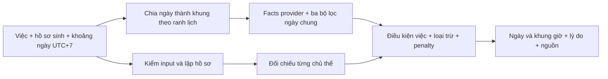

# Kế hoạch MVP 2 — Tra ngày theo việc và hồ sơ sinh

Ngày nghiên cứu: **12/10/2026**, UTC+7. Trạng thái: **đề xuất phát triển**, chưa bật tính năng trong ứng dụng.

## 1. Mục tiêu và hướng đã trao đổi

Chọn ngày cho **cưới hỏi, khai trương, xuất hành** dựa trên lịch và ngày giờ sinh của chủ thể. Người dùng đề xuất ba bộ lọc: Hoàng/Hắc Đạo, tương tác Can Chi, và các ngày kỵ lớn. Dùng đề xuất này làm cấu trúc cho tầng đánh giá ngày chung; bổ sung điều kiện của công việc và lá số để đáp ứng mục tiêu cá nhân hóa ban đầu.

Kết quả trả ngày, khung giờ bắt đầu phù hợp, lý do, điểm bị trừ và nguồn của từng luật. “Ngày đẹp” luôn gắn với **việc đã chọn, chủ thể đã nhập và khung giờ đang xét**. Điểm phản ánh bộ quy tắc nội bộ.

Ba mức kết quả đề xuất: **Ngày Đẹp / Ngày Bình Thường / Ngày Xấu**. Giữ Hoàng Đạo/Hắc Đạo thành một trường riêng; không đặt `Ngày Xấu = Hắc Đạo` hay `Ngày Đẹp = Can sinh Chi`. Thiếu dữ liệu luật thì trả trạng thái đánh giá chưa đầy đủ, không ép vào một trong ba mức.

## 2. Baseline đã đọc và bằng chứng

- Runtime hiện tại: FastAPI, Pydantic, SQLite; `lunar-python==1.4.8`, lịch Trung Quốc, nhập UTC+7 và chuyển cùng instant sang UTC+8.
- `randomyst/bazi.py::analyze` đã trả Tứ Trụ qua adapter, Dụng/Hỷ/Kỵ Thần, cách cục và lý do. Có thể tính hồ sơ một lần cho mỗi truy vấn.
- `randomyst/bazi.py::star_bonuses` dùng Thiên Ất/Văn Xương đối chiếu các chi **lá số gốc**; Thiên Đức dùng tháng tiết khí gieo đối chiếu lá số gốc. Hàm này không đánh giá ngày ứng viên.
- `NumberEngine.draw` có ngẫu nhiên, retry và điểm bộ sáu số. Điểm đó không dùng xếp ngày. Tính năng chọn ngày cần engine xác định, chạy lặp lại cùng dữ liệu phải trả cùng kết quả.
- Graph `.ua/knowledge-graph.json` đã đối chiếu **94 file baseline**, không thấy file baseline đổi hoặc thiếu trước khi thêm nghiên cứu MVP 2. Dự án chưa có Git. Graph hiện mô tả MVP 1; tài liệu/script mới chưa nằm trong graph.
- Khảo sát provider trên **2.557 ngày, 2024–2030**, tại 12h UTC+7, xác nhận đủ dữ liệu nên/kỵ cho ba nhóm việc. Đây là khảo sát độ phủ, không phải đánh giá tốt/xấu toàn bộ ngày.

Báo cáo có thể tái lập: [mvp2_auspicious_date_feasibility.json](research/mvp2_auspicious_date_feasibility.json). Bản giải thích: [mvp2_auspicious_date_research.md](research/mvp2_auspicious_date_research.md).

## 3. Phạm vi lần phát triển đầu

| Việc | Khóa | Token provider đề xuất | Hồ sơ cần nhập |
|---|---|---|---|
| Cưới hỏi | `MARRIAGE` | `嫁娶` | Hai người, cùng xét một khung thời gian |
| Khai trương | `BUSINESS_OPENING` | `开市` | Một chủ thể chính |
| Xuất hành | `TRAVEL` | `出行` | Một chủ thể chính |

Mapping này là đề xuất cho sản phẩm, cần rà nghĩa trước khi bật. Khai trương ở đây giới hạn mở hoạt động kinh doanh; không tự đồng nhất với ký hợp đồng, giao dịch hay treo biển. Cưới hỏi chưa bao gồm lễ đính hôn, nạp thái hoặc tư vấn hợp hôn. Xuất hành chưa bao gồm thuật toán chọn hướng.

- Nhập ngày giờ sinh chính xác theo contract MVP 1; giữ phạm vi sinh 1950–2026. Chưa tự điền giờ khi không biết giờ sinh.
- Khoảng tra theo ngày dương lịch UTC+7 trong 2024–2030; mặc định một tháng, tối đa đề xuất **93 ngày/lần**, tối đa hai chủ thể.
- Cho chọn ngày trong tuần và giờ có thể tổ chức. Khung giờ là **giờ bắt đầu**; chưa khẳng định toàn bộ lễ/chuyến đi kéo dài đều thuận.
- Cưới hỏi thiếu một hồ sơ thì báo thiếu, không gọi kết quả là ngày đẹp cho cặp đôi.
- Tái dùng dữ liệu form sinh. Đọc hồ sơ từ một phiên cũ là tiện ích giai đoạn sau, vì phiên v3 có quy ước lịch khác.
- Chưa thêm tài khoản, lịch nhiều chủ thể, LLM, GPS, lịch Việt Nam riêng hoặc thay luật sinh số.

## 4. Ba bộ lọc ngày chung

### Bộ lọc 1 — Hoàng Đạo/Hắc Đạo

**12 Thiên Thần** và **12 Trực** là hai hệ riêng. Thiên Thần gồm Thanh Long, Minh Đường, Thiên Hình, Chu Tước, Kim Quỹ, Thiên Đức, Bạch Hổ, Ngọc Đường, Thiên Lao, Huyền Vũ, Tư Mệnh, Câu Trần. Trực gồm Kiến, Trừ, Mãn, Bình, Định, Chấp, Phá, Nguy, Thành, Thu, Khai, Bế.

Provider đã có `getDayTianShen()`, `getDayTianShenType()`, `getZhiXing()`. Ưu tiên gọi các hàm đã ghim và lưu facts. Nếu chuyển thành bảng nội bộ để test, cần cả **offset theo chi tháng** và index chi ngày; một mảng 12 tên không đủ xác định thần của ngày.

Quy ước đề xuất: giữ nguyên hành vi provider cho tầng lịch chung, ghi `PROVIDER_JIE_CIVIL_DATE_MONTH`. Tháng này đổi vào **ngày dân sự Bắc Kinh chứa tiết**, khác tháng âm số 1–12 và khác tháng Bát Tự đổi đúng giây giao tiết. Không thay đầu vào chỉ để khớp một bài lịch Việt Nam.

Hắc Đạo là yếu tố bị trừ điểm theo policy sản phẩm; chưa mặc định là loại trừ mọi việc. Trực chỉ tham gia chấm nếu có ma trận theo việc đã được rà soát; không tự gán một nhóm Trực “tốt cho tất cả”.

### Bộ lọc 2 — Tương tác Can Chi ngày/tháng/năm

Tách rõ các facts:

1. Ngũ hành Can → Chi **bên trong ngày**: sinh, đồng hành, được sinh, khắc, bị khắc.
2. Lục hợp/lục xung của chi ngày với chi tháng/năm; ngũ hợp Can nếu đưa vào thì có rule riêng.
3. Tam hợp: lưu đủ các chi tham gia. Hai chi cùng nhóm chỉ ghi hỗ trợ/bán hợp theo policy đã chọn, không khẳng định đủ Tam Hợp hoặc tự hóa hành. Không đếm một chi lặp thành chi thứ ba.

Can Bính Hỏa sinh chi Thìn Thổ là một quan hệ ngũ hành, không phải kết luận mọi công việc đều thuận. Điểm tổng còn qua điều kiện công việc, loại trừ và chủ thể.

Mỗi fact lưu `day_basis`, `month_basis`, `year_basis`. Với tầng chung đề xuất dùng day Ganzhi dân sự, month Ganzhi provider và year theo Lập Xuân ở độ phân giải ngày; với Bát Tự cá nhân dùng chart sect 1 và năm/tháng exact. Không lấy cột âm lịch năm/tháng từ một nguồn khác mà bỏ nhãn quy ước.

### Bộ lọc 3 — Ngày kỵ lớn và điều kiện loại trừ

| Luật | Nguồn hiện có | Công việc tiếp theo |
|---|---|---|
| Nguyệt Phá | `月破` trong provider; bảng tinix 12 chi tháng | Đối chiếu hai bảng trên cùng quy ước tháng/ngày; khử đếm trùng với xung chi tháng |
| Sát Chủ | Bảng `month_based['Sát Chủ']` trong tinix đã ghim | Chuẩn hóa target CHI, xác định phạm vi công việc và quy ước tháng trước khi dùng cho ngày ứng viên |
| Thọ Tử | Bảng `month_based['Thọ Tử']` trong tinix đã ghim | Như Sát Chủ; chưa coi bảng Bát Tự gốc là đặc tả chọn ngày đã được kiểm chứng |
| Tam Nương | Người dùng yêu cầu; chưa có bảng được ghim cho chức năng này | Tìm nguồn đủ bảng, ghi hệ lịch/tháng nhuận/ngày âm; chưa bật luật từ trích dẫn lẻ |

Mã tinix gốc tra **chi tháng sinh** rồi đối chiếu các trụ sinh. Thay tháng sinh bằng tháng ứng viên và target bằng chi ngày là **mở rộng của sản phẩm**, cần ghi version và kiểm chứng riêng.

Các luật được xác định là loại trừ dùng `HARD_EXCLUSION`; điểm thuận không bù lại. Các luật còn tranh luận hoặc chưa đủ nguồn phải báo chưa có dữ liệu, không mặc định “không trúng sát”. Chưa khẳng định cả bốn luật là đại kỵ bất biến cho mọi loại việc.

## 5. Hai điều kiện để thành kết quả cá nhân hóa

### Điều kiện của công việc

- Ngày ghi kỵ token việc đã chọn → loại trừ khung thuộc ngày lịch đó. Giờ ghi kỵ → loại trừ riêng khung giờ.
- Token có trong cả nên và kỵ → báo mâu thuẫn nguồn, không khuyến nghị.
- Token không xuất hiện → `NOT_LISTED`; không suy ra là tốt. Đề xuất chỉ cho mức Ngày Đẹp khi có hỗ trợ ngày rõ ràng từ nguồn.
- `无` là sentinel không có mục tương ứng, không phải luật “mọi việc đều tốt”.
- `诸事不宜`, `馀事勿取` và biến thể `余事勿取` cần handler riêng. Khảo sát có các mục này ở cả cột nên và kỵ. Giữ nguyên văn và provenance; chuẩn hóa alias chỉ phục vụ lookup. Quy tắc nào chưa rõ phải đưa về trạng thái cần kiểm tra nguồn.
- Hoàng Đạo, Trực và Yi/Ji là facts có thể khác chiều. Bộ quyết định ghi rõ luật nào chiếm ưu tiên.

### Điều kiện của chủ thể

- Tính Tứ Trụ và Dụng/Hỷ/Kỵ một lần từ sinh; giữ nguyên khi quét ngày.
- Đối chiếu Can/Chi ngày và giờ ứng viên với Dụng/Hỷ/Kỵ, cùng các quan hệ hợp/xung của chi năm/ngày sinh theo policy đã version. Điểm tương hợp là đề xuất mô hình, chưa phải phép chọn ngày cổ truyền đã được xác nhận.
- Nhập đè Dụng Thần được ghi rõ. Giữ cả kết quả tự tính và giá trị dùng; không giả định Hỷ/Kỵ đã được tính lại theo override. Nếu bộ hiệu lực mâu thuẫn, phải có policy ưu tiên rõ ràng trước khi chấm.
- Không gọi `star_bonuses` để đánh giá ngày. Nếu thêm Thiên Ất/Văn Xương trên chi ứng viên thì xây evaluator mới, ghi target CAN/CHI và source chính xác; chưa đưa vào đợt tối thiểu.
- Cưới hỏi: dùng mức phù hợp thấp nhất của hai người và mọi loại trừ của từng người; không lấy trung bình để che một hồ sơ bị xung. Xét hai người tại **cùng một khung giờ**, không kết hợp hai giờ đẹp riêng biệt.

## 6. Chấm điểm trừ lùi và gắn nhãn

Đồng ý về kiến trúc **penalty points**: thuận là không bị trừ hoặc bị trừ ít; mỗi bất lợi có mã luật và lý do. Không cần bộ sinh ngẫu nhiên hay LLM để chấm.

```text
facts → các rule match có nguồn
      → hard exclusions + soft penalties + missing data

nếu thiếu dữ liệu luật bắt buộc:
    assessment_state = PARTIAL; score = null; grade = null
nếu có hard exclusion:
    assessment_state = COMPLETE; score = 0; grade = BAD
nếu đủ dữ liệu và không bị loại:
    score = clamp(100 - tổng penalty đã khử trùng, 0, 100)
    grade = phân mức theo ngưỡng, điều kiện việc và điều kiện chủ thể
```

**Chưa khóa số điểm và ngưỡng.** Cần bảng đề xuất riêng, chạy thử rồi chốt version. Không lấy ngưỡng 70/75/85, β=2 hoặc G_cap của bộ số chuyển sang ngày.

Ràng buộc trước khi chọn con số:

- Các mức trừ và ngưỡng là policy của ứng dụng, không gắn nhãn “điểm cổ thư”.
- Nguyệt Phá và chi ngày xung chi tháng nếu biểu thị cùng sự kiện chỉ trừ một lần; các facts vẫn hiển thị đủ.
- Nhóm penalty có cap để nhiều tên khác nhau của cùng nhóm không áp đảo toàn bộ điểm.
- Các điều kiện tốt trong bộ lọc 2 phải được phản ánh theo bảng mức trừ; không mặc định mọi ngày Hoàng Đạo đều 100 điểm.
- Cùng facts và policy → cùng điểm/nhãn; thêm bất lợi thuần túy không được làm điểm tăng.
- Thiếu “nên làm” không nhận nhãn Đẹp chỉ nhờ ít penalty.
- Ngày Xấu không đổi trường `calendar_class`: có thể là Hoàng Đạo nhưng kỵ việc/chủ thể.
- Đồng điểm: ưu tiên độ đầy đủ của bằng chứng, mức phù hợp của chủ thể yếu nhất, khung có thể dùng dài hơn, rồi ngày/giờ sớm hơn. Sắp xếp xác định.

Kết quả đẹp/bình thường/xấu cần lấy từ **khung cụ thể**. Tóm tắt ngày ghi “có khung phù hợp”, kèm số phút/khung áp dụng; không lấy giờ tốt nhất để tuyên bố toàn bộ ngày là Đại Cát. Nếu mọi khung bị loại thì ngày Xấu theo phạm vi đã chọn. Nếu có khung chưa đánh giá đủ thì ghi rõ phạm vi chưa đủ dữ liệu.

## 7. Ranh thời gian phải xử lý

| Ranh | Bắc Kinh UTC+8 | Giờ nhập/hiển thị UTC+7 |
|---|---|---|
| Chi giờ / Bát Tự sect 1 sang ngày | 23h | 22h |
| Ngày âm/dân sự provider | 00h | 23h |
| Các ranh Chi giờ còn lại | 01h, 03h…21h | 00h, 02h…20h |
| Năm/tháng Bát Tự | Đúng giây giao tiết | Chuyển cùng instant |
| Tháng không exact của provider | Ngày Bắc Kinh chứa tiết | Đổi từ 23h UTC+7 tối hôm trước ngày đó |

Quét một ngày dương lịch UTC+7 bằng các đoạn `[start, end)`: cắt tại ranh giờ, 22h, 23h, ranh date và các giao tiết exact. Mỗi đoạn đánh giá tại một instant thuộc đoạn, xác nhận facts không đổi trong đoạn. Không dùng một mốc 12h đại diện cho cả ngày.

`getTimes()` trả 13 đối tượng cho **ngày Bắc Kinh**, gồm đầu/cuối giờ Tý. Không sao chép nguyên danh sách thành 12 khung giờ Việt Nam. Tự dựng interval từ instant, đổi timezone rồi cắt vào ngày người dùng.

Truy vấn ngày 31/12/2030 vẫn nhận vì đầu vào UTC+7 hợp lệ, dù cuối ngày chuyển sang 01/01/2031 Bắc Kinh. Không đánh giá điểm tại end exclusive nằm ngoài phạm vi công khai.

Sai số giờ sinh đã biết phải kiểm cả ranh giờ/ngày **và tiết khí**; helper `beijing_clock` hiện chưa đủ cho ranh tiết. Thiếu sai số giữ `UNDETERMINED`, không tự giả định bằng không. Nếu khoảng sai số làm lá số đổi, đánh giá các biến thể và báo chưa ổn định trước khi khuyến nghị chắc chắn.

## 8. Kiến trúc và contract đề xuất



| Thành phần dự kiến | Trách nhiệm |
|---|---|
| `randomyst/date_calendar.py` | Facts lịch, Hoàng/Hắc Đạo, Trực, Yi/Ji, interval và nguồn của provider; gọi adapter hiện hành |
| `randomyst/date_rules.py` | Rule match có kiểu target, hard/soft, scope việc và month/day basis; khử trùng |
| `randomyst/date_engine.py` | Tính hồ sơ, quét, đối chiếu chủ thể, chấm và xếp ngày xác định |
| `config/mvp2_date_rules.json` | Version mới, allowlist, penalty/cap/ngưỡng, trạng thái rà soát; chỉ tạo khi bảng luật đã đủ |
| `randomyst/models.py`, `api.py` | Model/endpoint mới, độc lập response của draw |
| `web/` | Tab Tra ngày, form việc/hồ sơ, lịch và chi tiết khung |
| `tests/test_auspicious_dates.py` | Ca hoạt động, cá nhân hóa, loại trừ, ranh và bất biến điểm |

Endpoint đề xuất: `POST /api/v2/auspicious-dates/search`, xử lý xác định và không ghi bảng `draws`. Không cần UUID idempotency kiểu gieo số. Có thể thêm lưu tra cứu vào bảng riêng sau khi có nhu cầu.

Request gồm `activity`, `subjects[{subject_id, birth}]`, `date_range{start,end}`, `allowed_weekdays`, `allowed_hours`. Response gồm:

- `schema_version`, `date_rules_version`, `calendar_policy`, `activity`, `subject_summaries`.
- `days[]`: ngày UTC+7, trạng thái tổng hợp, các khung đã đánh giá, khung khuyến nghị, phạm vi áp dụng và lý do không có kết quả.
- Mỗi khung: `start_at`, `end_at`, facts ngày dân sự/ngày Bát Tự, `calendar_class`, `day_officer`, `activity_status`, `assessment_state`, `score`, `grade`, `hard_exclusions`, `penalties`, `subject_assessments`, `missing_rules`, `sources`.
- Mỗi penalty: `rule_id`, `dedupe_group`, `points`, input/target thực sự khớp, `basis`, nguồn và phạm vi việc.

Không gửi trace mọi khung của 93 ngày ở chế độ mặc định; trả tóm tắt và cho mở chi tiết ngày. Cache facts lịch theo provider/version/instant/rule basis, tách dữ liệu chủ thể. Đặt giới hạn request trước tính toán.

UI: chọn việc → nhập một/hai hồ sơ → chọn tháng và thời gian có thể dùng → tra → xem lịch → mở lý do/khung giờ. Màu kết quả chung và nhãn Hoàng/Hắc Đạo hiển thị riêng. Có trạng thái chưa đủ dữ liệu, không có ngày phù hợp, lỗi và truy vấn mới thay truy vấn cũ; không gọi draw khi mở ngày.

## 9. Thứ tự triển khai và tiêu chí qua bước

| Bước | Công việc | Điều kiện hoàn tất |
|---|---|---|
| R0 — Nghiên cứu khả thi | Graph, provider, coverage, ranh, nguồn người dùng | Đã có script/báo cáo; các phần chưa đủ nguồn ghi riêng |
| R1 — Đóng bảng luật | Chuẩn hóa hai hệ 12 mục; map việc; rule Sát Chủ/Thọ Tử/Nguyệt Phá/Tam Nương; special token; penalty/ngưỡng | Mỗi luật đủ source/hash, target type, phạm vi, basis và fixtures; đánh dấu rõ luật chưa bật |
| R2 — Calendar/evaluator | Interval UTC+7, facts lịch, rule ngày chung; engine xác định | Qua test ranh, hard gate, dedupe, thiếu dữ liệu; không ảnh hưởng draw |
| R3 — Cá nhân hóa và việc | Dụng/Hỷ/Kỵ, override, một/hai người; rule theo việc | Cùng ngày đổi việc/đổi người có kết quả giải thích được; cặp đôi dùng cùng khung |
| R4 — API và UI | Endpoint, tab lịch, chi tiết lý do, giới hạn, lỗi | Kiểm HTTP/UI bằng hồ sơ giả lập; không ghi draws; hành vi ngày cũ giữ nguyên |
| R5 — Hiệu chỉnh và bàn giao | Corpus fixtures nguồn, thử penalty, benchmark đầy đủ, cập nhật graph/README | Chốt version; regressions MVP 1 pass; ghi giới hạn và trạng thái review của luật |

R1 là bước tiếp theo. Chưa triển khai API chấm điểm trước khi có đủ semantics của nguồn và bảng penalty. Đây là thứ tự công việc, không phải yêu cầu xin phép lại để đọc nguồn hoặc hoàn thiện bảng đề xuất.

Kiểm chứng cần có:

1. Hai hệ 12 mục không lẫn; đủ 6 Hoàng/6 Hắc; đủ offset của 12 tháng.
2. Bính Thìn Can sinh Chi vẫn có thể kỵ xuất hành; cùng ngày cưới/khai trương có facts khác.
3. Hard exclusion áp đảo mọi thuận; Nguyệt Phá không bị trừ đôi; trạng thái thiếu nguồn không thành điểm 100.
4. Hai chi chưa thành đủ Tam Hợp; không tự hóa hành; chi lặp và nhiều alias không tăng/trừ đôi.
5. Các cột special token, trường hợp có/không có target, mâu thuẫn nên/kỵ.
6. Đổi giờ/sinh/Dụng Thần override ảnh hưởng đúng; không tính lại Dụng Thần sinh theo từng ngày.
7. Cưới hai người: đổi thứ tự không đổi kết quả, một người bị loại thì khung chung bị loại; đổi một hồ sơ có thể đổi thứ tự.
8. Toàn bộ 12 ranh giờ, 22h/23h UTC+7, Tết, nhuận, Lập Xuân/giao tiết exact, ngày đổi tháng non-exact, cuối năm/phạm vi.
9. Interval không hở/chồng, đúng clip với allowed hours, same instant bảo toàn timezone; kết quả thuộc phạm vi đã gửi.
10. Tính xác định, điểm hữu hạn/bounded, penalty không làm tăng điểm, stable sort; không có ngẫu nhiên hoặc ghi draw.
11. Không sửa lịch sử v3/v4, chạy lại idempotency và kiểm bộ sáu số sau khi bắt đầu thay runtime.
12. Đo API cold/warm cho 31/93 ngày, 1/2 người; mục tiêu đề xuất dưới 2 giây/31 ngày, dưới 5 giây/93 ngày trên máy phát triển, cần đo thực tế.

## 10. Những phần chưa chốt

- Bảng penalty/ngưỡng và phạm vi loại trừ của từng ngày kỵ.
- Nguồn đầy đủ cho Tam Nương; tính hợp lệ của mở rộng Sát Chủ/Thọ Tử từ bảng natal sang chọn ngày.
- Handler special token và mapping khai trương; ma trận Trực theo từng việc nếu đưa vào.
- Tên hiển thị “Đại Cát”: đề xuất dùng “Ngày Đẹp cho [việc]” trong bản đầu để giữ phạm vi kết luận rõ ràng.
- Hiệu năng toàn engine/API và kiểm chứng nội dung ngoài provider. Các phép đối chiếu cùng họ 6tail không phải ground truth độc lập.

Các mục này là backlog nghiên cứu để hoàn thiện kế hoạch triển khai, chưa phải hành vi đã được người dùng khóa.

## 11. Đánh giá đề xuất ma trận rẽ nhánh và cộng/trừ điểm

Người dùng đề xuất tách điểm tổng quan/tag công việc, cộng Hoàng Đạo `+30`, Can sinh Chi `+20`, phạt đại kỵ `−100`, cảnh báo xung tuổi riêng. Đây là phương án đang đánh giá; các số này **chưa thay công thức hoặc khóa trọng số ở mục 6**.

Giữ ý tưởng ma trận khai báo và tách ba lớp **facts lịch → quyết định theo việc/chủ thể → điểm xếp hạng**. Các điểm cần chỉnh trước khi triển khai:

1. Không gán Trực Phá/Bế vào Hắc Đạo mặc định. Theo provider 1.4.8, tại 12h UTC+7: 08/02/2026 là Trực Bế/Minh Đường Hoàng Đạo; 12/03/2026 là Trực Phá/Ngọc Đường Hoàng Đạo. Hai cột cần lưu độc lập.
2. Boolean công việc không phân biệt “nên”, “kỵ”, “không đề cập”, “mâu thuẫn/chưa đủ nguồn”. Dùng map theo activity với enum `SUPPORTED | AVOID | NOT_LISTED | UNRESOLVED`, cùng reasons/source. Số việc không bắt buộc bằng 12 và không phụ thuộc số Trực.
3. Ma trận Trực là một nguồn hỗ trợ. Không tự ghi “ĐẠI CÁT” chỉ vì một ô True, bỏ qua Yi/Ji, các sentinel, ngày kỵ, chủ thể và giờ. Những phạm vi công việc ngoài ba nhóm MVP đầu chưa được bật chỉ vì có một ví dụ trong thảo luận.
4. `+30 +20 −100 = −50`: gọi kết quả đó là bình thường mâu thuẫn với “phủ quyết toàn bộ”. Luật đã xác định cấm việc cần `BLOCK` độc lập; bất lợi chỉ mang tính cảnh báo dùng `WARN`/penalty. Luật không cấm một việc khác không chặn việc đó.
5. `−100` không bảo đảm phủ quyết nếu tổng bonus có thể vượt 100. Tính hard blocks trước khi phân nhãn; điểm dùng xếp các ứng viên đủ điều kiện. Không dùng một số âm lớn làm thay thế cho điều kiện logic.
6. Có thể giữ nguyên điểm tổng quan khi xung tuổi, nhưng `personal_status` phải ảnh hưởng kết luận “phù hợp với bạn”. Đề xuất bảo thủ: loại trừ xung đã nằm trong allowlist policy; trường hợp chưa đủ nguồn trả chưa đánh giá đủ. Cưới hai người xét cả hai, không chỉ hiện cảnh báo bên cạnh nhãn Đại Cát chung.
7. `+30/+20/−100` cố định là trọng số tĩnh. Chỉ gọi theo ngữ cảnh khi policy thay đổi có giải thích theo activity/rule scope; các giá trị vẫn cần thử và ngưỡng phân mức.
8. Điều kiện xét mức đẹp nên là đủ dữ liệu + không bị loại + hỗ trợ công việc + điều kiện chủ thể + đạt ngưỡng. Can sinh Chi là bonus khả dĩ; chưa có nguồn để biến thành điều kiện cần phổ quát. “Thần Cát” nếu dùng làm điều kiện phải có allowlist, không dùng khái niệm không định nghĩa.

Một rule khai báo nên có `rule_id`, `when`, `activity_scope`, `subject_scope`, `basis`, `effect: BONUS | PENALTY | BLOCK | WARN`, `points` (chỉ bonus/penalty), `dedupe_group`, `source`, `review_status`, `version`. UI được tạo từ các reasons thực sự khớp, không giữ chuỗi kết luận cố định cho một Trực.

Ví dụ lời hiển thị đề xuất: “Trực Phá · Ngọc Đường Hoàng Đạo. Lịch có mục phù hợp phá dỡ; mức phù hợp cuối còn phụ thuộc các điều kiện đang xét.” Không suy từ loại Trực ra rằng việc chữa bệnh hoặc bất kỳ việc nào luôn Đại Cát.

Bằng chứng phản ví dụ và phép cộng điểm: [mvp2_rule_matrix_counterexamples.json](research/mvp2_rule_matrix_counterexamples.json). Những fixtures xác nhận hành vi phần mềm đã ghim, chưa xác nhận hiệu quả thực tế của quan niệm chọn ngày. Uy tín nội dung cần nguồn có version và kiểm định nhất quán; cấu trúc code tự nó chưa chứng minh hơn các sản phẩm khác.
