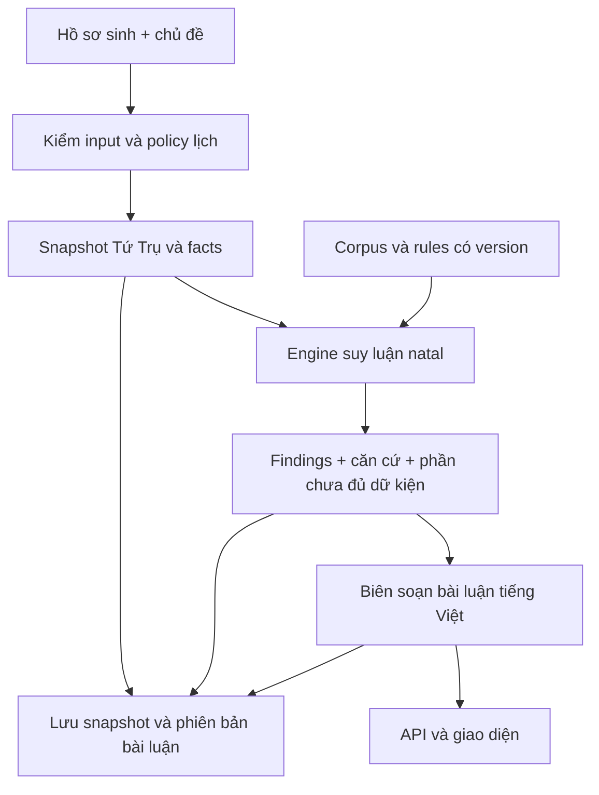

# Kế hoạch tính năng Luận Giải Bát Tự

Ngày lập: **26/10/2026**. Trạng thái cập nhật: **đã triển khai bản natal v1 có API/UI độc lập**; phạm vi thực tế và các phần luận có điều kiện nằm ở [bàn giao](bazi_module_handoff.md). Các mục dưới đây giữ đề xuất gốc để đối chiếu; chưa tuyên bố hoàn tất toàn bộ phương pháp Tử Bình hoặc các phần mở rộng.

## 1. Mục tiêu sản phẩm

Thêm **Luận Giải Bát Tự** vào menu chính của Arcana, cùng cấp với Gieo bộ số, Tra ngày theo việc và Luận Giải Kinh Dịch. Người dùng nhập hồ sơ sinh để nhận lá số và bài luận có căn cứ, có thể mở lại trong lịch sử riêng.

Bài luận phải trả lời được: Nhật chủ đang ở thế nào; yếu tố nào tạo nên thế đó; các nhóm Thập Thần phối hợp hoặc cản trở ra sao; vì sao đề xuất một hướng cân bằng; nhận định này có ý nghĩa gì đối với chủ đề đang đọc. Mỗi nhận định gắn với dữ kiện cụ thể của lá số, tránh lặp mô tả chung theo một Thiên Can hoặc một hành.

Phạm vi phát hành đầu tiên là **mệnh cục lúc sinh**. Đại vận, Lưu niên và câu hỏi về một thời điểm tương lai nằm ở bản tiếp theo, sau khi hoàn tất quy ước khởi vận và đối chiếu riêng.

## 2. Hiện trạng và khoảng thiếu đã xác minh

| Thành phần hiện có | Có thể dùng tiếp | Phần phải bổ sung |
|---|---|---|
| `randomyst/time_engine.py` | Provider `lunar-python==1.4.8`, chuyển cùng thời điểm từ giờ Việt Nam sang UTC+8, Tứ Trụ sect 1, giao tiết chính xác của provider | Adapter facts Bát Tự độc lập, tàng can, Thập Thần đầy đủ và snapshot policy |
| `randomyst/bazi.py` | Bản logic số học ghim nguồn, đang dùng cho gieo số và tra ngày | Bộ luận natal mới; đánh giá lại cách cục, vượng nhược, Điều hậu và lấy dụng |
| `randomyst/bazi_reading.py` | Cách tổ chức lời luận theo dữ kiện, nhánh tính và căn cứ | Hiện bắt buộc có `draw.trace.bazi` và bộ số; chưa phải service luận lá số riêng |
| `ModuleReading` trong `models.py` | Summary, sections, evidence, references và kiểm liên kết | Model facts/findings có kiểu dữ liệu rõ cho Bát Tự; profile và coverage riêng |
| Kho nguồn Bát Tự hiện tại | Bản mã và một số mô tả Nhật chủ/cách cục có hash | Corpus quy tắc luận natal được đối chiếu, tách cổ văn, diễn giải và policy sản phẩm |
| API/UI/lưu trữ | Mẫu consultation, UUID idempotent, SQLite và lịch sử của Mai Hoa/Lục Hào | Endpoint, bảng, form và màn hình kết quả Bát Tự |

Các khoảng thiếu ảnh hưởng trực tiếp đến chất lượng lời luận:

- Hàm `structure()` hiện gán cả `Tài+` và `Tài-` thành **Chính Tài Cách**. Đã chạy đối chiếu tại môi trường local: Giáp–Mậu được provider nhận là Thiên Tài, Giáp–Kỷ là Chính Tài; logic cách cục cũ trả cùng một nhãn. Cần bảng Thập Thần chuẩn hóa tên và cực tính.
- Cách cục thường hiện suy từ **can tháng** và nhánh Kiến Lộc; chưa xét đầy đủ nguyệt lệnh, tàng can và thấu can. Có đường fallback thành Sát. Không đem đường fallback này sang module natal mới.
- Điểm vượng nhược hiện dùng trọng số vị trí cố định 40/16/10/8, ngũ hành chính của chi và các ngưỡng 82/12/35/50. Đây là mô hình hiện hành phục vụ sản phẩm, chưa đủ cơ sở để gọi là phép luận toàn diện.
- Chưa có engine tàng can, thông căn, hợp/xung/hình/hại/phá và quan hệ cứu giải trong module Python Bát Tự. Thần sát hiện có là bonus chọn số, có cả dữ kiện tháng gieo; không dùng nguyên trạng để luận mệnh cục sinh.

## 3. Phương pháp và nguồn

Đề xuất trục luận **Tử Bình: Nhật chủ – nguyệt lệnh – căn khí – Thập Thần – phối hợp Can Chi**. Tách ba câu hỏi trong kết quả: cấu trúc mệnh cục, nhu cầu phù ức và nhu cầu Điều hậu. Không gọi ba kết quả này là cùng một “Dụng Thần”, cũng không ép về một hành duy nhất khi chúng chưa thống nhất.

R0 phải đóng chính xác định nghĩa “Dụng” đang dùng, điều kiện lập cách, điều kiện ngoại cách và thứ tự giải quyết xung đột giữa các phép xét. Chưa đủ điều kiện thì trả ứng viên hoặc nhận định chưa đủ căn cứ; không tự gán một cách cục để có lời luận.

Nguồn dùng theo vai trò:

- **Facts lịch và bảng tra:** [6tail/lunar-python](https://github.com/6tail/lunar-python) và [mã EightChar](https://github.com/6tail/lunar-python/blob/master/lunar_python/EightChar.py). Bản cài local 1.4.8 đã có tàng can và Thập Thần; có thể dùng qua adapter, không cần tự viết lại lịch. Trước khi build corpus phải ghim đúng phiên bản/mã và hash, không ghim nhánh `master` cho runtime.
- **Tài liệu luận:** [Địch Thiên Tủy, revision 844410](https://zh.wikisource.org/w/index.php?oldid=844410) là nguồn đã đọc cho các mục Can, nguyệt lệnh, suy vượng và hàn noãn. Tử Bình Chân Thuyên là nguồn cần thu thập, xác minh bản và đối chiếu các chương dụng thần/cách cục trong R0; hiện chưa có corpus đã ghim cho sách này.
- **Logic kế thừa:** [tinix-bazi ở commit đang ghim](https://github.com/vhphuoc1102/tinix-bazi/tree/80ff4463d0397c1b11db76f38d880255f55558bc) chỉ dùng để tái lập profile cũ và phân tích khác biệt. Không xem phần mềm này là bằng chứng độc lập cho quy tắc luận mới.

Mỗi rule có `rule_id`, điều kiện, ngoại lệ, dữ kiện đầu vào, nguồn/đoạn tham chiếu và trạng thái đối chiếu. Nguyên văn, lời diễn giải Việt và ngưỡng do sản phẩm chọn phải được phân biệt trong dữ liệu. So với chính provider chỉ chứng minh adapter tích hợp đúng, không phải kiểm chứng độc lập.

## 4. Nội dung bản đầu

| Phần kết quả | Nội dung và điều kiện |
|---|---|
| Tổng quan mệnh cục | 3–5 nhận định nổi bật, mỗi nhận định truy được facts và rule; ưu tiên vấn đề chi phối toàn cục |
| Bàn Tứ Trụ | Năm/Tháng/Ngày/Giờ, Âm Dương, hành của Can Chi, tàng can và Thập Thần so với Nhật chủ |
| Nhật chủ và khí thế | Đắc lệnh, thông căn, thấu can, sinh trợ, khắc/tiết/hao; giải thích cả yếu tố hỗ trợ và yếu tố ngược chiều |
| Cách cục và phối hợp | Ứng viên nội cách, điều kiện đã đạt/chưa đạt, quan hệ phối hợp; ngoại cách chỉ kết luận khi đủ bộ điều kiện đã ghim |
| Hướng cân bằng | Phù ức và Điều hậu trình bày riêng; Dụng/Hỷ/Kỵ có lý do và phạm vi theo profile; xung đột được giữ rõ |
| Tương tác Can Chi | Ngũ hợp Can; lục hợp, lục xung, tam hợp/tam hội đủ bộ; hình/hại/phá khi có bảng và điều kiện đã đối chiếu. Phân biệt “có quan hệ” với “đủ điều kiện hóa” |
| Luận theo chủ đề | Tổng quan, Công việc, Tài chính, Học tập, Quan hệ. Chỉ dùng findings thực sự có trong lá số; chủ đề đổi cách sắp xếp/diễn giải, không đổi lá số |

Luận theo chủ đề cần gắn ít nhất một finding cụ thể cùng dữ kiện phối hợp/ngược chiều. Ví dụ không suy “nhiều Tài = giàu”; phải xét Tài trong quan hệ với sức Nhật chủ và các nhóm liên quan trước khi mô tả xu hướng quản lý nguồn lực.

Thần sát, nạp âm và vòng Trường sinh chỉ bổ sung khi có vai trò rõ và nguồn riêng; không dùng làm trụ cột thay thế mệnh cục. Nội dung sức khỏe, bệnh/tử, xác suất giàu có hoặc sự kiện chắc chắn không thuộc bản đầu. Không cần dựng điểm tổng “số mệnh /100”.

## 5. Luồng giao diện

1. Mở **Luận Giải Bát Tự**.
2. Nhập tên gọi tùy chọn, ngày sinh và giờ sinh; nhãn giờ **Giờ Việt Nam**. Không điền sẵn giờ sinh mẫu khi tạo hồ sơ mới. Bản đầu nhận ngày dương lịch 1950–2026, yêu cầu biết giờ để luận đủ Tứ Trụ; không mặc định 12:00 khi thiếu giờ.
3. Chọn **Chủ đề muốn xem**, mặc định Tổng quan. Sau đó mới hiển thị ô **Điều bạn muốn hiểu thêm**, không bắt buộc.
4. Bấm **Lập lá số & luận giải**.
5. Xem tóm tắt, bàn Tứ Trụ và các phần luận. Căn cứ/nguồn nằm trong mục mở thêm; lỗi nhập hoặc ranh thời gian thực sự ảnh hưởng lá số xuất hiện sát dữ liệu liên quan.
6. Mở lại từ **Các lá số gần đây**, hoặc đổi chủ đề bằng phiên bản bài luận khác trên cùng snapshot lá số.

V1 chọn chủ đề tường minh; câu hỏi tự do được lưu làm ngữ cảnh, chưa tự hứa đã hiểu mọi ý hỏi. Nhận diện ý hỏi là bước sau, có bộ từ khóa theo miền Bát Tự; khi triển khai sẽ gợi ý xác nhận xung đột, không âm thầm đổi chủ đề người dùng chọn.

Không hiện thông báo “chưa có biên sai số đồng hồ” mặc định. Nếu người dùng khai sai số và khoảng đó cắt qua đổi giờ/ngày/giao tiết, phải xử lý trước khi kết luận đầy đủ. Tính năng không rõ giờ sinh cần module lá số ứng viên riêng ở bản sau.

## 6. Kiến trúc đề xuất

| File/thành phần dự kiến | Trách nhiệm |
|---|---|
| `randomyst/bazi_models.py` | Request, birth input riêng, chart/facts, findings, reading, source, coverage và response |
| `randomyst/bazi_facts.py` | Adapter provider; Tứ Trụ, tàng can, cực tính, Thập Thần, thông căn, quan hệ Can Chi; không biên soạn lời luận |
| `randomyst/bazi_rules.py` | Đọc corpus/rules và kiểm hash; điều kiện/ngoại lệ, giải quyết finding trùng hoặc xung đột |
| `randomyst/bazi_service.py` | Điều phối một lần lập lá số, engine mệnh cục và bài luận theo chủ đề |
| `randomyst/bazi_narrative.py` | Biên soạn từ facts/findings đã có; không tự thêm dữ kiện hoặc tính lại lá số |
| `randomyst/bazi_store.py` | Idempotency, snapshot, lịch sử và các bài luận khác chủ đề |
| `config/bazi_rules.json`, `data/reference/bazi/` | Trường phái/profile, bảng tra, corpus ghim nguồn, manifest và hash |
| `web/bazi.js`, phần mới trong `index.html`/`style.css` | Form, state riêng, tải/luận lại, lỗi, kết quả và lịch sử; responsive |
| `schemas/`, `examples/`, `tests/` | Contract mẫu, fixtures nguồn độc lập, kiểm rule và hồi quy |

Shape chính: `chart + facts → findings → reading`. Một finding chứa `rule_id`, `topic_scope`, kết luận, `fact_refs`, `evidence_refs`, điều kiện đạt/chưa đạt và trạng thái `SUPPORTED | CONDITIONAL | UNRESOLVED`. Đây là trạng thái độ đủ căn cứ, không phải phần trăm dự đoán.

Response có `schema_version`, `calendar_policy`, `analysis_profile`, `rules_version`, `corpus_version`, `chart`, `findings`, `reading`, `coverage`. Facts và references phải có kiểu/validator rõ, không để toàn bộ chart thành dict tự do. `PARTIAL` được xác định theo phần thiếu hoặc xung đột; không biến thiếu dữ liệu thành kết luận âm tính.

Ưu tiên engine xác định và lời luận biên soạn cục bộ trong v1. Nếu sau này dùng LLM thì chỉ nhận facts/findings đã tính, kiểm tham chiếu và có fallback; không giao việc lập Tứ Trụ hay quyết định Dụng Thần cho model ngôn ngữ.

## 7. API, lưu trữ và tương thích

API đề xuất:

- `GET /api/v1/bazi/rules`: phạm vi, profile, policy lịch, version và chủ đề hỗ trợ.
- `POST /api/v1/bazi/consultations`: lập và lưu một snapshot lá số, cùng bài luận đầu tiên.
- `GET /api/v1/bazi/consultations/{request_id}`: đọc đúng snapshot và bài luận ban đầu đã lưu.
- `GET /api/v1/bazi/history?limit=10`: lịch sử riêng, chỉ trả thông tin đủ để nhận diện lá số.
- `POST /api/v1/bazi/consultations/{request_id}/readings`: thêm bài luận khác chủ đề từ snapshot; có UUID riêng cho lần luận, không tính lại lịch.
- `GET /api/v1/bazi/consultations/{request_id}/readings`: danh sách các bài luận đã lưu, kèm version.

Request dùng model sinh riêng: không mang theo `casting`, tọa độ hoặc `override_dung_than` của gieo số. Không dùng dữ kiện ngày hiện tại khi đọc mệnh cục sinh. Chỉ mở rộng dải năm sau một đợt audit riêng.

SQLite thêm `bazi_consultations` và `bazi_readings`; mỗi bảng có UUID, payload hash, thời gian tạo và JSON snapshot. Retry cùng UUID/payload trả kết quả đã lưu; đổi payload với UUID cũ trả 409. Đọc lịch sử không chạy engine mới. Timestamps và timezone được giữ đủ trong backend, trình bày giờ Việt Nam ở UI.

Giữ profile `legacy_numeric_v1` cho gieo số/tra ngày đang chạy; module natal dùng profile `bazi_natal_v1` sau R0. Không sửa trực tiếp `analyze()` để tránh thay sinh số hoặc điểm chọn ngày ngoài phạm vi. Hai profile có thể khác kết luận và phải có provenance rõ, không ép chúng đồng nhất bằng sửa snapshot.

Phần Đọc sâu hiện tại tiếp tục đọc phiên đã lưu. Chỉ chia sẻ các hàm diễn giải trung lập và cấu trúc căn cứ khi đã có test tương thích; không đưa lõi natal mới vào phiên cũ một cách ngầm định. Việc chuyển hai tính năng cũ sang profile mới, nếu cần, là một migration có version riêng.

## 8. Các mốc triển khai và điều kiện hoàn tất

| Mốc | Công việc | Điều kiện hoàn tất |
|---|---|---|
| **R0 — Chốt phương pháp** | Ghim nguồn; định nghĩa nguyệt lệnh/thông căn/cách cục/Dụng; bảng Thập Thần; luật phù ức/Điều hậu; ngoại lệ và độ phủ | Có đặc tả rule thực thi được, thứ tự ưu tiên, ví dụ thuận/nghịch; không còn ngưỡng hoặc fallback không giải thích được |
| **R1 — Facts và contract** | Model/schema; adapter lịch; tàng can, Thập Thần, quan hệ; bộ fixtures | Đúng 100 cặp Can–Nhật chủ, 12 bảng tàng can, các tổ hợp quan hệ và ranh lịch; kiểm adapter tách khỏi diễn giải |
| **R2 — Engine và bài luận** | Findings mệnh cục; cách cục ứng viên; phù ức/Điều hậu; tổng hợp và 5 chủ đề | Mỗi kết luận có facts/rule/nguồn, giữ được mâu thuẫn và thiếu dữ kiện; bài luận thực sự khác nhau theo cấu trúc lá số |
| **R3 — API và snapshot** | Endpoint, SQLite, retry, lịch sử, luận lại theo chủ đề | Idempotency và 409 đúng; mở/luận lại không lập lại lá số; không ghi bảng các tính năng khác |
| **R4 — Giao diện và nghiệm thu** | Menu/form, bàn Tứ Trụ, bài luận, lịch sử; HTTP/UI/keyboard/mobile smoke; tài liệu bàn giao | Đi hết luồng nhập → lập lá số → đọc căn cứ → đổi chủ đề → mở lịch sử; mọi kiểm thử bắt buộc đạt |

Thứ tự phụ thuộc **R0 → R1 → R2 → R3 → R4**. Đầu ra đầu tiên là bộ quy tắc và lá số mẫu đối chiếu được; giao diện dùng đúng contract này để tránh viết màn hình trước khi biết engine luận được đến đâu.

## 9. Tiêu chí nghiệm thu bắt buộc

- Lịch: trước/đúng/sau giao Lập Xuân và các giao Jie; đổi ngày 23:00 Bắc Kinh tương ứng 22:00 Việt Nam; ranh giờ; năm nhuận dương lịch; hai đầu dải sinh. Nêu rõ những ca mới đối chiếu provider và những ca có nguồn độc lập.
- Quan hệ: đủ bộ cần các chi khác nhau; hai chi không thành tam hợp đủ; nhiều chi lặp không được cộng lặp căn cứ; “hợp” không tự động là “hóa”; không tự suy toàn bộ chuỗi cứu giải từ một cặp đơn.
- Thập Thần: kiểm đủ 100 cặp, đặc biệt Giáp–Mậu/Giáp–Kỷ; Nhật chủ mang vai trò riêng trong bàn, tránh mô tả nó như một thần phụ thêm.
- Luận: có fixtures thân mạnh/yếu, cân bằng hoặc chưa phân định, nội cách, ngoại cách nghi vấn, thiếu điều kiện, Điều hậu khác hướng phù ức và nhiều tín hiệu trái chiều. Cần bộ ví dụ ngoài chính mã đang kiểm để đối chiếu; ghi đúng trạng thái hiệu đính thực tế.
- Căn cứ: không có section/finding trỏ tới ID không tồn tại; rule bật có nguồn hoặc được ghi rõ là policy sản phẩm; câu văn không thêm sự kiện đời người không có trong dữ liệu.
- Snapshot: một lần dựng facts cho consultation mới; luận lại chỉ dùng snapshot; cùng input/profile/version cho cùng kết quả; bản cũ không đổi khi rules mới phát hành.
- Hồi quy: gieo số, tra ngày, Mai Hoa, Lục Hào và phần đọc sâu giữ kết quả trước thay đổi. Baseline gần nhất đã ghi nhận 147 kiểm thử Python và 5 JavaScript; khi triển khai phải chạy lại baseline cùng ca mới, không xem số lượng test là bằng chứng đúng mệnh lý.
- UI: dữ liệu kết quả gắn với hồ sơ đã submit, không trôi theo form đang sửa; hủy request cũ và chống response về muộn; loading/retry không tạo thêm lá số; render văn bản an toàn và thao tác được bằng bàn phím.

## 10. Bước tiếp theo sau bản đầu

**Đại vận → Lưu niên → câu hỏi gắn mốc thời gian.** Provider có [Yun](https://github.com/6tail/lunar-python/blob/master/lunar_python/eightchar/Yun.py) với tham số giới tính của phép tính và nhiều quy ước khởi vận. Cần chốt riêng thuận/nghịch, cách quy đổi khoảng đến tiết, tuổi khởi vận, ngày bắt đầu và ranh năm Lưu niên; `EightChar.sect` và `Yun.sect` là hai lựa chọn khác nhau, không dùng lẫn. Đối chiếu đúng bản cài 1.4.8 trước khi dựa vào API trong tài liệu online.

Sau đó mới bổ sung không rõ giờ sinh bằng các lá số ứng viên, nhập ngày âm, nhiều múi giờ/đồng hồ mặt trời, hợp hai lá số và xuất bản báo cáo. Mỗi phần cần contract, nguồn và nghiệm thu riêng.
