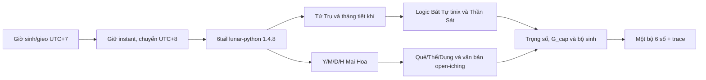

# Đặc tả hiện hành MVP 1 — rules v6

Ngày 26/10/2026, người dùng mở phạm vi gieo số từ 00–45 lên 00–99. Rules v5 kế thừa quy tắc lịch Bắc Kinh UTC+8 của v4 ngày 11/10/2026; giữ thuật toán trọng số, điểm/ngưỡng và quota. Bản v3 ở `archive/logic_plan_mvp1_v3.md` chỉ phục vụ truy vết.

Cùng ngày, rules v6 nâng ngưỡng các nhóm thường và Đại Cát lên **80**, giữ Đại Hung **85**. Màn hình gieo số hiển thị lời giải gắn với bộ số đã chọn; không đổi dữ liệu hoặc ngưỡng trong phiên lịch sử.

## 1. Mục tiêu và pipeline

Mỗi phiên trả **một bộ sáu số khác nhau từ 00 tới 99**, sắp tăng dần, định dạng hai chữ số. Bể có 100 số; mỗi hành có 20 số, gồm 10 chẵn và 10 lẻ. `G_cap` được tính lại trên không gian bộ hợp lệ của bể mới.

## 2. Thời gian và lịch

- Input cố định **UTC+7**, ngày sinh 1950–2026, gieo 2024–2030. Kiểm tra phạm vi trước khi chuyển sang Bắc Kinh. Timestamp UTC+7 cuối 2030 vẫn hợp lệ khi sang 01/01/2031 ở Bắc Kinh.
- Chuẩn hóa bằng `astimezone(timezone(timedelta(hours=8)))`; giữ cùng thời điểm UTC. Không dùng timezone hệ thống, DST hay offset lịch sử của IANA.
- Truyền năm/tháng/ngày/giờ/phút/giây Bắc Kinh vào `Solar.fromYmdHms(...).getLunar()`. Khóa `lunar-python==1.4.8`; runtime kiểm tra phiên bản khi khởi tạo.
- Không tính TST, EoT, kinh độ hay Sóc/tiết khí tự viết. Không lấy GPS/IP và không dùng tọa độ cũ để dịch giờ.
- Y = `getYearZhiIndex()+1`: chi năm âm lịch đổi tại Tết, Tý = 1 … Hợi = 12.
- M = `abs(getMonth())`: 1–12, tháng nhuận giữ số tháng; dấu âm được lưu thành `is_leap_month=true`.
- D = `getDay()`: 1–30. Lịch âm dân sự đổi đồng bộ Y/M/D lúc **00:00 Bắc Kinh**, tương ứng 23:00 UTC+7.
- H = `getTimeZhiIndex()+1`: giờ Chi theo **đồng hồ Bắc Kinh**; Tý [23:00,01:00), Sửu [01:00,03:00), tiếp tục hai giờ. Không cộng thêm giờ/phút vào công thức.
- Bát Tự: `getEightChar().setSect(1)`. Năm/tháng theo giao tiết chính xác của 6tail; trụ ngày đổi ở **23:00 Bắc Kinh**. Quy tắc trụ ngày này không được dùng để tự dịch ngày âm Mai Hoa thêm lần nữa.
- Tháng Thiên Thời/Thiên Đức lấy `getMonthZhiIndexExact()` ở mốc gieo; `getPrevJie(False)` lưu giao tiết trước đó để truy vết.
- Clock uncertainty nếu có chỉ dùng gắn cờ ranh giới giờ hoặc nửa đêm, không dịch timestamp. Thiếu biên đồng hồ ghi `UNDETERMINED`; không có thành phần lỗi EoT/vị trí trong v4.

Ví dụ cố định: `11/10/2026 10:00 UTC+7` → `11:00 UTC+8` → **Y/M/D/H = 7/9/2/7**, thượng Đoài 2, hạ Càn 1, hào 1, quẻ 43 夬 (Trạch Thiên Quải).

## 3. Core Mai Hoa khóa

`upper = ((Y+M+D-1)%8)+1`; `lower = ((Y+M+D+H-1)%8)+1`; `moving = ((Y+M+D+H-1)%6)+1`.

Quái 1–8: Càn, Đoài, Ly, Chấn, Tốn, Khảm, Cấn, Khôn. Hào từ dưới lên; hạ quái trước thượng quái. Quái chứa hào động là Dụng, quái còn lại là Thể. Hổ/Biến chỉ nằm trong schema hiển thị, không ảnh hưởng chọn/chấm số.

## 4. Nguồn Bát Tự và kinh văn

- `tinix-bazi` commit `80ff4463d0397c1b11db76f38d880255f55558bc`: logic số học/cách cục/Dụng-Hỷ-Kỵ/Điều Hầu chuyển sang Python. Giữ danh sách đầy đủ; MVP lấy Dụng Thần đầu tiên hoặc override.
- Ba sao: Thiên Ất/Văn Xương tra can ngày rồi khớp chi bốn trụ; Thiên Đức tra tháng tiết khí gieo rồi khớp đúng loại can/chi trong bốn trụ sinh.
- Mỗi tên sao chỉ một lần cho từng hành; sao có hai hành trợ +20% cho từng hành. Khác tên cùng hành cộng giảm biên 20%, thêm 10%, thêm 5%.
- `open-iching` commit `4c5f00f8cb62c6e0d2471243d28150b473ef592f`: khớp quẻ/hào bằng ID chính xác và kiểm hash. Nguyên văn Hán có nguồn; thiếu nguồn được ghi rõ, không tự sinh kinh văn.

## 5. Điểm nghiệm thu và trọng số chọn

Hành đuôi: 1/2 Mộc, 3/4 Hỏa, 5/6 Thổ, 7/8 Kim, 9/0 Thủy.

`R(E,target)`: E sinh target +100; cùng hành +80; target sinh E +30; target khắc E 0; E khắc target −100. `S_i=R(E_i,P)+R(E_i,Thể)`.

`G_raw = mean(S_i) − 15 × số con số phạm khắc với P hoặc Thể` (mỗi số đếm một lần). Chọn hành giải sát theo điểm thô khả thi rồi khóa `G_cap=max(G_raw)` của các bộ hợp lệ trước lượt 1. `G=100×clip(G_raw/G_cap,0,1)`; cap phải dương.

Điểm Âm Dương: 3–3 = 100; 4–2 = 70; 5–1 = 8; 6–0 bị loại. `Score=.4A+.6G`; ngưỡng **80** cho Đại Cát và các nhóm thường, **85** cho Đại Hung, giữ nguyên mọi lượt. So sánh theo điểm chưa làm tròn; nâng ngưỡng không làm tăng điểm hay xác suất trúng thưởng.

`base=exp(2×(S_i−max_allowed_S)/100)`; `weight=base×remediation_multiplier×(1+Σdelta)`. Số cấm có weight 0. Bốn delta chỉ ảnh hưởng xác suất chọn, không ảnh hưởng Score hoặc G_cap:

- Thiên Thời +15%: tháng tiết khí Thìn/Tuất/Sửu/Mùi lấy Thổ suốt tháng; Vượng = hành tháng, Tướng = hành được tháng sinh. Ngoài Hung thưởng hai hành; Hung chỉ thưởng hành giải sát nếu vượng/tướng.
- Hào động +10% cho số cùng chẵn/lẻ vị trí hào.
- Thần Sát theo luật giảm biên ở mục 4.
- Dân Gian +5% từng số trong 09,11,18,22,28,33,38,39,44 nếu không khắc P.

## 6. Giải sát, sinh và dừng

Chỉ Dụng khắc Thể bật giải sát. Cấm hành khắc P ngay lượt 1; hành mục tiêu ×3 và quota **3–4**. Chuỗi ba chiến lược theo quy tắc đã chốt: Thể sinh P/P khắc Dụng; hành giải sát an toàn; fallback bảo vệ P. Chọn ứng viên bằng điểm thô khả thi, hòa điểm ưu tiên ít số phạm khắc, điểm hành mục tiêu, cuối cùng thứ tự Mộc/Hỏa/Thổ/Kim/Thủy.

Tích trọng số quyết định xác suất bộ có điều kiện, không dùng bốc độc lập có hoàn lại. Tối đa **5 lượt tổng cộng**. Retry 3–3 từ tập hợp lệ đạt ngưỡng khi có nghiệm; Đại Hung còn lọc hành khắc Thể. Hết lượt chọn bộ hợp lệ điểm cao nhất, hòa điểm giữ lượt đầu, gắn `SUB_OPTIMAL`. Không nới quota hay cấm để trả bộ sai luật.

## 7. API, trace và lịch sử

API trả `draw-response-v2`, rules `mvp1-logic-2026-10-26-v6`. Trace gồm input UTC+7, instant UTC, giờ Bắc Kinh, ngày âm/nhuận/YMDH, Tứ Trụ/provider/sect, tháng giao tiết, quẻ/kinh văn, Dụng Thần/Thần Sát, G_cap/weights của đủ 100 số và các lượt. Health đọc phạm vi từ cấu hình engine, trả `pool: [0,99]`.

Vị trí cũ tùy chọn trong payload được chấp nhận để tương thích nhưng không dùng. Giao diện không nhập tọa độ. Lịch sử gắn rules version; cùng UUID/payload trả nguyên kết quả đã lưu, kể cả ngưỡng 70/75 trước v6. UUID mới tạo phiên v6. Đổi payload với cùng UUID trả 409. Schema context nhận 00–99 cho v5/v6; các phiên v2/v3/v4 vẫn bị giới hạn 00–45 trong hợp đồng context cũ. Từ v4 trở đi bắt buộc thời gian Bắc Kinh.

## 8. Kiểm chứng và phần còn lại

Kiểm tra timezone một lần; 12 ranh giờ; nửa đêm/Tết đồng bộ Y/M/D; nhuận không tăng M; Bát Tự Lập Xuân/23h; đầu/cuối dải civil; không phụ thuộc vị trí; output sáu số trong 00–99 và định dạng hai chữ số; 125 ngữ cảnh hành; tối đa năm lượt/suboptimal; idempotency/concurrency và lịch sử v3; schema Việt ngữ nhận v6 và bắt buộc time_context Bắc Kinh từ v4 trở đi.

Kiểm chứng v5: **138 kiểm thử đạt**, đủ 125 ngữ cảnh/profile, **16.169 bộ mẫu** không vi phạm luật cứng; 25/25 ca Đại Hung vẫn có retry đạt ngưỡng và đạt được cap đã khóa. API live trả `[0,99]`, đọc lịch sử/lời giải không gieo lại. [Báo cáo và hash triển khai](research/number_pool_99_validation.json), [khả thi giải sát](research/remediation_feasibility_v5.json), [phân bố tổng hợp](research/exponential_distribution_trial_v5.md). Các mẫu tổng hợp không đại diện tỷ lệ đạt của hồ sơ thực.

Kiểm chứng v6: **139 kiểm thử Python và 5 kiểm thử JavaScript đạt**; kiểm 125 ngữ cảnh/profile với ngưỡng mới, **17.554 bộ mẫu** không vi phạm luật cứng. Tất cả ngữ cảnh có cấu hình retry đạt ngưỡng; API live trả ngưỡng 80. JavaScript kiểm tra đủ 100 nhãn hành, 00/99, hai trục hồ sơ/quẻ, override, lượt được chọn khác lượt cuối, delta chỉ cho số đã chọn và lịch sử bể cũ. [Báo cáo v6](research/number_draw_v6_validation.json), [phân bố v6](research/exponential_distribution_trial_v6.md).

Nguồn ngày tham khảo: bảng [HKO 2024](https://www.hko.gov.hk/en/gts/time/calendar/pdf/files/2024e.pdf) và [HKO 2025](https://www.hko.gov.hk/en/gts/time/calendar/pdf/files/2025e.pdf). Kiểm tra khớp 6tail là kiểm tra tích hợp, không phải nguồn thiên văn độc lập toàn dải.

LLM chưa được kết nối. Giao diện hiển thị Hán và bản nháp Việt đã soạn sẵn, có nhãn nguồn/AI riêng. Điểm nội bộ không thể được diễn giải thành xác suất thắng xổ số. Các nghiên cứu adapter/TST cũ không dùng để chứng nhận lịch v4. Báo cáo lịch: `research/beijing_calendar_migration_validation.json`.

## 9. Luận quẻ và Bát Tự — phần đọc độc lập v2

`GET /api/v1/interpretation/{request_id}` đọc đúng phiên SQLite đã lưu, không chạy lại NumberEngine. `GET /api/v1/draw/{request_id}` phục vụ mở phiên từ lịch sử. Schema `source-explanation-v2` thêm `readings.bazi` và `readings.maihoa`, có phiên bản, căn cứ và phạm vi riêng; validator vẫn nhận response v1 cũ. Rules sinh số hiện tại là v6.

“Đọc sâu” hiển thị bài luận từ `BaziInterpreter` và `DrawMaiHoaInterpreter`. Bát Tự diễn giải 10 nhánh chọn hành trong kết quả đã lưu, giữ mùa sinh, cách cục và override riêng. Mai Hoa gọi `MaiHoaService.interpret_chart`, cùng lõi với consultation, trên đúng quẻ/tháng gieo cũ; không gọi lại lịch hoặc `calculate_source`. Hỗ quẻ Càn/Khôn trong phiên số cũ không bị đổi theo profile consultation mới. View “Thời điểm và dữ liệu của phiên” đã được bỏ cả HTML lẫn code render. [Bàn giao đọc sâu](draw_deep_reading.md).

`web/draw_reading.js` tạo phần giải thích bộ số từ chính snapshot đã lưu: nhóm hành theo chữ số cuối; quan hệ từng nhóm với Dụng Thần của hồ sơ và hành Thể của quẻ; chẵn/lẻ; đóng góp 40% Âm Dương và 60% Ngũ Hành của đúng `selected_attempt`; các delta chỉ ảnh hưởng chọn số được tách riêng. Không lấy dữ liệu từ form đang sửa, không gọi RNG. Nếu trace cũ thiếu thành phần điểm thì không tự bịa phần thiếu. Nhãn “Số lần gieo số” là tổng lượt nội bộ của phiên; dòng giải thích nêu rõ lượt đã chọn, kể cả fallback lấy lượt sớm hơn.

- `original`: tên quẻ Việt/Hán, quẻ từ và hào động nguyên văn, bản nháp nghĩa Việt, tổng quan ngắn, Thoán/Đại Tượng/Tiểu Tượng nguyên văn. Không dùng tìm kiếm ngữ nghĩa; khóa `iching__{id}` và `iching__{id}_{line}`.
- 64 quẻ/384 hào có nghĩa Việt `AI_TRANSLATION`, tổng quan `AI_INTERPRETATION`, trạng thái `UNREVIEWED`. Mỗi bản dịch liên kết evidence_id và SHA-256 của nguyên văn; không gắn nhãn như bản dịch có sẵn trong repo.
- Kinh văn `SOURCE_ORIGINAL` từ open-iching. Thiếu Thoán quẻ 32 giữ source_gap, không bịa bổ sung. Thoán/Tượng chưa có bản dịch Việt.
- `bazi`: bảng `STEM_ESSENCE` từ `phan_tich/data/dich_thien_tuy_data.js` và `STRUCTURE_ANALYSIS` từ `phan_tich/data/ngu_hanh_data.js` của tinix-bazi. Theo can ngày và chi tháng sinh; không dùng mùa gieo để luận mùa sinh. Bốn trường cách cục trích nguyên văn. Trường hợp engine trả khóa không có trong nguồn giữ nguyên tên và báo thiếu.
- Bát Tự `SOURCE_ORIGINAL` có nghĩa là giữ đúng nội dung repo, không phải xác nhận nguyên tác cổ điển. `verse` của tinix là Hán Việt, không phải chữ Hán được khảo chứng. Override chỉ đổi trường hành đã dùng, không sửa lời nguồn.
- Hổ/Biến nhận nghĩa quẻ trong `display_hexagrams`, không có tác động trọng số/điểm. Nguyên văn và dịch dùng textContent để không thực thi markup.
- Nếu lỗi tải giải thích, bộ số đã lưu vẫn hiển thị; retry chỉ đọc lại phần giải thích. Các phiên v3 được diễn giải từ trace v3, không đổi giờ/quẻ sang v4.
- JSON Schema kiểm hình dạng; validator Pydantic kiểm hash bản dịch, references và URL commit. Kiểm thử phủ 384 vị trí, 10 Nhật Chủ × 4 mùa, missing-source, override, read-only và lịch sử.
