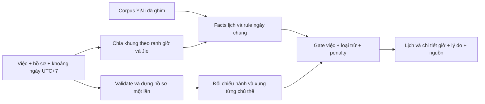

# MVP 2 — Tra ngày theo việc và hồ sơ sinh

**Bản hiện hành 25/10/2026:** [triển khai 7 nhóm/18 việc](major_events_handoff.md), rules `mvp2-dates-2026-10-25-v2`, response v2. Các mục dưới đây ghi policy v1 cho ba việc cũ, được giữ để đối chiếu; scope/ngưỡng chỉ xét ngày và registry v2 nằm trong bàn giao mới.

Chốt triển khai ngày **12/10/2026** theo góp ý và chỉ đạo R1–R5 của người dùng. Bản local đã có API/UI; rules **`mvp2-dates-2026-10-12-v1`**. Kế hoạch trước R1 được giữ tại [bản lưu](archive/logic_plan_mvp2_pre_r1.md).

## 1. Quyết định đã chốt

- Chọn ngày cho **cưới hỏi, khai trương, xuất hành**. Cưới hỏi cần hai hồ sơ; hai việc còn lại cần một chủ thể chính.
- Mỗi request dựng **Tứ Trụ + Dụng/Hỷ/Kỵ đúng một lần/chủ thể**, trước vòng quét. Các khung chỉ đối chiếu object hồ sơ đã dựng.
- Ngày kỵ có bảng ghim được bật `BLOCK`. **Tam Nương chưa bật**, không trở thành dữ liệu bắt buộc bị thiếu, không làm toàn API trả `PARTIAL`.
- Nhãn đẹp trên UI là **“Ngày Đẹp cho [việc]”**; Hoàng/Hắc Đạo và Trực là facts riêng.
- Điểm và phạm vi loại trừ là policy sản phẩm có version; dữ liệu ghim không đồng nghĩa được chuyên gia chọn ngày kiểm định độc lập.

## 2. Phạm vi và input

| Việc | Khóa | Token Yi/Ji | Số chủ thể |
|---|---|---|---|
| Cưới hỏi | `MARRIAGE` | `嫁娶` | 2 |
| Khai trương | `BUSINESS_OPENING` | `开市` | 1 |
| Xuất hành | `TRAVEL` | `出行` | 1 |

Khoảng ngày UTC+7: **2024–2030, 1–93 ngày inclusive**. Năm sinh: **1950–2026** theo contract sinh hiện hành. Ngày trong tuần: `0=Thứ Hai…6=Chủ Nhật`. Giờ có thể chọn trong một ngày là `[start,end)`; API cho `end=null` để kết thúc ở 24:00. Mặc định API xét cả ngày, UI mặc định 06:00–22:00.

Kết quả xét **giờ bắt đầu** của việc. Khai trương chưa bao gồm ký hợp đồng/treo biển; cưới hỏi chưa gồm đính hôn hoặc hợp hôn; xuất hành chưa chọn hướng. Không có GPS, LLM hay tự đoán giờ sinh.

## 3. R1 — Schema và dữ liệu đã đóng

Nguồn cấu hình: [mvp2_date_rules.json](../config/mvp2_date_rules.json). JSON Schema: [mvp2_date_rules.schema.json](../schemas/mvp2_date_rules.schema.json). Model runtime: `randomyst/date_models.py`.

| Nhóm | Trường chính và ràng buộc |
|---|---|
| Version/basis | `schema_version`, `rules_version`, `provider_version`, `calendar_policy`, `major_taboo_basis` |
| Nguồn | `source_id`, `path`, `sha256`, `url`, `basis`; runtime kiểm hash |
| Việc | `activity`, `name`, `provider_token`, `subject_count`; cố định mapping v1 |
| Bảng tháng | `sat_chu`, `tho_tu`, `nguyet_pha`: 12 target CHI, index 0–11 |
| Rule | `rule_id`, `enabled`, `when{fact,equals}`, `activity_scope`, `subject_scope`, `effect`, `points`, `dedupe_group`, `message`, `source_id`, `review_status` |
| Score | Base/ngưỡng, penalty thiếu token, penalty từng nhóm hành và policy xung sinh |

`effect` chỉ có `PENALTY | BLOCK | WARN`. Chỉ `PENALTY` có points không âm; `BLOCK/WARN` dùng null. Rule bật phải có nguồn; rule tắt ghi `NOT_ENABLED` và có trong `disabled_rules`. Giá trị điều kiện và target ngoài allowlist bị từ chối. Pydantic kiểm thêm ràng buộc chéo ngoài JSON Schema.

Builder [build_date_data.py](../scripts/build_date_data.py) đã số hóa **toàn bộ mảng nguyên văn Yi/Ji ngày và giờ** trước khi nối scoring: 2.558 ngày Bắc Kinh, 33.254 bản ghi giờ và 100 mốc Jie. Ngày đệm 01/01/2031 hỗ trợ cuối ngày 31/12/2030 UTC+7. Manifest khóa gzip/nội dung giải nén/mã provider; gzip tái lập bằng `mtime=0`.

Xem [quy ước corpus](../data/date_calendar/README.md), [manifest](../data/date_calendar/manifest.json). Builder xuất cả config và schema; sửa policy tại builder để lần build sau không ghi đè thay đổi thủ công.

## 4. Ba bộ lọc ngày chung

**Hoàng/Hắc Đạo:** đọc 12 Thiên Thần bằng provider; đọc 12 Trực riêng. Không gán Trực Phá/Bế mặc định là Hắc Đạo. Chưa có ma trận Trực theo việc được hiệu đính; Trực hiện cung cấp ngữ cảnh, Yi/Ji quyết định scope việc.

**Can Chi:** quan hệ Can–Chi bên trong ngày có năm mức. Hợp chi ngày với tháng/năm phân biệt `FULL`, `PAIR`, `NONE`; Tam Hợp đầy đủ cần ba chi khác nhau đúng nhóm. Hai chi hỗ trợ không được gọi đủ Tam Hợp. Không tự suy hóa hành.

**Ngày kỵ lớn:** Sát Chủ, Thọ Tử, Nguyệt Phá lấy bảng từ `tinix-bazi/shensha.js` ở commit/hash đã ghim. Đầu vào là **chi tháng ứng viên exact Jie, chi ngày Bát Tự sect 1**. Đây là mở rộng của sản phẩm từ bảng natal sang ngày ứng viên, đã được ghi tại `major_taboo_basis` và nguồn. Ba luật bật `BLOCK` cho ba việc hiện hành. Nguyệt Phá dùng nhóm `MONTH_CLASH`, không thêm penalty xung tháng lần hai. Tam Nương có bản ghi tắt, chưa match hay chặn.

## 5. Điều kiện công việc và cá nhân

Yi/Ji theo **ngày dân sự Bắc Kinh** và giờ provider:

- Có token nên: `SUPPORTED`; có token kỵ: `AVOID`; không có: `NOT_LISTED`.
- Token cả hai cột hoặc token nên cùng `诸事不宜`: `UNRESOLVED`.
- `无`: không có mục. `诸事不宜`: nên tránh. `馀事勿取`/`余事勿取`: tránh việc chưa được ghi nên rõ ràng.
- Ngày kỵ việc loại các khung tương ứng; giờ kỵ chỉ loại khung đó. Dữ liệu nguyên văn được giữ trong response.

Object sinh giữ trụ sinh, Dụng Thần tự tính, Dụng Thần hiệu lực, Hỷ/Kỵ và cảnh báo ranh. Can/Chi **ngày và giờ** ứng viên tạo bốn lần đối chiếu hành. Override có ưu tiên cho đúng hành được chọn; không giả rằng Hỷ/Kỵ được tính lại theo override.

Chi ngày ứng viên xung chi năm hoặc chi ngày sinh: `NATAL_CLASH`, loại khung theo policy v1. Cặp đôi dùng **penalty cá nhân lớn nhất** và mọi loại trừ của cả hai tại cùng khung; đảo thứ tự chủ thể không đổi kết luận.

Sai số sinh bỏ trống: `UNDETERMINED` + cảnh báo, vẫn đánh giá hồ sơ đã nhập. Nếu sai số đã biết vượt ranh giờ/ngày hoặc Jie exact: `UNSTABLE`, các khung trả `UNRESOLVED`; bản đầu chưa đánh giá nhiều biến thể lá số.

## 6. Score và nhãn v1

```text
source conflict hoặc birth unstable → UNRESOLVED, score=null, grade=null
hard exclusion                    → COMPLETE, score=0, grade=BAD
còn lại                           → clamp(100 − tổng penalty, 0, 100)
```

| Yếu tố | Penalty |
|---|---|
| Hắc Đạo | 15 |
| Can sinh Chi / cùng hành / Chi sinh Can | 0 / 5 / 10 |
| Can khắc Chi / Chi khắc Can | 15 / 20 |
| Không có hỗ trợ hợp chi ngày với tháng/năm | 5 |
| Chi ngày xung chi năm ứng viên | 15 |
| Ngày / giờ không đề cập việc | 15 / 5 |
| Mỗi hành ứng viên thuộc Dụng / Hỷ / trung tính / Kỵ | 0 / 2 / 5 / 10 |

`GOOD`: >=75, ngày hỗ trợ việc rõ ràng, không bị loại, mọi chủ thể ở `SUPPORTED` (không có hành Kỵ/xung). `NORMAL`: >=45 nhưng chưa đủ điều kiện đẹp. Các khung thấp hơn: `BAD`. `raw_score` vẫn giữ tổng trước hard gate để giải thích; không dùng nó để bù cấm.

Can sinh Chi không là điều kiện cần phổ quát. Hắc Đạo chỉ bị penalty, có thể phù hợp một việc khi vượt các gate khác. Các số trên là bộ mặc định sản phẩm để thử nghiệm, chưa phải trọng số được hiệu chỉnh từ dữ liệu hiệu quả thực tế.

Ngày lấy mức tốt nhất trong các khung hợp lịch tổ chức; trả `recommended_minutes` bằng tổng thời lượng khung GOOD, cùng cờ `has_unresolved_windows`. Nhãn ngày không đại diện mọi giờ. Xếp khung theo mức, điểm, thời lượng; hòa cuối cùng giữ giờ sớm hơn.

Response bổ sung `hour_branch` trên khung chi tiết và `recommended_windows` gọn trên mỗi ngày, giữ **toàn bộ khung GOOD theo thời gian**. Tóm tắt `windows` vẫn top 3, không được dùng để liệt kê giờ đẹp vì có thể bỏ sót. Card có chiều cao cố định, chỉ hiện số khung đẹp; popup liệt kê đủ theo mẫu “Giờ [chi] - Từ hh:mm đến hh:mm”, giữ giây lẻ nếu có và 24:00 ở cuối ngày; không gộp ranh lịch. Phần lý do tải khi được mở trong popup; đóng popup hủy request chi tiết đang chạy. Các nhãn Gia chủ/Người xuất hành/Đương sự ánh xạ theo request đã tạo kết quả. [Danh mục việc trọng đại ngày 25/10](research/mvp2_major_life_events.md) đề xuất 7 nhóm/18 việc chính, thay thứ tự ưu tiên của [nghiên cứu 14/10](research/mvp2_activity_expansion.md); chưa thay ba việc đang bật.

## 7. Ranh lịch và hiệu năng

| Ranh | UTC+7 |
|---|---|
| Chi giờ và ngày Bát Tự sect 1 | 00h,02h…22h; đổi ngày ở 22h |
| Ngày dân sự/âm lịch Bắc Kinh | 23h |
| Năm/tháng Bát Tự | Đúng giây giao Jie |
| Tháng non-exact provider | Ngày Bắc Kinh chứa Jie, từ 23h UTC+7 hôm trước |

Mỗi ngày cắt thành `[start,end)` tại ranh trên và clip theo giờ cho phép. Không dùng 12h đại diện ngày. Facts Yi/Ji dùng corpus chia sẻ, candidate chart lấy provider tại đầu từng khung. Hồ sơ sinh nằm ngoài vòng quét.

Ca 93 ngày có giao tiết đã đánh giá **1.212 khung × 2 người = 2.424 lượt đối chiếu**, với đúng hai lần `pillars/analyze`. Corpus kiểm hash và đọc khi khởi tạo; request không gọi lại natal analysis trong vòng lặp.

## 8. API/UI và kiến trúc



- `date_models.py`: contract/ràng buộc. `date_calendar.py`: corpus, candidate facts, interval và ranh sinh.
- `date_rules.py`: facts, special token, rule match và dedupe. `date_engine.py`: hồ sơ request, đối chiếu, gate/score/xếp kết quả.
- `POST /api/v2/auspicious-dates/search`; `GET /api/v2/auspicious-dates/rules`.
- Mặc định trả tối đa ba khung tốt nhất/ngày; mở ngày gọi một ngày với `include_details=true` để lấy đủ khung.
- `web/dates.js` có state riêng, hủy request cũ và kiểm revision khi query mới. Hiển thị một/hai hồ sơ theo việc, grid, lỗi/không có kết quả và lý do.

Tính năng tra ngày xác định, không gọi NumberEngine và không ghi bảng draws. API v1 và dữ liệu các phiên vẫn giữ contract hiện hành. Request/response/schema mẫu: [examples](../examples/date_search_request.json), [cặp đôi](../examples/marriage_date_search_request.json), [response](../examples/date_search_response.json).

## 9. Kiểm chứng và bàn giao R1–R5

| Bước | Kết quả |
|---|---|
| R0 | Nghiên cứu provider/ranh/độ phủ và nguồn; giữ báo cáo lịch sử |
| R1 | Config/schema/raw corpus và luật bật/tắt có provenance |
| R2 | Calendar interval, rules/sentinel/dedupe; tests ranh và hard gate |
| R3 | Một/hai hồ sơ, override, xung, worst subject, one analysis per subject |
| R4 | API, UI lịch/chi tiết, input/error và HTTP/UI smoke |
| R5 | Regression, benchmark local, ví dụ/tài liệu và refresh graph `.ua` |

**66 tests pass**, gồm 16 ca MVP 2 và 50 ca baseline. Hai ca bổ sung kiểm toàn bộ khung GOOD vượt top 3 và clipping giờ chọn, cùng chi giờ/ranh Jie/cuối ngày. Đã kiểm đủ hai hệ 12 mục, 12 chi tháng của ba bảng loại trừ, chi lặp trong Tam Hợp, special token, dedupe, hai ranh 22h/23h, giao Jie exact, ngày đệm cuối dải, clip/filter, override, unstable birth, đảo chủ thể, determinism, schema và không ghi draws.

HTTP trên fresh server Darwin arm64/Python 3.13.2: 31 ngày/1 người cold search **0,0697s**, warm **0,0618s**; 93 ngày/2 người lần đầu **1,0705s**, lặp **1,2259s**, trả đầy đủ chi tiết **1,0262s**. Server sẵn sàng khoảng **0,6707s**. Đạt mục tiêu <2s/31 ngày, <5s/93 ngày trên máy này.

Bổ sung ca **93 ngày là lần tra đầu tiên trên fresh server riêng**: cold **0,9213s**, warm **0,9091s**, server ready **0,4706s**. [Báo cáo cold 93 ngày](research/mvp2_cold_93_runtime_validation.json) giúp phân biệt với “first 93” chạy sau ca 31 ngày ở process trước.

Báo cáo [HTTP](research/mvp2_runtime_validation.json) ghi byte/count/hash và phạm vi đo; chưa là load test/P95. [UI smoke](research/mvp2_ui_smoke.json) và [bàn giao](../MVP2_HANDOFF.md). Graph cập nhật bằng fingerprint/inventory do workspace chưa có Git; giữ baseline `unversioned`, `autoUpdate=false`.

## 10. Giới hạn nội dung và hướng tiếp theo

Tam Nương chờ nguồn có bảng/quy ước đủ; ma trận Trực theo việc và cát tinh ứng viên bổ sung sau khi có nguồn/fixtures. Bảng Sát Chủ/Thọ Tử được sao đúng mã đã ghim, nhưng cách áp vào chọn ngày và phạm vi ba việc là quyết định sản phẩm. Cần hiệu đính chuyên môn trước khi tuyên bố tương đương một truyền thống chọn ngày cụ thể.

Các phép so với chính provider xác nhận tích hợp, không là ground truth độc lập hay chứng minh kết quả sự kiện đời thực. Chưa hiệu chỉnh trọng số theo mẫu đại diện, chưa load test nhiều request đồng thời, chưa triển khai dịch vụ công khai.

Nghiên cứu gốc: [nguồn và khả thi](research/mvp2_auspicious_date_research.md), [khảo sát 2.557 ngày tại 12h](research/mvp2_auspicious_date_feasibility.json), [phản ví dụ Trực/Hoàng Đạo và cộng điểm](research/mvp2_rule_matrix_counterexamples.json). Khảo sát noon ban đầu khác corpus raw đầy đủ có ngày đệm của R1.
