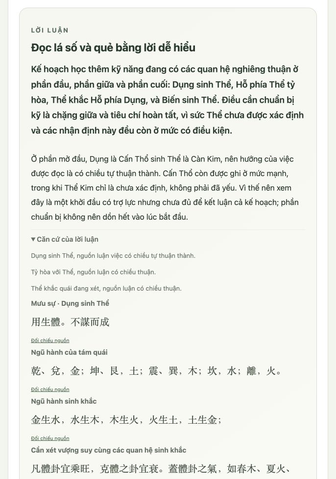

# Kiểm tra nội dung hiển thị — 27/10/2026

Đã rà các chức năng Gieo bộ số, Tra ngày theo việc, Mai Hoa, Gieo ba đồng/Lục Hào, thư viện 64 quẻ và Bát Tự. Phần kết quả cần trình bày bằng lời đọc, bảng hoặc nhãn tiếng Việt phù hợp với người sử dụng.

## Các điểm đã sửa

- Căn cứ AI lấy nhận định đã diễn giải và trích đoạn nguồn; không hiển thị trực tiếp dữ kiện máy dùng để viết bài luận.
- Dùng chung lớp hiển thị chỉ chấp nhận văn bản và số. Chặn object, mảng, JSON lồng trong câu, khối code, mô tả schema và mã tham chiếu nội bộ.
- Diễn đạt các trạng thái và quan hệ đã biết thành tiếng Việt; bỏ mã nhận định và phiên bản kỹ thuật khỏi kết quả.
- Thông báo lỗi lấy từ bộ câu tiếng Việt do giao diện quản lý. Lỗi kiểm tra đầu vào chỉ chỉ ra tên mục nhập; không đưa đường dẫn trường, phản hồi máy chủ hay lỗi phân tích dữ liệu lên màn hình.
- Bài luận AI mới phải qua kiểm tra văn xuôi trước khi lưu. Kiểm tra này áp dụng cho phần dẫn, từng đoạn phân tích, gợi ý thực tế và giới hạn.
- Bài AI cũ không đạt kiểm tra sẽ không được tải lên giao diện; người dùng có thể yêu cầu viết lại. Một lượt sửa có giới hạn được dùng cho kết quả mới chưa đạt; phản hồi lỗi không được coi là bài luận.
- Liên kết nguồn không dẫn tới API nội bộ hay tệp JSON/schema. Trường hợp đó giữ lại tên nguồn dạng chữ; nguyên văn và phần giải thích vẫn đọc được trong ứng dụng.

## Kết quả xác minh

| Phạm vi | Kết quả |
| --- | --- |
| Bộ kiểm thử Python đầy đủ | 204 bài đạt |
| Kiểm thử JavaScript | 31 bài đạt |
| Cú pháp tất cả tệp JavaScript | Đạt |
| Bài AI đã lưu trong cơ sở dữ liệu xem trước | 22 bài đạt kiểm tra văn xuôi |
| Bộ prompt và nguồn được ghim | Kiểm tra toàn vẹn đạt |
| Rà khóa kết nối trong tệp công khai và kiểm thử | Không phát hiện khóa thật |
| Gọi AI trả phí thêm trong lượt xác minh | 0 |

Kiểm thử giao diện bao gồm phản hồi lỗi từ máy chủ, lỗi phân tích phản hồi, lỗi kiểm tra đầu vào, phản hồi thành công nhưng sai cấu trúc, JSON nằm trong các trường lời luận, dữ kiện máy trong phần căn cứ, tải lại và phản hồi trễ.

Đã mở kết quả đã lưu của gieo số, Bát Tự, Mai Hoa và Lục Hào trong trình duyệt; tra và mở chi tiết ngày khai trương 13/10/2026. Đã rà cả nội dung thu gọn. Sau sửa, kết quả mẫu Mai Hoa và Lục Hào không còn đoạn dự phòng do nhầm phần tử rỗng hoặc tiêu đề quan hệ với dữ liệu lỗi. Nguồn theo việc của phần tra ngày hiển thị bằng chữ; không còn liên kết mở API.

Các kiểm tra trên xác minh cách ứng dụng hiển thị dữ liệu. Lịch, điểm, lá số, quẻ và bộ nguồn ghim được giữ nguyên; giao thức trao đổi nội bộ vẫn phục vụ các bộ hiển thị chuyên biệt.
